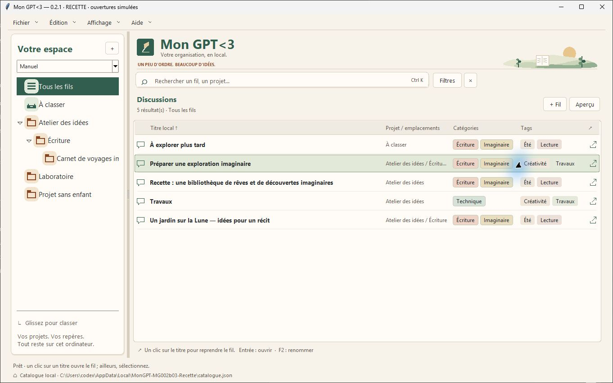

# Mon GPT<3 — 0.2.1

Application Windows locale pour organiser ses discussions ChatGPT. MG-002a donne corps à l’« Atelier chaleureux » : bandeau illustré, cartes papier, titres affirmés, icônes harmonisées, badges et menus dessinés. La **vue Liste** conserve l’ouverture directe. Aucun serveur, compte applicatif ou API OpenAI ; aucune modification dans ChatGPT.



MG-002b-02 place les colonnes directement sous le menu validé : arbre et aperçu utilisent toute la hauteur, tandis que l’identité et la recherche compacte restent au centre. La recherche est plafonnée en largeur ; les pastilles n’occupent une ligne que si un périmètre ou un filtre est actif. [Rapport et trois captures](reports/MG-002b-02/rapport.md).

MG-002b-03 affine uniquement la Liste : lignes de 42 px, catégories et tags séparés, petites icônes au trait et lien à droite. Le titre et le lien restent visibles pendant le défilement horizontal des colonnes secondaires. En largeur très réduite, `+N` indique les repères repliés ; le survol d’une ligne restitue son titre entier et tous ses repères. Les en-têtes trient et leurs limites se redimensionnent. Flèche droite dans la Liste focalise l’action de fin de ligne ; Entrée ouvre la sélection. [Rapport et quatre captures](reports/MG-002b-03/rapport.md).

## Lancer

Windows 11 x64, Python 3.13 avec Tcl/Tk et commande `python` accessible. Aucune dépendance pip ni police à installer. Recette sur CODEX-VM avec Python 3.13.17 / Tk 8.6. Depuis PowerShell :

```powershell
& 'C:\Users\codex\Documents\Projets\mon-gpt\lancer.cmd'
```

Ou, depuis le dépôt : `python -m mon_gpt`. Le double-clic sur `lancer.cmd` convient aussi. Sur Zenith Ice : installer Python avec Tcl/Tk, cloner le dépôt puis utiliser son lanceur. Vérification de Tk : `python -m tkinter`.

## Retrouver et ouvrir

Un clic sur le **texte du titre**, l’icône du fil ou le **petit lien à droite de la ligne** ouvre le fil dans le navigateur par défaut, sans passer par un formulaire. Cliquer dans les autres colonnes ou dans l'espace vide du titre sélectionne seulement. Double-clic sur une ligne ou **Entrée dans la liste** ouvre aussi. Un projet (icône dossier) n'ouvre jamais ChatGPT ; double-clic/Entrée navigue vers son emplacement.

**Ctrl+K** focalise la recherche unique. Elle explore titres, résumés/descriptions, notes, tags, catégories et métadonnées, sans casse ni accents. Les suggestions et **Filtres** proposent les valeurs du catalogue : choisir un tag, une catégorie ou un projet ; les pastilles × retirent les filtres. Le projet sélectionné inclut **ses descendants**. Partout/Tous les fils retire ce périmètre ; Effacer remet à zéro texte, tag et catégorie. Un fil multi-rattaché reste unique dans les résultats. Entrée dans un champ de recherche/édition n'ouvre pas le navigateur.

L'**inspecteur** est facultatif, masqué au premier lancement. La commande discrète **Aperçu**, ou Affichage, affiche ses sections et Ouvrir/Copier le lien. **Modifier la fiche** rend volontairement accessibles tous les champs MG-001. Sa molette agit uniquement sous le pointeur dans ce panneau. Replier l'inspecteur laisse l'ouverture directe disponible. Les colonnes et séparateurs des panneaux sont ajustables ; cliquer un en-tête trie la liste. Affichage propose les formats compact 1000×680 et confortable 1360×820 ; le compact resserre le bandeau et les lignes. Un projet n’apparaît plus parmi ses propres résultats, ses descendants restent inclus.

## Créer et modifier

Le **+** de Votre espace, **+ Fil** près de la Liste, Édition et le clic droit dans l'arbre proposent les créations. Aucun gros bouton permanent Nouveau/Inspecteur dans le bandeau :

- **Ctrl+Maj+P** : ligne de projet éditable insérée sous le projet sélectionné, ou à la racine depuis Tous les fils/À classer. Entrée crée ; Échap annule sans entrée fantôme. Aucune image à choisir.
- **Ctrl+N** : zone intégrée à la liste avec titre et URL. Entrée valide, Échap annule. URL invalide et doublon sont signalés dans cette zone. Un bouton explicite retrouve/rattache une fiche existante sans remplacer titre et notes.
- **F2** : renommer dans une ligne intégrée ; Entrée valide, Échap annule.
- **Modifier les détails** : résumé/description, notes, tags, catégories, métadonnées `clé=valeur` (une ligne par clé unique), emplacements et parent de projet. Dates automatiques avec fuseau local, affichées au format français.
- Tags/catégories : choisir une valeur connue dans la liste ou saisir une valeur puis Entrée/+ Ajouter. Les valeurs choisies sont des **pastilles** ; × retire une valeur de la saisie. Les variantes de casse/accents d'une valeur connue la réutilisent. Aucun champ de liste à virgules imposé.
- **Ctrl+S** ou Enregistrer : appliquer les modifications de fiche. Une saisie non enregistrée reste protégée avant navigation/fermeture. Ouvrir un fil par son menu ne détruit pas la saisie. Le panneau d'édition défile.

## Classer

Glisser gauche un **projet** vers un autre change son parent ; le déposer sur Tous les fils le remet à la racine. Les cycles sont interdits. Le mode Manuel mémorise l'ordre des frères, réglable par **Alt+↑/↓ dans l'arbre** ou Monter/Descendre dans le menu contextuel. Le mode Alphabétique français ne détruit pas cet ordre.

Glisser un **fil** vers un projet déplace seulement le rattachement du contexte de départ ; tous les autres restent intacts. Avec un seul rattachement, même depuis Tous les fils, le déplacement est immédiat. Si plusieurs rattachements rendent le départ ambigu, une zone intégrée demande **quel lien déplacer** avant toute écriture. La cible de dépose et les refus sont signalés visuellement.

Le **clic droit / touche Menu** offre les actions selon l'objet : ouvrir/copier le lien, créer ici, renommer, modifier, déplacer, ajouter/retirer un rattachement, supprimer. Ajouter un rattachement garde la même fiche et ses notes. Le glisser droit propose à la dépose Déplacer ici / Ajouter un rattachement ici / Annuler ; **son geste physique reste à valider manuellement sous Windows** : gestionnaires testés, outil de recette limité au drag gauche. Le menu contextuel équivalent est validé dans la vraie fenêtre et reste utilisable au clavier.

Supprimer demande confirmation. Un projet supprimé remonte ses enfants au parent et retire ses rattachements **sans supprimer les fils**. Supprimer un fil retire seulement sa fiche locale. Retirer le dernier rattachement conserve le fil dans Tous les fils et À classer. Emplacements accepte aussi Ctrl+clic/Maj+flèche dans l'édition détaillée. Catégories, tags et emplacements restent trois notions distinctes.

## Menus et données

**Fichier** : Sauvegarder le catalogue, Restaurer, Dossier de données, Quitter. **Ctrl+S reste l'enregistrement de fiche**, distinct de la sauvegarde globale. **Affichage** : inspecteur, recherche, filtres et taille de fenêtre. **Aide** rappelle les gestes et raccourcis.

Les menus supérieurs et contextuels partagent un habillage papier ; leurs commandes sont réelles. Flèches/Entrée permettent de choisir, Échap ferme le menu. Illustration, icônes et contrôles sont dessinés localement avec Tk/Canvas : aucun téléchargement, actif de maquette, paquet graphique ou police supplémentaire.

Catalogue : `%LOCALAPPDATA%\MonGPT\catalogue.json`, hors dépôt ; chemin affiché en bas, cliquable pour ouvrir le dossier. JSON UTF-8 **schéma 1 inchangé**, dates ISO 8601 zonées, validation stricte, fichier temporaire puis remplacement atomique, verrou d'instance. Une erreur de lecture arrête l'ouverture sans réinitialiser. Une mise à jour du code ne supprime pas les données.

Sauvegarder exporte toutes les données métier vers un JSON choisi. Restaurer valide sans mutation, demande confirmation, crée `avant-restauration-DATE.json` dans le dossier des données, puis remplace le catalogue. Un fichier invalide laisse les données intactes. Conserver aussi une copie hors du disque du PC ; les données ne sont pas chiffrées.

`interface.json` conserve séparément taille de fenêtre, vue Liste et état de l'inspecteur à la fermeture. Ce fichier de confort est exclu des exports métier ; colonnes, filtres, tri d'affichage et sélection ne persistent pas entre lancements. Le vrai catalogue n'est pas utilisé pour les recettes.

## URL reconnues

`https://chatgpt.com/c/UUID` et `https://chatgpt.com/g/IDENTIFIANT-OU-SLUG/c/UUID`. Slug ASCII : lettres, chiffres, tirets/soulignements. UUID standard avec tirets, casse indifférente ; barre finale facultative. Paramètres conservés, fragment retiré ; seul l'UUID déduplique.

Domaine exact `chatgpt.com`, HTTPS uniquement. Domaines voisins, identifiants utilisateur, ports explicites, schémas exécutables, anciens liens `chat.openai.com` et liens `/share/…` refusés. L'existence du chat et ses droits d'accès ne sont pas vérifiés. Aucun contenu de conversation n'est téléchargé ou indexé.

## Démonstration fictive et tests

```powershell
python -m examples.create_ux_demo "$env:LOCALAPPDATA\MonGPT-Demo-UX"
python -m mon_gpt --data-dir "$env:LOCALAPPDATA\MonGPT-Demo-UX" --simulate-open
python -m unittest discover -s tests -v
```

Le générateur refuse de remplacer un catalogue existant. `--simulate-open` est signalé dans le titre et le statut ; les ouvertures validées sont journalisées dans `ouvertures-recette.log`, sans navigateur. Ce mode est interdit sur le dossier utilisateur par défaut. Retirer l'option pour les ouvertures normales. Les tests utilisent des dossiers temporaires et Windows/Tk ; ils sont distincts de la recette visuelle. Le jeu MG-001 reste disponible via `examples.create_demo`.

[Architecture](docs/architecture.md) · [Rapport, 42 tests et captures MG-002a](reports/MG-002a/rapport.md) · [Rapport MG-002](reports/MG-002/rapport.md) · [Rapport MG-001](reports/MG-001/rapport.md).

## Limites

**Détaillée, Mosaïque, galerie de couvertures, import d'images et personnalisation visuelle sont prévus, non livrés dans MG-002.** Aucun faux sélecteur actif. Les icônes sont applicatives ; les trois PNG de référence sont inchangés et ne sont pas embarqués dans l'interface. Aucun travail MG-003 engagé.

Les suggestions de tags/catégories portent sur **tout le catalogue**, pas seulement les résultats filtrés. Le cas suspect de doublon signalé en recette reste à reproduire dans un lot fonctionnel : MG-002a ne modifie pas la déduplication par UUID de l’adaptateur. L’accessibilité par lecteur d’écran des nouveaux contrôles Canvas n’est pas évaluée.

Saisie manuelle, pas de collecte Chrome, synchronisation, lecture des messages ou installateur autonome. Recherche en mémoire et réécriture du JSON complet ; performances massives non mesurées. Tri français courant sans collation exhaustive ni tri numérique naturel. Taille minimale 1000×680 ; titres/chemins longs consultables dans l'aperçu et les colonnes ajustables/défilantes. Un filtre tag et un filtre catégorie combinables à la fois, une fiche sélectionnée à la fois. Déposer dans la partie visible de l'arbre ; ouvrir/défiler l'arbre avant une destination lointaine ou utiliser le menu Déplacer. Réserve de recette sur le glisser droit physique ; menu équivalent validé. Autres zooms Windows et Zenith Ice restent à vérifier.
