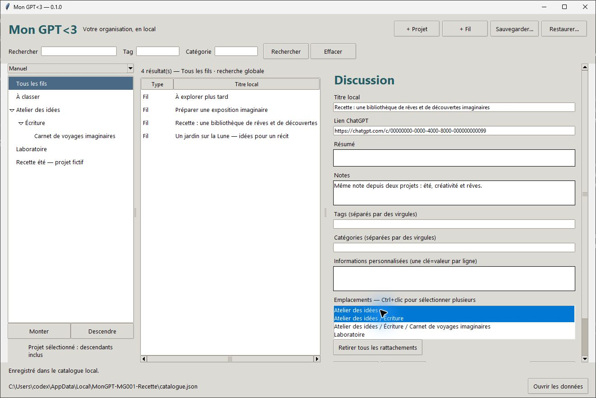
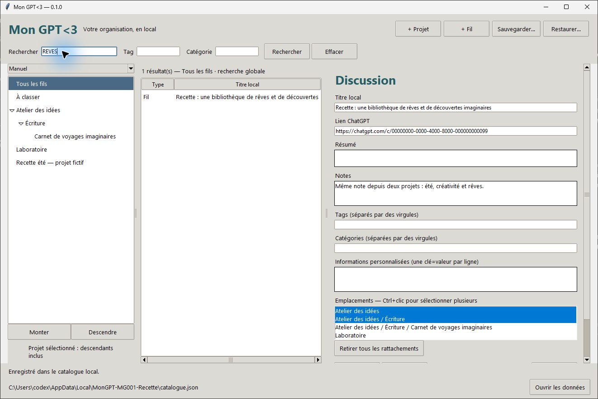
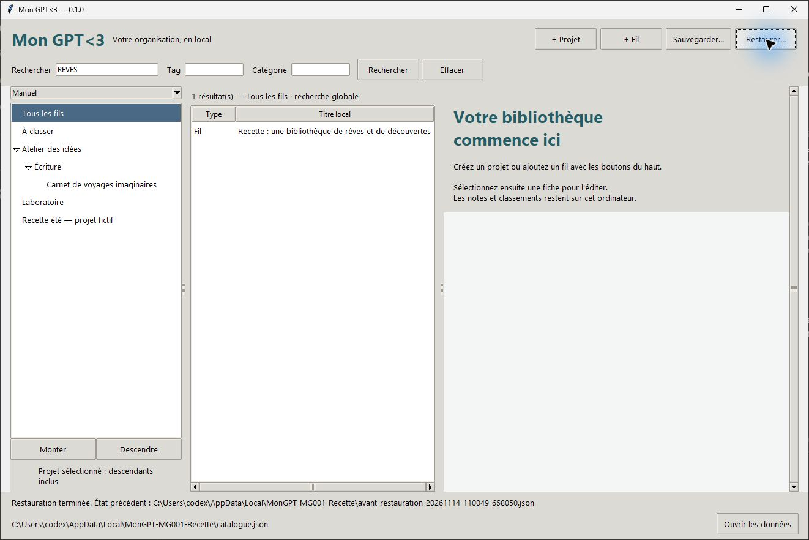
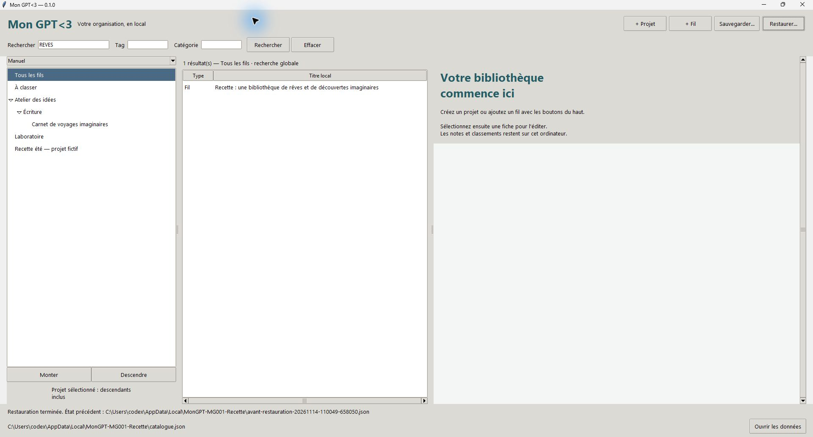
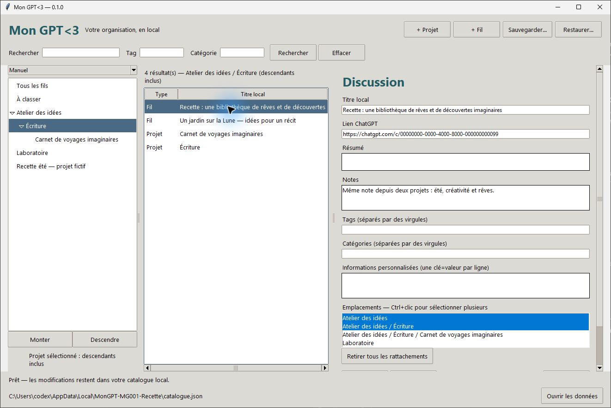
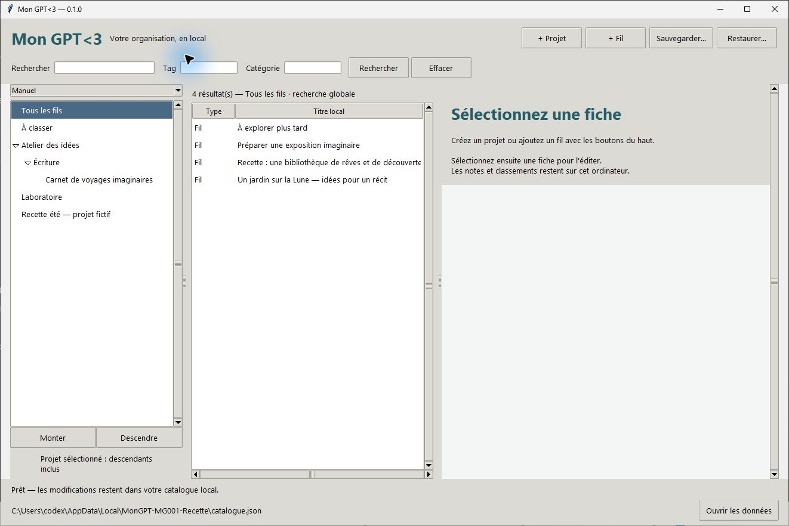

# MG-001 — Rapport de réalisation

14 novembre 2026 · Mon GPT<3 **0.1.0** · CODEX-VM, Windows x64.

**Statut : TERMINÉ pour le périmètre MG-001.** Application locale utilisable, tests et recette réelle réalisés. Les limites et contrôles non effectués sont précisés ci-dessous.

## Dépôt et lancement

Chemin réel vérifié : `C:\Users\codex\Documents\Projets\mon-gpt` (tiret, malgré `mon_gpt` dans le texte de mission). Remote : `https://github.com/ugadavid/Mon-GPT.git`. Le dépôt était propre au départ, au commit `8ef442f`. Synchronisation par fetch puis avance rapide vers `58090cf` contenant la mission, sans stash nécessaire ni perte de travail local.

Commande exacte PowerShell :

```powershell
& 'C:\Users\codex\Documents\Projets\mon-gpt\lancer.cmd'
```

Prérequis : Python 3.13 avec Tk. Aucune installation pip, aucun service, aucune clé API. Les données normales résident dans `%LOCALAPPDATA%\MonGPT`. La recette utilise un catalogue séparé `%LOCALAPPDATA%\MonGPT-MG001-Recette`, entièrement fictif et non versionné.

## Réalisé

Arbre de projets à profondeur libre, édition de toutes les informations communes, déplacement avec prévention des cycles, ordre manuel et affichage alphabétique sans perte de cet ordre. Suppression explicitée et confirmée ; les discussions survivent à la suppression d'un projet.

Fiches locales avec titres, résumés, notes, tags, catégories multiples, métadonnées texte et dates zonées. Rattachements multiples sans duplication ; retrait indépendant de la suppression globale ; vues Tous les fils et À classer. Ajout et modification d'URL, identité par UUID de conversation, traitement explicite des doublons et ouverture HTTPS validée dans le navigateur par défaut.

Recherche française dans les champs communs des projets et fils, filtres tag/catégorie et projet avec descendants annoncés. Résultats typés et uniques. JSON versionné hors dépôt, validation, écriture atomique, verrou d'instance, export complet et restauration avec validation, confirmation et copie préalable. Erreur de lecture sans réinitialisation. Interface redimensionnable à trois panneaux, panneau de fiche défilant, messages d'enregistrement et protection des saisies non enregistrées.

## Architecture validée

`core.py` ne dépend que de la bibliothèque standard et ne contient aucune particularité ChatGPT. Les identifiants internes sont des UUID indépendants. `Conversation` et le parseur d'URL sont isolés dans `chatgpt.py`, reliés aux fiches par UUID interne. UI et stockage sont des couches distinctes. La recherche générique ne lit aucune URL. Deux tests dédiés dans `test_core_standalone.py` n'importent que le socle ; un contrôle AST empêche l'ajout de dépendances applicatives. L'entrée `ChatGPT.ingest` prépare une collecte ultérieure sans serveur ou extension anticipés. Frontières et extraction future documentées dans [architecture.md](../../docs/architecture.md) et maintenues par [AGENTS.md](../../AGENTS.md).

## Vérifications automatisées

Commande : `python -m unittest discover -s tests -v` — **17 tests, tous réussis**, sur Python 3.13.17 / Tk 8.6. `python -m compileall -q mon_gpt examples tests` et `git diff --check` réussis.

| Critère de mission | Vérification et résultat |
|---|---|
| Hiérarchie à trois niveaux, déplacement, cycle | Création, déplacement et refus de soi-même/descendant ; suppression sûre vérifiée |
| Ordre manuel conservé | Aller-retour alphabétique et relecture du fichier dans un nouveau catalogue : identique |
| Note commune à deux projets | Une seule fiche et même note depuis les deux recherches projet |
| Retrait du dernier rattachement | Fiche conservée, retrouvée dans À classer et recherche globale |
| Identité et sécurité URL | Deux formes, UUID en majuscules, paramètres et fragment ; doublon sans écrasement ; domaines trompeurs et schémas refusés |
| Recherche française | Accents, casse, ligature œ, métadonnées de projets et fils ; absence de doublons |
| Export/restauration complets | Identités, relations, ordre, dates, champs communs et source strictement conservés |
| Restauration invalide | Plusieurs erreurs de schéma, cycle, métadonnées, identité manquante : octets du fichier courant inchangés et aucune copie préalable créée |
| Copie avant restauration valide | Relue et comparée à l'état précédant la restauration |
| Isolation du socle | Tests génériques sans import UI, stockage ou adaptateur, plus contrôle des imports |
| Erreur d'écriture/lecture | Échec simulé de remplacement : fichier intact ; JSON corrompu refusé sans réinitialisation |
| Instances concurrentes | Deuxième verrou refusé sans fuite de fichier ouvert |
| Formulaires | Champs et emplacements enregistrés ; erreur d'écriture préserve la saisie et restaure le modèle ; filtre projet par tag ; annulation de sortie |
| Ouverture | Appel au navigateur avec URL validée ; schéma dangereux revalidé et rejeté sans appel au navigateur |

Les tests de formulaires créent de vrais widgets Tk avec fenêtre masquée et mocks des dialogues. **Ils ne sont pas présentés comme une recette visuelle.**

## Recette réelle Windows

Application lancée en processus `pythonw.exe`, fenêtre sélectionnée, inspectée et manipulée via le contrôle Windows `@oai/sky`. Les captures proviennent de la vraie fenêtre de l'application sur CODEX-VM, avec uniquement des titres, notes et URL fictifs.

1. Ouverture du catalogue de démonstration : arbre à trois niveaux et trois fils visibles.
2. Création par les dialogues d'un projet « Recette été — projet fictif », puis d'une discussion avec un titre long accentué et un UUID inventé : succès.
3. Saisie de la note « Même note depuis deux projets : été, créativité et rêves. », sélection de deux projets dans Emplacements, Ctrl+S : note et deux liens effectivement persistés, vérifiés aussi par lecture du catalogue.
4. Recherche réelle `REVES` : un seul résultat pour « rêves » malgré les deux rattachements.
5. Bouton Sauvegarder, dialogue Windows, export vers un fichier séparé : retour de succès et fichier vérifié.
6. Bouton Restaurer, validation de neuf fiches puis confirmation et restauration : retour de succès ; copie préalable effectivement créée. Pour éviter toute perte même fictive, la recette visuelle restaure un export identique à l'état courant. Le remplacement d'un état différent est couvert par le test automatisé complet.
7. Agrandissement réel de la fenêtre de 1322×882 à 1920×1032 : panneaux réorganisés et contrôles accessibles. Les séparateurs sont ajustables ; le panneau droit possède une barre de défilement.
8. Fermeture via Alt+F4 puis nouveau processus : projet et fil créés retrouvés. Ouverture de la fiche depuis son sous-projet : note et deux emplacements conservés.
9. Relancement de la version finale après ajout des barres de défilement de l'arbre et des résultats : rendu contrôlé, capture 06.

### Captures













Les captures 01 à 05 précèdent l'ajout final des barres de défilement des listes et l'amélioration du texte d'accueil ; la capture 06 montre ces améliorations. Les règles et tests associés restent identiques.

## Limites et contrôles non effectués

Pas de recette sur Zenith Ice, de mesure sur un catalogue massif, de simulation de panne électrique matérielle ou d'essai à tous les facteurs de zoom Windows. La taille minimale 1000×680 est définie dans le code ; les dimensions visuellement inspectées sont celles mentionnées ci-dessus. Le navigateur réel n'a pas été ouvert vers une conversation authentifiée : aucun lien personnel n'est utilisé ; l'ouverture est vérifiée à la frontière de `webbrowser.open` par test.

Tri français courant par normalisation, sans collation linguistique exhaustive ni ordre numérique naturel. Préférences d'affichage non conservées au redémarrage ; ordre manuel métier conservé. Stockage JSON complet en mémoire, données non chiffrées. Python/Tk requis, pas d'installateur signé. Saisie manuelle, aucune collecte Chrome, synchronisation ou lecture des messages, conformément au périmètre.

Prochaines étapes : recette sur Zenith Ice puis mission de collecte Chrome via le point d'entrée applicatif existant, en maintenant la frontière du socle générique.

## Publication

Livrables destinés à `origin/main`, sans force-push. Version identifiable par `mon_gpt.__version__ = "0.1.0"` et titre de fenêtre. Le compte rendu de livraison fournit le SHA distant vérifié et le lien du commit publié ; le présent rapport est versionné dans ce même commit.
