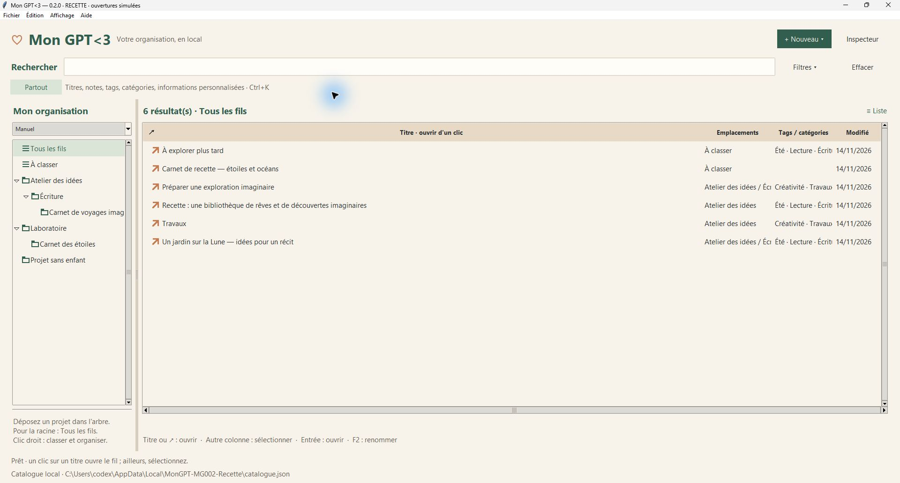
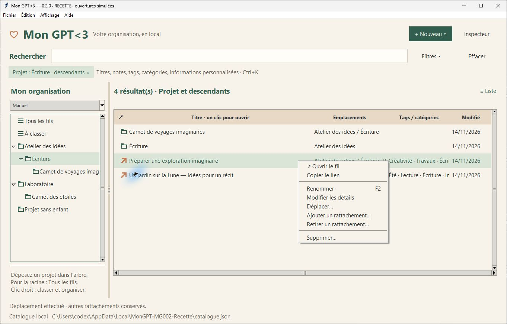
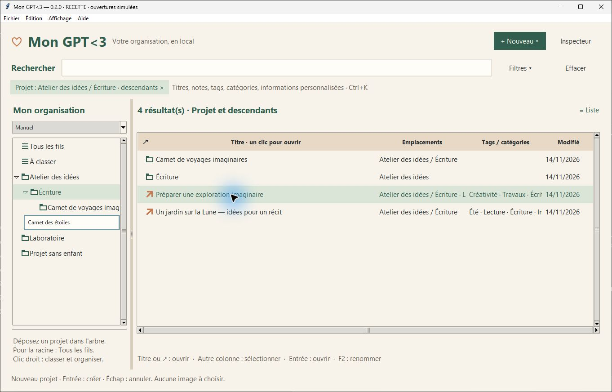
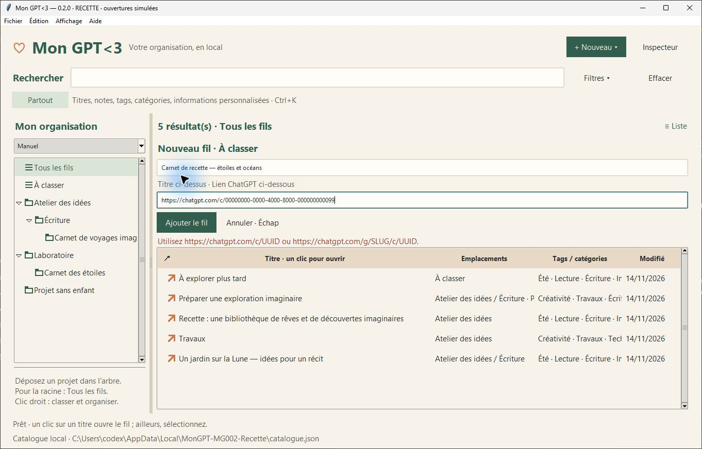
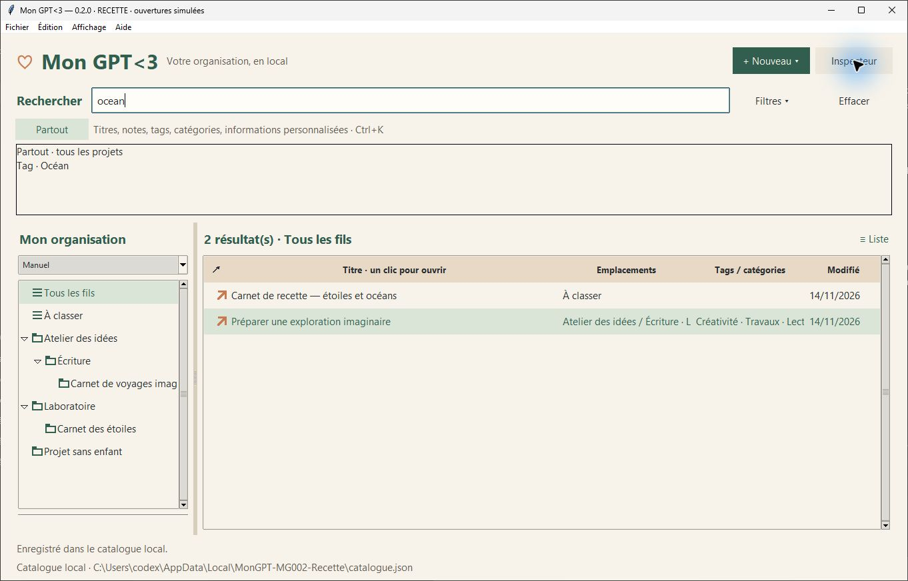
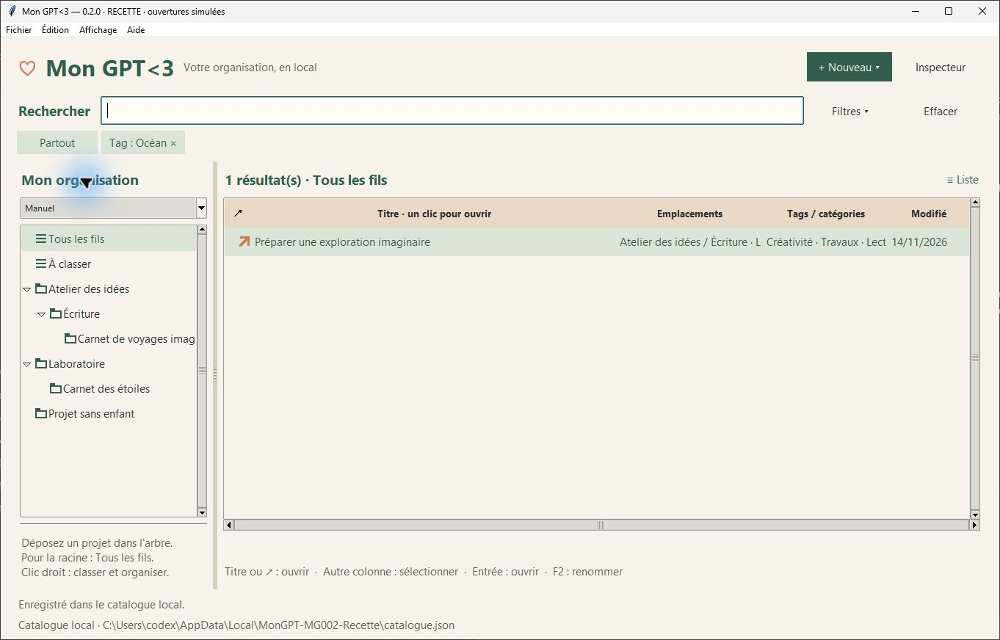
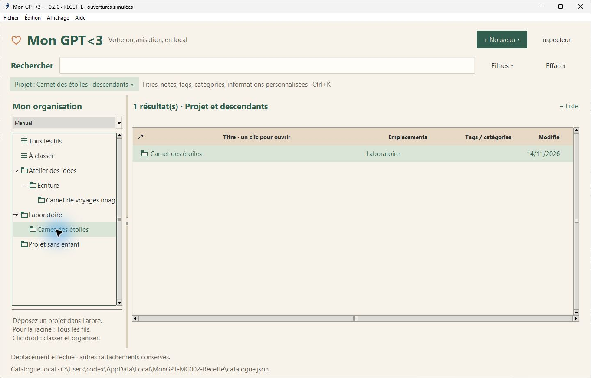
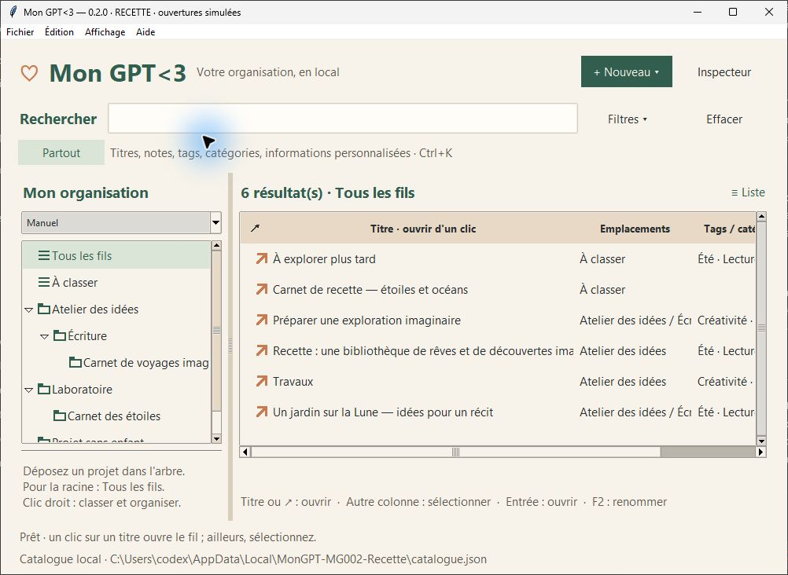

# MG-002 — Atelier chaleureux et vue Liste

14 novembre 2026 · Mon GPT<3 **0.2.0** · CODEX-VM, Python 3.13.17 / Tk 8.6.

**Statut global : PARTIEL, avec une seule réserve de preuve : le glisser droit physique Windows.** Le socle graphique et le parcours Liste sont opérationnels et validés dans la vraie application. Les gestionnaires du drag droit sont implémentés et testés ; leur injection physique n'est pas disponible dans l'outil de recette. Le menu contextuel équivalent a été réellement manipulé et validé. Aucun GO global inconditionnel n'est donc annoncé.

## Périmètre et protections

Dépôt vérifié : `C:\Users\codex\Documents\Projets\mon-gpt`, remote `ugadavid/Mon-GPT`, branche `main`. État initial propre au commit `427689d`, fetch puis avance rapide vers `3440164` pour les documents de mission. Aucun travail local à masquer ou écraser.

Lecture des instructions, documentation MG-001 et spécification MG-002 ; consultation locale des trois maquettes. Les PNG ne sont ni copiés dans le code, ni transformés, ni renommés. Leurs SHA-256 sont identiques avant/après :

| Fichier de référence | SHA-256 |
|---|---|
| `11_51_22-1.png` | `31A52AB256FD78FE72C09EF73048E1B978638E9FF9A3B2E2CA0B5BB1ADA4763E` |
| `11_51_54-2.png` | `AA3F4763F0D6583545A7BB956CC556D3F68ABFD59ED9DA67CA5D9A4A421CB653` |
| `11_51_55-3.png` | `0CA51A4F5F69365174E068ABA9EAFB9F5F83068041893A8690D5D336CBE7BD0C` |

`core.py`, `chatgpt.py`, `storage.py` et les trois fichiers de tests MG-001 sont **strictement inchangés** par rapport à `3440164` (`git diff --exit-code` vérifié). Le JSON métier reste **schema: 1**. Aucun catalogue utilisateur n'a été ouvert : toute la recette est isolée dans `%LOCALAPPDATA%\MonGPT-MG002-Recette`, avec données et UUID de conversation inventés.

## Ce qui change dans les gestes

La Liste occupe l'espace principal. Un clic sur le titre ou l'icône d'un fil appelle directement l'ouverture validée ; les autres colonnes sélectionnent seulement. L'inspecteur est facultatif et masqué au premier lancement ; l'édition détaillée ne s'ouvre que volontairement. Double-clic et Entrée dans la liste sont également pris en charge ; Entrée dans un champ n'ouvre pas de fil. Les projets utilisent une icône dossier et ne possèdent pas d'action d'ouverture ChatGPT.

Une recherche unique propose les tags, catégories et projets existants, transformés en filtres visibles et retirables. Les champs communs restent recherchés par `Catalog.search`. Les créations ordinaires et renommages sont des brouillons intégrés : ligne de projet dans l'arbre, titre/URL de fil dans la Liste. Entrée valide, Échap annule sans écriture. Les doublons restent un choix explicite inline, sans écrasement.

Le glisser gauche classe les projets et déplace un seul rattachement de fil. L'origine ambiguë d'un fil ouvre un choix explicite, sans supprimer les autres liens. Le clic droit et la touche Menu offrent les actions équivalentes. Les tags et catégories se sélectionnent/réutilisent en pastilles, avec création de nouvelles valeurs et état vide utile. Les actions rares de sauvegarde/restauration sont rangées sous Fichier ; Ctrl+S demeure Enregistrer la fiche.

La palette est centralisée dans `theme.py` : ivoire, sable, vert sapin, terracotta et encre. Police Segoe UI disponible, icônes générées localement, pas de police ou maquette embarquée. `details.py` conserve les formulaires/protections MG-001 ; `widgets.py` fournit le sélecteur de pastilles. `ui_state.py` mémorise séparément dimensions, vue Liste et inspecteur dans `interface.json`, sans toucher au catalogue ou à ses exports. Voir la [note d'architecture](../../docs/architecture.md).

## Tableau de recette par geste

GO signifie ici validé au niveau indiqué ; les tests automatisés sont explicitement distingués des entrées physiques dans l'application.

| Geste | Verdict | Preuves et portée |
|---|---|---|
| Recherche unique, suggestions et pastilles | **GO** | Sur la VM : `ocean` retrouve le titre « océans » et le tag « Océan » ; sélection de la suggestion Tag → une seule fiche malgré trois rattachements. Suppression/combinaison des filtres et catégories couvertes par intégration ; recherche MG-001 inchangée. |
| Ouverture sans inspecteur | **GO** | Sélection d'Écriture puis clic physique sur le titre → ouverture simulée validée. Sélection par Emplacements sans ouverture. Entrée dans la liste puis double-clic sur une autre colonne → deux autres ouvertures. Journal final : exactement 3 URL fictives validées. Recherche/Entrée et édition de tags n'ajoutent rien au journal. |
| Création intégrée | **GO** | Ctrl+Maj+P, saisie et Entrée créent « Carnet des étoiles » dans l'arbre. Ctrl+N crée une zone de fil ; URL non autorisée refusée inline, correction acceptée, Entrée crée « Carnet de recette — étoiles et océans ». Nouvelle création annulée avec Échap : toujours six fils. Doublon et changement d'URL avant confirmation couverts par tests d'intégration. Aucune fenêtre Ajouter séparée. |
| Menus | **GO** | Clic droit sur fil, choix Ajouter un rattachement, destination Laboratoire et validation : même fiche. Fichier → Sauvegarder/Restaurer manipulés dans les dialogues Windows. Menus propres aux projets, racine et fils ; contrôles sans action décorative. |
| Tags / catégories | **GO** | VM : tag Lecture choisi dans les valeurs connues, nouveau tag Océan ajouté par Entrée, pastilles affichées, Ctrl+S puis recherche. Champs de catégorie, absence de valeur, réutilisation et persistance vérifiés par intégration ; pas de nouvelle propriété métier. |
| Glisser gauche projet et cycle | **GO** | VM : Carnet des étoiles déplacé d'Écriture sous Laboratoire. Tentative de déplacer Laboratoire sous son enfant : cible interdite, catalogue inchangé. Retour visible et relecture du parent. |
| Glisser gauche fil / multi-rattachement | **GO** | VM : exploration déplacée depuis Laboratoire vers Projet sans enfant ; Écriture conservé. Menu Ajouter ramène Laboratoire comme troisième rattachement. Relecture : une seule identité, trois projets, note intacte. Origine globale ambiguë, annulation, ajout et remplacement d'un seul lien vérifiés aussi par intégration. |
| Glisser droit physique | **PARTIEL** | Gestionnaires B3-Motion/release et menu Déplacer/Ajouter/Annuler implémentés. Test de contrat sur widgets Tk : aucune mutation avant choix puis ajout sur même fiche. **Pas de drag droit injecté physiquement** : l'API `sky.drag` documentée n'expose pas le bouton. Aucune affirmation de fiabilité native exhaustive ; menu contextuel équivalent réellement validé. |
| Clavier et focus | **GO** | VM : Ctrl+K, Ctrl+N, Ctrl+Maj+P, Ctrl+S, Entrée, Échap et double-clic. F2 et Alt+↓ testés via les liaisons d'événements Tk ; Alt+↑ partage la même commande d'ordre. L'édition ne déclenche pas d'ouverture, les alertes de saisie MG-001 sont préservées. |
| Visuel, redimensionnement, inspecteur | **GO** | Fenêtre normale, format client **1000×680**, agrandissement réel (capture **1920×1032**). Inspecteur affiché sur demande puis replié. Titres longs/accentués, colonnes ajustables, défilements et chemin de données visibles. Correction d'un espace conservé après fermeture d'une zone inline et d'une barre horizontale masquée au format compact. |
| Reprise et sauvegarde/restauration | **GO** | Plusieurs fermetures/reprises réelles : projet, fil, note, tags et liens conservés. Format compact et inspecteur replié retrouvés via préférences séparées. Export puis restauration du même état via Fichier : validation de 12 fiches, confirmation, copie préalable relue identique, schema 1 conservé. Remplacement par un état différent et archives invalides couverts par tests. |
| État vide et suppression sûre | **GO** | VM : recherche sans résultat, message d'aide et remise à zéro possibles. Suppression de projet/fils et conservation des fiches/rattachements vérifiées dans les tests MG-001 et intégration UI avec confirmation ; aucune suppression physique effectuée via l'outil Windows. Aucun appel navigateur par ces suppressions. |

## Tests automatisés et contrôles

```powershell
python -m unittest discover -s tests -v
python -m compileall -q mon_gpt examples tests
git diff --check
```

**35 tests réussis** : les 17 MG-001 inchangés et 18 nouveaux contrats d'interface. [Sortie complète des tests](tests.txt). Compilation et contrôle des espaces réussis. Validation spécifique : type de clic, focus Entrée, brouillons/annulation, URL malformée et doublons, préservation de notes/liens, cycle, suggestions, pastilles, préférences corrompues sans mutation métier, restauration et suppression via UI, visibilité des contrôles au format compact et liaisons clavier.

Les tests créent de vrais widgets Tk, certains masqués et certains mappés ; ils invoquent des gestionnaires/événements et remplacent certains dialogues ou le navigateur. **Ils ne remplacent pas la recette visuelle native** décrite dans le tableau. En particulier, le test de contrat du glisser droit n'est pas présenté comme une injection physique Windows.

L'ouverture de recette traverse bien `parse_url` puis une fonction injectée à la place du navigateur. `--simulate-open` est annoncé dans le titre et le statut et refusé sur le dossier utilisateur par défaut. Aucune URL authentifiée ni aucun message distant n'a été ouvert/téléchargé.

## Captures de la vraie application

Toutes proviennent de la fenêtre Python/Tk exécutée sur CODEX-VM et de données fictives. Les captures 01–10 suivent les étapes de recette ; 11–14 montrent les derniers ajustements de disposition. Aucune des trois maquettes originales n'est reprise comme capture de résultat.

















Autres preuves : [ouverture directe](02-ouverture-directe.png), [cycle refusé](06-cycle-refuse.png), [pastilles en édition](08-tags-pastilles.png), [restauration avec copie préalable](13-restauration.png), [état vide](14-etat-vide.png), [première Liste](01-liste.png).

## Lancement et limites

Commande normale inchangée :

```powershell
& 'C:\Users\codex\Documents\Projets\mon-gpt\lancer.cmd'
```

La recette utilise explicitement `python -m mon_gpt --data-dir "C:\Users\codex\AppData\Local\MonGPT-MG002-Recette" --simulate-open`. Pour créer un autre jeu fictif, voir `examples/create_ux_demo.py` et le README ; le générateur refuse de remplacer un catalogue existant.

Réserve restante : preuve du **geste physique glisser droit**. Le classement reste entièrement accessible par le clic droit/menu intégré testé, sans dépendre de ce geste. Autres limites : dépôt dans la partie visible de l'arbre (défiler/développer avant de glisser), pas de sélection multiple de fiches, un filtre tag et catégorie à la fois, colonnes et sélection non mémorisées au redémarrage. Le format compact utilise la barre horizontale pour garder une largeur lisible de titre ; chemins longs consultables via l'aperçu. Pas de matrice exhaustive des zooms Windows, recette Zenith Ice ou charge massive. Le stockage JSON et ses limites MG-001 sont conservés.

**Détaillée, Mosaïque, galerie/imports de couvertures et personnalisation visuelle sont prévus, non livrés.** Pas de bouton actif pour une vue inexistante, pas de migration prématurée, aucune fonction MG-003 engagée.

## Propositions non engagées

Faire une validation manuelle du glisser droit physique sur CODEX-VM puis Zenith Ice, puis décider du prochain lot UX. Une vue Détaillée ou Mosaïque et des couvertures persistantes demanderont une mission explicitement validée, incluant migration et sauvegarde des actifs. Aucune de ces propositions n'est lancée par cette livraison.

## Publication

Livraison sur `origin/main`, sans force-push, après vérification d'absence de travail concurrent. Le compte rendu final fournit le SHA distant vérifié et le lien du commit contenant ce rapport et les preuves fictives. Les données et préférences du catalogue de recette restent hors dépôt.
