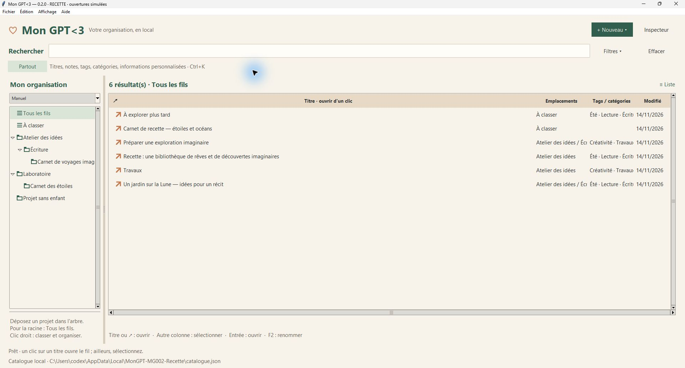
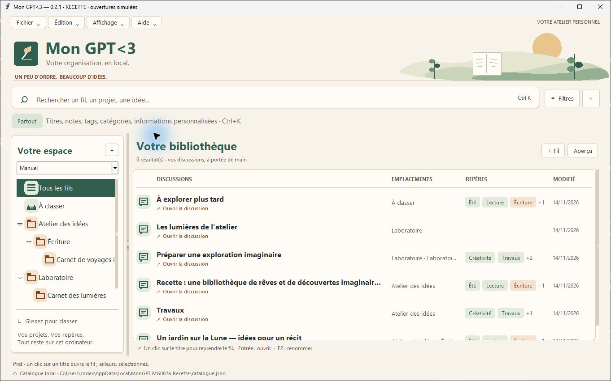
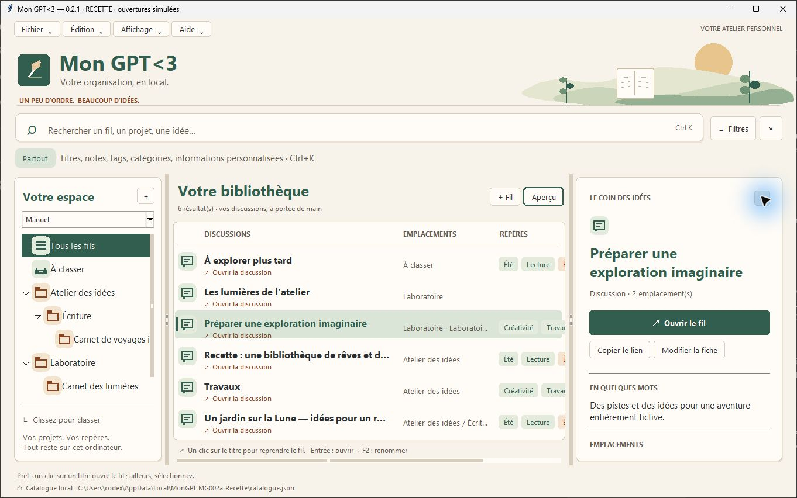
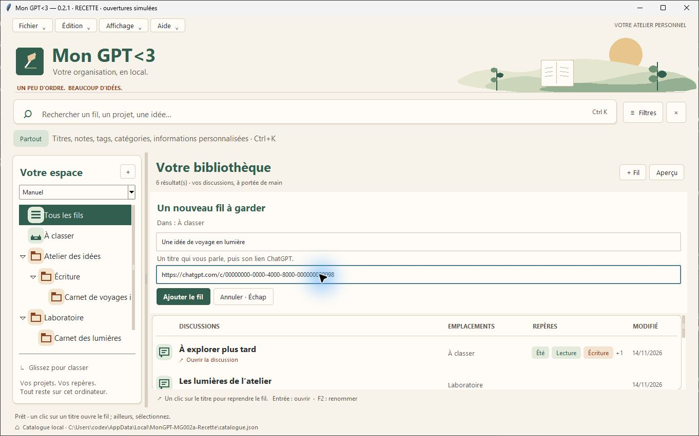
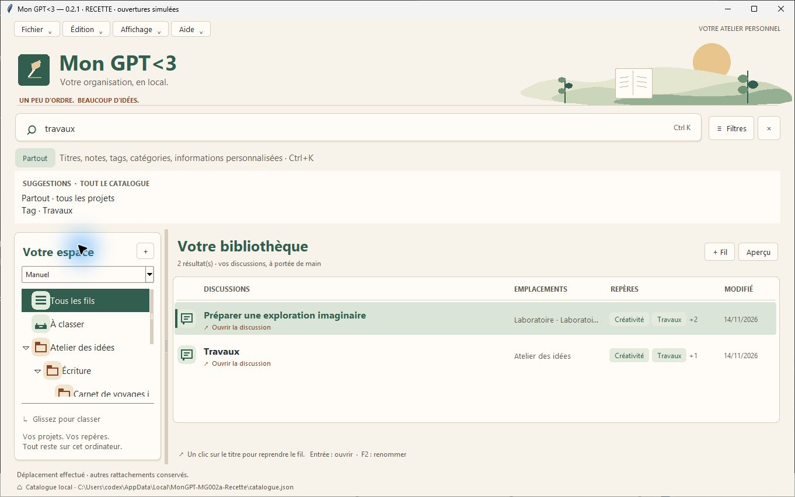
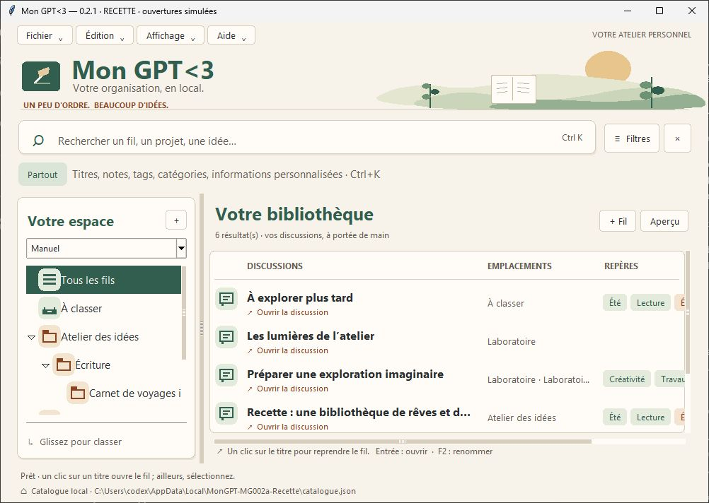

# MG-002a — Atelier chaleureux, pour de vrai

14 novembre 2026 · Mon GPT<3 **0.2.1** · recette native Windows sur CODEX-VM.

## Verdicts

- **GO graphique** : changement substantiel de composition, de hiérarchie et de composants, visible dans les captures comparatives ci-dessous. Ce verdict de réalisation reste soumis à l’appréciation esthétique de David et GPT.
- **GO gestes** sur les scénarios effectivement exécutés : ouverture directe, sélection seule, clavier, recherche/pastilles, créations intégrées, menus, glisser gauche, rattachement sans duplication, aperçu et molette, changement de projet, formats compact/confortable, fermeture et reprise.
- **PARTIEL** pour le glisser droit physique : l’outil natif ne sait produire qu’un drag gauche. Les gestionnaires restent testés ; le menu contextuel de classement a été réellement utilisé. Autres DPI/zooms Windows et Zenith Ice non validés dans cette recette.

## Base et audit visuel

État initial propre à `2690dcd`. Synchronisation par avance rapide sur `origin/main` à `9a4e5a9`, qui publie cette mission. Aucun travail local écarté. Lecture de la spécification UX, de la mission, du rapport MG-002, de ses captures et des trois maquettes consultées **localement**. Les PNG de référence ne sont ni modifiés, ni dupliqués, ni intégrés à l’application.

| Écart de 0.2.0 par rapport aux références | Transformation réalisée |
|---|---|
| Table uniforme, minuscules repères, titres et sélection peu affirmés | Liste Canvas sur papier clair, titres gras, grandes icônes cohérentes, indication d’ouverture, badges verts/terracotta, sélection bordée et trait sapin, survol distinct |
| Bandeau sans composition forte, commandes permanentes dominantes, menus Windows gris | Identité plume/carnet, paysage vectoriel doux, hiérarchie typographique ; menus papier opérationnels ; créations et aperçu accessibles par commandes discrètes dans leur contexte |
| Aperçu proche d’un formulaire, zones vides et défilements envahissants | Carte secondaire en sections, bouton Ouvrir saillant, édition volontaire, barres discrètes présentes si nécessaire ; bandeau et lignes plus compacts à petite largeur |

La Liste garde uniquement des icônes. Le dessin du carnet dans le bandeau est une illustration d’interface, pas une couverture persistante de fiche.

**Avant — vraie application MG-002 :**



**Après — vraie application 0.2.1, 1360×820, aperçu masqué :**



## Choix techniques et frontières

Python 3.13.17 / Tk 8.6, bibliothèque standard uniquement. Aucun paquet, police ou chaîne graphique à installer. `atelier.py` dessine le bandeau, les cartes, les boutons, les badges et la liste ; `theme.py` conserve les tokens communs et génère les icônes localement. L’arbre conserve sa gestion hiérarchique Tk, avec son propre habillage. Les menus s’appuient sur de vrais modèles `tk.Menu` et leurs commandes, affichés dans une surcouche papier de la fenêtre ; choix souris/clavier, Échap et fermeture extérieure sont fonctionnels.

Les couleurs approuvées structurent l’ensemble : ivoire `#F7F3EA`, sable `#E7D9C5`, sapin `#315E4F`, terracotta `#C87A50`, encre `#292D30`, avec des dérivés papier et sélection. L’illustration est du code vectoriel local, sans PNG de maquette ni nouveau fichier média applicatif.

**`core.py`, `chatgpt.py`, `storage.py`, les modèles, le schéma JSON 1 et les 35 tests précédents sont inchangés.** La séparation entre organisation générique, particularités ChatGPT et présentation est conservée. Les composants visuels ne connaissent aucune identité ChatGPT. Les préférences restent dans `interface.json`, hors catalogue et exports.

Corrections ciblées dans l’interface :

- Exclusion du projet courant après `Catalog.search`, sans modifier cette méthode ni les descendants.
- Molette de l’aperçu limitée aux widgets du panneau sous le pointeur, sans voler le focus de l’arbre ou de la Liste.
- Déplacement immédiat si le rattachement source est unique ou explicitement identifié. Plusieurs origines ambiguës imposent toujours un choix avant mutation.
- Suggestions habillées et libellées **« TOUT LE CATALOGUE »** : leur portée globale existante ne change pas.
- Positionnement initial des séparateurs après réalisation de la fenêtre : la restauration de l’inspecteur ne doit pas écraser la Liste.

## Recette native et preuves

Toutes les captures proviennent de l’application Python réellement exécutée, pas de maquettes statiques. Données entièrement fictives dans `C:\Users\codex\AppData\Local\MonGPT-MG002a-Recette`, créé avec `examples.create_ux_demo`. Le catalogue utilisateur par défaut n’a pas été utilisé. Dimensions indiquées pour la fenêtre cliente ; les captures incluent les bordures Windows.

| Scénario exécuté | Résultat observé / preuve |
|---|---|
| Clic sur titre, puis ouverture d’une autre sélection par Entrée | Exactement deux URL fictives dans `ouvertures-recette.log` (UUID finissant en 001 et 003), aucun navigateur ; clic dans une colonne de contexte = sélection seule, aperçu masqué |
| Liste avec aperçu volontaire | Sections, bouton Ouvrir et commande de repli visibles ; [capture 02](02-apercu.png) |
| Molette au-dessus de l’aperçu | Défilement jusqu’aux repères et notes sans déplacer la Liste ; [capture 03](03-molette-notes.png) |
| Menus Fichier et contextuel | Commandes affichées et utilisables, Échap ferme ; [Fichier](04-menu-fichier.png), [menu de fiche](06-menu-contextuel.png) |
| Projet Écriture | Trois descendants avant les classements suivants ; Écriture lui-même absent de ses résultats ; [capture 05](05-projet-descendants.png) |
| Création de projet intégrée | `Carnet des lumières` créé sous Écriture par raccourci et Entrée ; [capture 07](07-projet-inline.png) |
| Glisser gauche du projet | Déplacement de Carnet des lumières dans Laboratoire et retour visuel de classement ; [capture 08](08-depose-projet.png) |
| Création de fil intégrée | `Les lumières de l’atelier`, URL fictive UUID finissant en 099, enregistré sous le nouveau projet ; six fils ensuite. [Capture 09](09-fil-inline.png) : autre brouillon fictif dans l’habillage final, annulé par Échap sans fiche fantôme |
| Glisser gauche depuis Tous les fils | Fil à rattachement unique déplacé immédiatement dans Laboratoire, sans formulaire intermédiaire ; [capture 10](10-deplacement-immediat.png) |
| Déplacement d’un seul lien d’une fiche multiple | Le lien Écriture de l’exploration va dans Carnet des lumières ; lien Laboratoire et note commune intacts |
| Recherche `travaux`, suggestion puis pastille | Deux résultats uniques ; suggestion globale explicite puis filtre actif ; [capture 11](11-recherche-suggestions.png), [capture 12](12-filtre-tags.png) |
| Ajout d’un rattachement par vrai menu contextuel | Écriture ajouté à l’exploration via choix explicite de destination ; toujours une fiche, note intacte et liens précédents conservés ; [capture 14](14-rattachement-sans-duplication.png) |
| Affichage > Fenêtre compacte puis confortable | Redimensionnement réel par action de menu ; commandes visibles, défilement horizontal disponible ; [capture 13](13-compact-1000.png), puis capture 01 à grande largeur |
| Fermeture/reprise, aperçu affiché ou masqué | Données conservées, préférences restaurées, trois panneaux utilisables lorsque l’aperçu est restauré |

Contrôle final du JSON de recette : **12 fiches/projets au total, six fils et six projets, schéma 1**. L’exploration conserve son UUID interne `fd62b19b-e584-4190-b3f6-26d0982b4a87`, sa note fictive et trois rattachements après l’ajout explicite final. Le brouillon de la capture 09 n’a ajouté aucune fiche. Les données et préférences de recette restent hors Git.

**Aperçu facultatif :**



**Création dans la fenêtre :**



**Recherche et suggestions globales :**



**Compact 1000×680 réellement obtenu par le menu :**



Les captures 03–05, 07–08 et 10–12 ont été prises pendant la recette avant les derniers ajustements de densité et de bordures ; les captures 01, 02, 06, 09, 13 et 14 montrent le rendu final. Les preuves de gestes demeurent celles de l’application exécutée.

## Vérifications automatisées

`python -m unittest discover -s tests -v` : **42 tests, OK**, en 27,917 s ; [sortie complète](tests.txt). Les **35 tests existants sont conservés sans modification**. Sept tests ciblés ajoutés : projet exclu uniquement dans la présentation, dépose globale non ambiguë, choix requis pour plusieurs sources, molette sans vol de focus, panneaux au démarrage avec aperçu restauré, menu clavier/Échap, clic sur la bonne ligne malgré un survol précédent.

La recette a révélé puis permis de corriger le positionnement des panneaux au lancement et le calcul de la ligne cliquée dans un menu. Les tests ajoutés couvrent ces régressions concrètes. `python -m compileall -q mon_gpt tests` et `git diff --check` passent. Comparaison Git avec `9a4e5a9` sans différence pour les trois modules métier, les anciens tests et le dossier des maquettes. Aucun schéma migré.

Suppression sûre, validation HTTPS, sauvegarde/restauration, Ctrl+S, protections de saisie et conservation des liens restent couverts par la suite existante. Une nouvelle suppression/restauration native destructive n’a pas été rejouée dans ce lot graphique ; les preuves natives MG-002 sont conservées dans son rapport. Cette distinction ne transforme pas un test automatisé en preuve de geste physique.

## Suites à investiguer et limites

**Doublons ChatGPT : cas utilisateur suspect non reproduit dans MG-002a, aucune affirmation de correction.** L’adaptateur déduplique déjà par UUID et la création dispose d’un traitement de doublon. Un lot fonctionnel devra reproduire avec les URL exactes : URL strictement identiques avec titres différents, variantes `/c/UUID` et `/g/…/c/UUID`, casse/barre finale/paramètres, puis changement d’URL lors d’une édition. Vérifier l’identité conservée et l’avertissement donnant la fiche existante avec ouverture/ajout de rattachement. Cette logique n’a pas été réécrite ici.

Glisser droit physique encore partiel ; classement accessible par menu effectivement testé. Pas de matrice exhaustive DPI, pas de recette Zenith Ice, pas d’évaluation lecteur d’écran des nouveaux Canvas ni de charge massive. En compact, colonnes longues accessibles par défilement/ajustement et aperçu ; la largeur reste au minimum 1000×680. Les suggestions sont globales, un tag et une catégorie à la fois. Les limites du stockage JSON restent celles de MG-001.

Vues Détaillée/Mosaïque, couvertures/imports d’images, personnalisation et collecte ne sont pas livrés. Aucun travail MG-003 engagé.

## Lancement et publication

Commande normale inchangée, depuis PowerShell :

```powershell
& 'C:\Users\codex\Documents\Projets\mon-gpt\lancer.cmd'
```

Commande de la recette isolée :

```powershell
python -m mon_gpt --data-dir 'C:\Users\codex\AppData\Local\MonGPT-MG002a-Recette' --simulate-open
```

Publication prévue sur `origin/main` sans force-push, avec vérification du SHA distant et de l’état propre. Le compte rendu final fournit le lien du commit contenant ce rapport et les captures fictives. Les trois PNG de référence restent inchangés.
