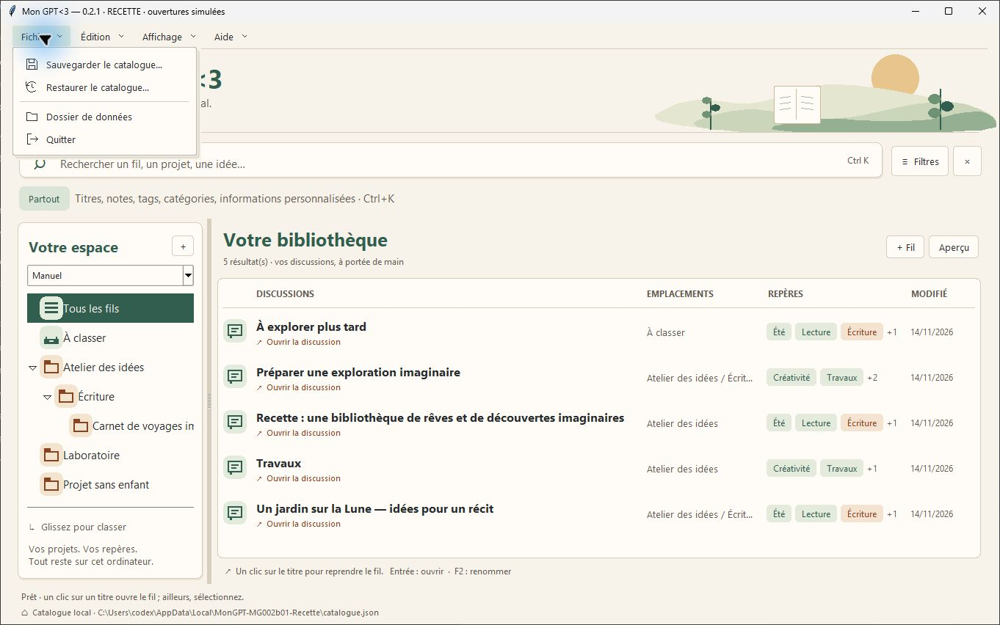
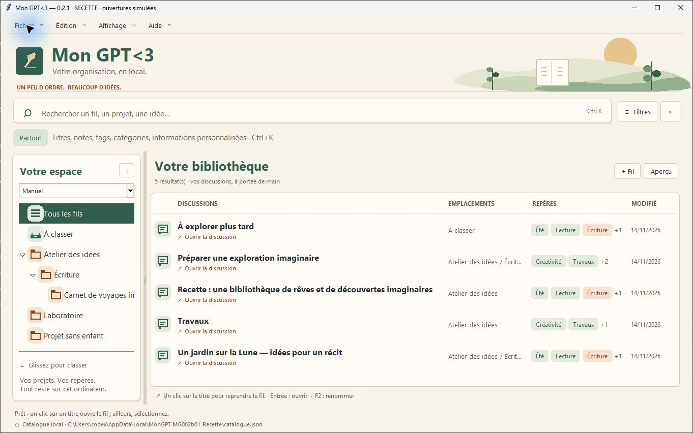

# MG-002b-01 — Menu Windows « plus plus »

14 novembre 2026 · Mon GPT<3 0.2.1 · micro-mission limitée au menu principal.

Dépôt initial propre, synchronisé par avance rapide de `57e86bd` vers `5d1341e` (publication de la mission). Lecture du rapport MG-002a et consultation locale des trois PNG ; priorité donnée à `Image ChatGPT 14 nov. 2026, 11_51_22-1.png`. Aucun PNG de référence modifié, dupliqué ou republié.

## Comparaison avec la première maquette

| Point de référence | Réalisation et différence résiduelle |
|---|---|
| Barre légère, quatre petits libellés et chevrons | Fichier, Édition, Affichage, Aide sur une ligne ivoire de 36 px, libellés Segoe UI 10, sans relief, bord de bouton ni capsule permanente. Étiquette décorative à droite retirée. La hauteur totale précédente est conservée pour ne déplacer aucune autre zone. |
| Fichier aligné au bord gauche de sa rubrique | Panneau à 16 px du bord client, juste sous la rubrique ; largeur minimale 250 px, lignes de 31 px. Proportions proches du menu court de la référence. Les autres menus s’élargissent seulement selon leur contenu réel. |
| Surface papier, coins doux, ombre | Fond papier chaud issu des tokens existants, bord fin, rayon de 7 px et petite ombre en deux tons décalés. L’ombre est dessinée, sans flou système : moins diffuse que celle de la maquette. |
| Icônes fines, sans blocs encadrés | Pictogrammes vectoriels de 16 px : disquette, historique de restauration, dossier, sortie ; aucun carré de fond. Le dessin est propre à l’application, pas une extraction des PNG. |
| Libellés et raccourcis en deux colonnes | Alignement commun des libellés et des raccourcis à droite. **Les libellés et raccourcis réels sont conservés** : Fichier garde « Sauvegarder le catalogue… », « Restaurer le catalogue… », « Dossier de données », « Quitter ». Contrairement à la maquette, aucun Ctrl+S/R/O/Q fictif n’y est affiché. Ctrl+S reste Enregistrer la fiche dans Édition. |
| Séparateurs et survol subtils | Trait fin, marges courtes, survol sable léger, rubrique active vert pâle, état désactivé atténué. Un clic souris n’active pas artificiellement la première commande ; le clavier sélectionne la première commande disponible. |
| Familiarité Windows | Clic, changement de rubrique, survol, flèches, Entrée, Échap, clic extérieur, F10 et accès Alt+F/E/A/I. Retour au contrôle précédemment focalisé après fermeture ; une seule surcouche et une seule capture souris à la fois. |

Le menu est au-dessus du bandeau existant, alors que la première maquette le place sous une petite ligne d’identité : déplacer ou refaire ce bandeau dépasserait ce lot. La typographie et les traits sont rendus par Tk/Canvas, sans anticrénelage vectoriel identique à l’image de référence. Le résultat vise sa composition et sa sobriété, sans prétendre à une reproduction pixel par pixel. La validation esthétique appartient à David et GPT avant toute autre micro-mission.

## Deux captures de l’application réelle

Fenêtre confortable 1360×820, bordures Windows incluses. Application Python réellement exécutée sur CODEX-VM, données entièrement fictives :





## Technique et périmètre

`main_menu.py` réserve l’habillage aux quatre menus principaux. Il réutilise le modèle de commandes `tk.Menu`, l’interface de `MenuSkin`, les tokens et le dessin arrondi existants. `ui.py` change uniquement l’assemblage dans `build_menus()` et son import. Aucun framework, paquet ou police ajouté ; lancement et version 0.2.1 conservés.

**Le menu +, les menus contextuels et leur `MenuSkin` sont inchangés.** Aucun changement du moteur, de l’adaptateur ChatGPT, du stockage, du schéma, de la recherche, du bandeau illustré, de la Liste, des icônes de fiches, de l’inspecteur, des créations ou du DnD. Comparaison Git avec `5d1341e` sans différence pour leurs modules, les maquettes et les 42 tests précédents. Les protections et callbacks des commandes restent ceux de 0.2.1.

## Recette et vérifications

Catalogue fictif isolé : `C:\Users\codex\AppData\Local\MonGPT-MG002b01-Recette`, créé avec `examples.create_ux_demo`. Aucun catalogue réel utilisé, aucune mutation métier nécessaire à cette recette.

- **1360×820 et 1000×680** : ouverture physique de Fichier ; quatre rubriques parcourues, panneaux sous la bonne rubrique, aucune commande tronquée.
- Souris : clic de Fichier vers Édition, Aide puis Affichage ; survol et sélection ; clic extérieur ferme sans action. Le cas clic après changement au survol a été corrigé et testé pour éviter une fermeture involontaire.
- Clavier : Ctrl+K pour placer le focus, Alt+F puis Échap avec retour du caret au champ ; F10, Droite, Bas pour Édition, Droite vers Affichage puis Aide. Les commandes désactivées sont sautées.
- Exécution réelle : format compact puis confortable commandés par clic ; même aller-retour effectué par Alt+A, flèches et Entrée. Le panneau se ferme après invocation, sans capture souris résiduelle.
- Fermeture/reprise de l’instance fictive : pas de menu bloqué. Export/restauration et autres commandes protégées conservent leurs callbacks existants ; aucune restauration ou suppression native rejouée pour ce lot de présentation.

`python -m unittest discover -s tests -v` : **46 tests réussis en 26,422 s**, dont **42 tests précédents inchangés** et quatre tests ciblés (focus/grab après Échap, navigation/invocation et commande désactivée, survol/changement/clic extérieur, bonne ligne cliquée). [Sortie complète](tests.txt).

`python -m compileall -q mon_gpt tests` et `git diff --check` : réussis. Contrôle du diff : seules l’intégration du menu principal, son composant dédié, ses tests et ce rapport/captures sont modifiés ou ajoutés.

Limites : menus dessinés dans la fenêtre plutôt que menus Win32 ; lecteur d’écran, contraste élevé système et autres DPI non évalués. Pas de sous-menu en cascade dans ces quatre rubriques existantes. Aucun changement entrepris dans une autre zone ; prochaine mission laissée à la validation utilisateur.

## Lancer

```powershell
& 'C:\Users\codex\Documents\Projets\mon-gpt\lancer.cmd'
```

Recette isolée : `python -m mon_gpt --data-dir 'C:\Users\codex\AppData\Local\MonGPT-MG002b01-Recette' --simulate-open`.

Publication sur `origin/main` sans forcer ; le compte rendu final fournit le commit contenant ces deux captures et le SHA distant vérifié.
