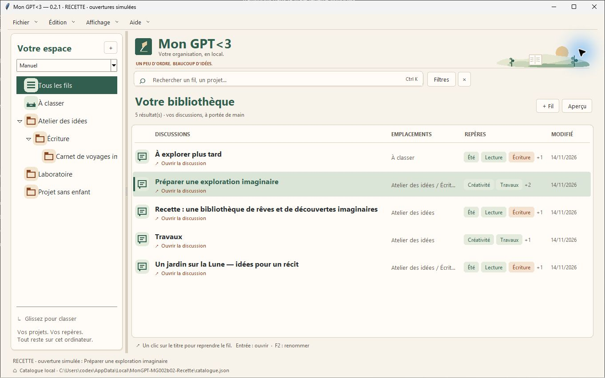
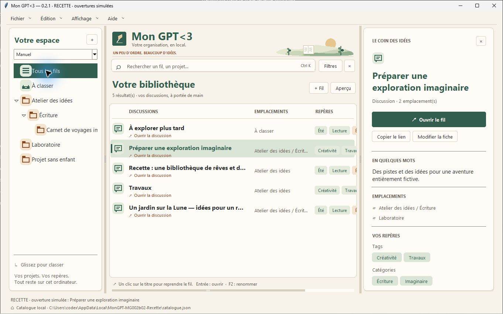
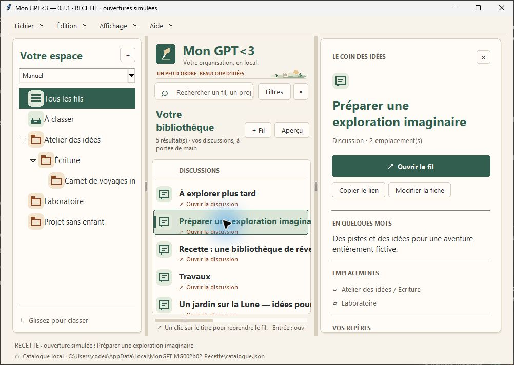

# MG-002b-02 — Trois colonnes dès le haut, recherche compacte

14 novembre 2026 · Mon GPT<3 0.2.1 · CODEX-VM. Dépôt initial propre, synchronisé de `940fb19` vers `3f8fd5b` par avance rapide. Lecture des deux missions, de la spécification UX et du rapport MG-002b-01 ; trois maquettes consultées localement sans modification ni duplication.

## Disposition livrée

Les panneaux commencent immédiatement sous le menu. L’arbre et l’aperçu récupèrent la hauteur auparavant occupée par le bandeau global et la recherche. **Le centre seul** contient désormais la signature plume/Mon GPT<3, le paysage existant recomposé sur 80 px, puis la recherche et la bibliothèque. En confortable sans filtre, le début de la Liste remonte d’environ 100 px par rapport à MG-002a ; les panneaux latéraux gagnent environ 225 px de hauteur.

La ligne de recherche mesure 40 px et reste plafonnée à **760 px, boutons compris**, même en fenêtre agrandie. Filtres et Effacer gardent une largeur réservée. Les pastilles de projet/tag/catégorie apparaissent seulement si nécessaires, sur une ligne adaptée à la largeur disponible. Suggestions et pastilles restent dans le centre. En compact avec aperçu, les commandes + Fil/Aperçu ont également une largeur réservée, et le titre de bibliothèque s’adapte. Aucun nouveau fond destiné à remplir artificiellement le gain de place.

`build_shell()` compose les widgets dans la colonne centrale ; `Masthead` adapte uniquement son dessin. La présentation des pastilles est compacte, leurs callbacks restent identiques. **`main_menu.py` et `build_menus()` sont strictement inchangés**, ainsi que les menus contextuels, le moteur, l’adaptateur ChatGPT, le stockage et le schéma 1. Aucun paquet ajouté, version et lanceur conservés.

## Trois captures de l’application réelle

Catalogue entièrement fictif : `C:\Users\codex\AppData\Local\MonGPT-MG002b02-Recette`, généré avec `examples.create_ux_demo`. Ouvertures simulées uniquement ; aucun catalogue utilisateur réel utilisé. Les bordures Windows sont incluses dans les captures.

**1360×820 — aperçu fermé, centre élargi :**



**1360×820 — trois colonnes alignées :**



**1000×680 — aperçu ouvert, commandes visibles :**



## Vérifications

Recette native exécutée : 1360×820 puis 1000×680, aperçu ouvert et fermé ; plusieurs replis/réaffichages avec sélection et filtre conservés ; changement de projet ; Ctrl+K, saisie `travaux`, suggestions globales et sélection du tag ; pastilles projet/tag dans le centre étroit ; Effacer ; molette autonome de l’aperçu jusqu’aux notes. Un fil fictif a été ouvert en simulation depuis le titre.

Fenêtre réellement maximisée à **1920×1032** : la recherche reste courte malgré l’élargissement du centre. Retour à 1360×820 par Affichage. Fichier ouvert physiquement au-dessus de l’arbre remonté ; Affichage accessible par Alt+A, commande souris exécutée, Échap ferme sans blocage. Les menus restent sur une couche supérieure de la fenêtre, sans découpage par les colonnes.

Fermeture/reprise de l’instance fictive : dimensions et aperçu restaurés, panneaux utilisables dès le lancement. **Le contrat de persistance antérieur reste inchangé : sélection et filtres ne sont pas mémorisés entre deux sessions.** Leur conservation a été vérifiée pendant les transitions d’une même session ; ajouter leur persistance aurait modifié le fonctionnement hors périmètre de cette mission.

**48 tests réussis en 33,934 s**, dont les **46 tests précédents inchangés**. Deux tests de régression ajoutés : alignement sous le menu/recherche plafonnée en 1000, 1360 et 1800 px ; ouvertures répétées de l’aperçu en compact avec commandes visibles, suggestions et pastilles contenues, focus et filtres conservés. [Sortie complète](tests.txt). Compilation Python et `git diff --check` réussis.

Comparaison Git : aucun changement dans `main_menu.py`, les modules métier, les anciens tests ou le dossier des maquettes. Comparaison AST de dix méthodes, dont `build_menus`, raccourcis, suggestions, choix de filtre, recherche/résultats, aperçu, molette, menu contextuel et dépose : comportements inchangés. Les seuls changements applicatifs concernent la disposition, la présentation des pastilles et le bandeau.

## Limites et validation attendue

En compact avec trois colonnes, les titres longs restent accessibles via l’aperçu et les colonnes défilantes ; les pastilles longues sont abrégées. Le paysage devient une petite signature à cette largeur. Autres DPI et Zenith Ice non testés. Aucun blocage technique restant constaté ; **l’approbation visuelle est laissée à David et GPT**. Aucune mission suivante engagée.

Lancement normal inchangé :

```powershell
& 'C:\Users\codex\Documents\Projets\mon-gpt\lancer.cmd'
```

Publication prévue sur `origin/main`, sans forcer ; le compte rendu final fournit le commit contenant ces preuves et le SHA distant vérifié.
