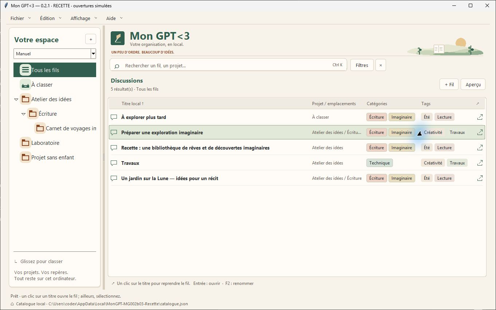
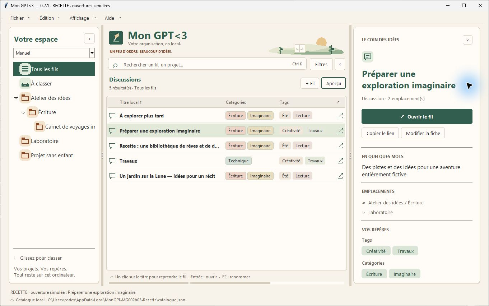
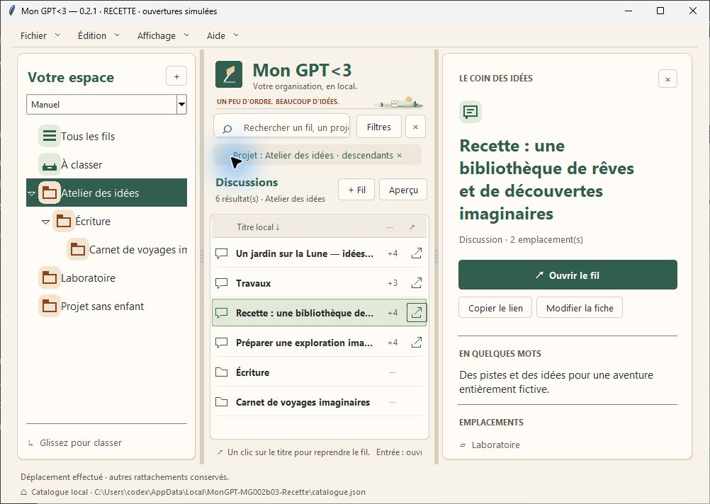
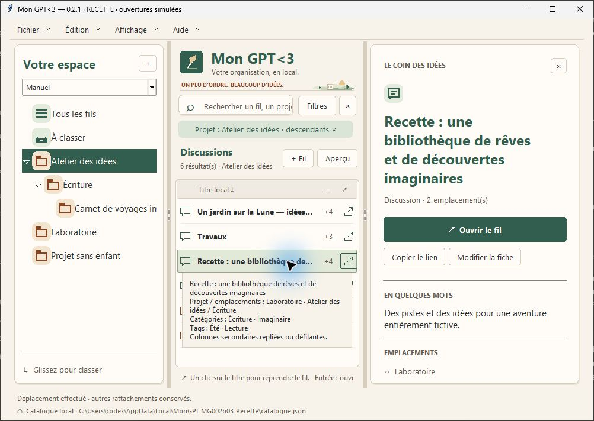

# MG-002b-03 — La Liste centrale

14 novembre 2026 · Mon GPT<3 0.2.1 · CODEX-VM. Dépôt initial propre, synchronisé par avance rapide de `384496d` vers `2593f37`, qui publie la mission. Troisième maquette consultée localement ; PNG de référence inchangés, non dupliqués et non embarqués.

## Comparaison concrète à la troisième maquette

| Composition de référence | Liste exécutée |
|---|---|
| Une discussion par ligne, sans sous-titre d’ouverture | **42 px par ligne**, titre gras Segoe UI 10, sans « Ouvrir la discussion » ni sous-titre de remplacement |
| Petite icône non encadrée | Bulle ou dossier dessiné au trait, 16 px, sans fond ni boîte ; aucun lien externe sur les projets |
| Discussions, résultat(s), colonnes horizontales | Petit titre Discussions, nombre et contexte juste dessous ; en-têtes Titre local, Projet/emplacements, Catégories, Tags, lien. Tri par en-tête, flèche de sens, limites redimensionnables |
| Catégories et tags colorés distincts | Deux colonnes et palettes différenciées, couleurs stables dérivées du libellé ; catégories bordées, tags plus légers. Aucune couleur personnalisée persistante ajoutée |
| Sélection sauge, lien discret à droite | Ligne sauge pâle, survol léger et contour de focus fin ; petit lien externe à droite. Titre et action restent épinglés pendant le défilement horizontal des repères |
| Lecture du titre long et des valeurs multiples | Troncature par ellipse, `+N` pour les valeurs repliées ; info locale au survol donnant titre entier, emplacements, catégories et tags, indépendamment de l’inspecteur |

Écarts assumés : le compteur reste sur une petite seconde ligne plutôt que collé au titre ; le tri utilise directement les en-têtes plutôt qu’un nouveau sélecteur. Pas de cases de sélection multiple ajoutées. La colonne Modifié est retirée de la table pour privilégier les informations demandées ; les dates métier restent intactes. À moins de 900 px de Liste, catégories et tags passent avant les emplacements, accessibles par défilement horizontal. Sous 440 px, ces colonnes sont repliées derrière `⋯` / `+N` et le détail au survol. Cette adaptation préserve le titre et le lien sans déplacer les panneaux validés.

## Quatre captures réelles

**1360×820, aperçu masqué :**



**1360×820, aperçu affiché :**



**1000×680, aperçu affiché, projets et fils distincts :**



**Même format compact, titre entier et repères au survol :**



Toutes les images proviennent de l’application Python réellement exécutée. Catalogue entièrement fictif dans `C:\Users\codex\AppData\Local\MonGPT-MG002b03-Recette`, mode `--simulate-open`, aucun catalogue utilisateur réel utilisé. Les captures suivent l’évolution de la recette : cinq fils initiaux, puis rattachement et déplacement dans un contexte de projet affichant aussi ses sous-projets.

## Recette native

- **Ouverture et hitboxes** : clic sur catégorie = sélection seule, sans création du journal d’ouverture ; clic titre de l’exploration = UUID fictif finissant par 001 ; petit lien à droite de Travaux = 002 ; flèche haut, droite puis Entrée sur Recette = 004. Les trois ouvertures correspondent aux bonnes lignes.
- **Clavier** : flèches de sélection, focus distinct sur l’action de fin, Entrée ; F2 affiche le renommage intégré, Échap l’annule. Projets affichés avec dossier et sans lien externe.
- **Classement** : vrai clic droit sur Recette, ajout du rattachement Laboratoire ; puis glisser gauche depuis le contexte Atelier des idées vers Écriture. Déplacement immédiat du seul rattachement de départ, lien Laboratoire et note fictive conservés. Même UUID interne `5f458d91-344c-461a-99b2-28a869f11012`, deux rattachements après l’opération, aucun doublon de fiche.
- **Table** : tri inverse par Titre local observé, resize réel de cette colonne, défilements horizontal et vertical. Le titre et l’action restent accessibles ; en-tête fixe. Le survol en compact a réellement montré le titre entier et les repères (capture 04).
- **Formats** : 1360×820 et 1000×680, aperçu ouvert/fermé. Colonnes secondaires repliées en centre étroit, lien toujours sur le bord visible. Ouverture/repli de l’aperçu et menus existants utilisés sans modification.
- **Création/recherche** : Ctrl+N, titre fictif « Une escale dans les idées », URL UUID 099, validation par Entrée ; nouvelle ligne avec le même rendu. Double-clic = **une seule** ouverture simulée supplémentaire. Ctrl+K puis `Travaux` : deux résultats et suggestions globales conservés ; Entrée dans la recherche n’ouvre rien.

Journal final : exactement **quatre** ouvertures simulées (001, 002, 004, 099), aucun navigateur. Catalogue fictif final : **11 enregistrements, six fils et cinq projets, schéma 1**. Données de recette hors Git.

## Tests et frontières

**53 tests réussis en 41,330 s**, dont les **48 tests antérieurs inchangés**. Cinq tests ciblés ajoutés : bonne ligne ouverte à toutes les largeurs/après scrolling ; badges/espace libre et détail complet ; tri/resize/action épinglée ; focus clavier/projets sans ouverture ; relâchement au-dessus du lien voisin sans mauvaise conversation. [Sortie complète](tests.txt). Compilation Python et `git diff --check` réussis.

Contrôle Git/AST : dans `atelier.py`, **seule la classe CatalogList change**. Dans `ui.py`, changements limités à son assemblage local, son petit en-tête, l’adaptation des valeurs de colonnes et `title_hit`. Menus, recherche, Masthead, panneaux, marges, arbre, aperçu, créations, DnD et stockage préservés. `main_menu.py`, les modules métier, le schéma, les anciens tests et les trois maquettes restent inchangés. Aucun paquet ajouté, version et lanceur conservés.

## Limites et validation

Le repli des colonnes secondaires est une adaptation de la Liste, pas une suppression de données. Le tri Tags porte désormais sur la colonne Tags distincte, et Catégories dispose de son propre tri. Couleurs par libellé, sans personnalisation persistante. Accessibilité lecteur d’écran et autres DPI non évalués. **PARTIEL : glisser droit physique toujours non prouvé** par l’outil de recette ; menu contextuel et glisser gauche réellement utilisés, contrats du drag droit conservés dans les tests.

L’approbation visuelle de cette seule Liste appartient à David et GPT. Aucune mission suivante engagée.

```powershell
& 'C:\Users\codex\Documents\Projets\mon-gpt\lancer.cmd'
```

Publication sur `origin/main` sans forcer ; le compte rendu final fournit le commit des captures et le SHA distant vérifié.
