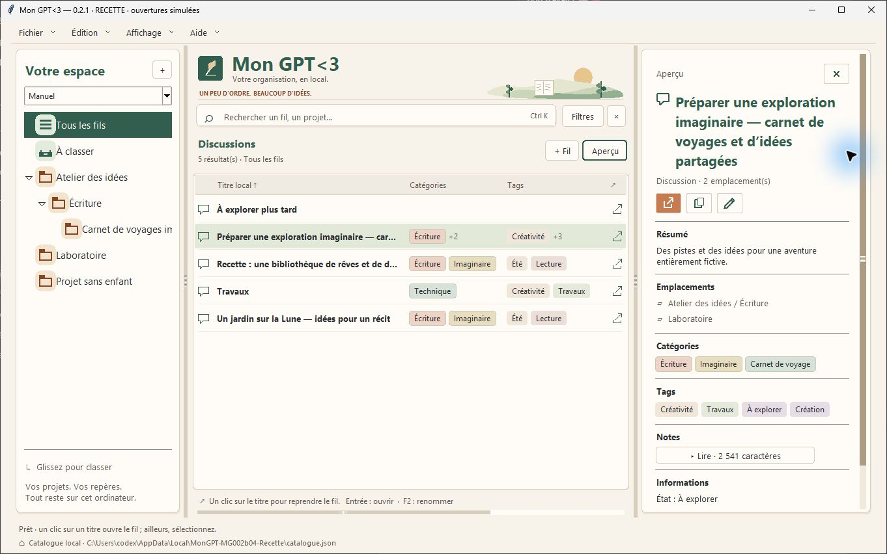
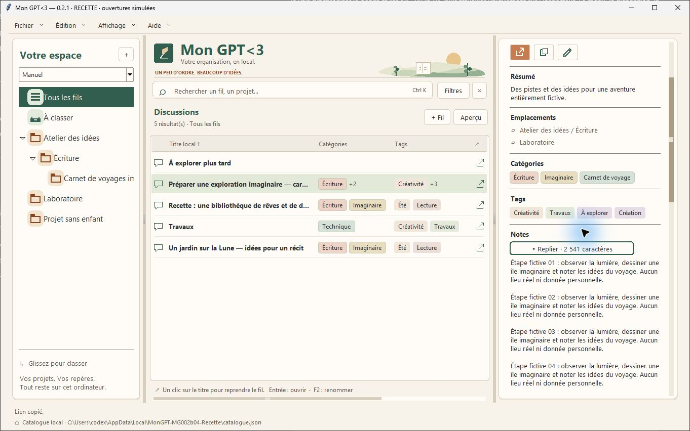
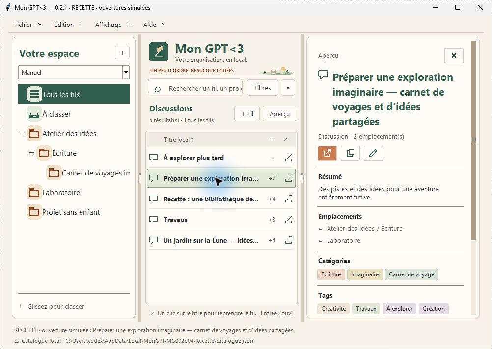

# MG-002b-04 — Refonte de l’inspecteur

14 novembre 2026 · Mon GPT<3 0.2.1 · CODEX-VM. Dépôt initial propre, synchronisé par avance rapide de `303e038` vers `9db4005`, publication de la mission. Rapport MG-002b-03 et spécification UX lus ; trois maquettes consultées localement, sans modification ni duplication.

## Résultat et comparaison aux panneaux de référence

| Référence / retour utilisateur | Inspecteur livré |
|---|---|
| En-tête utile, titre dominant | « Aperçu » et fermeture sur une ligne ; petite bulle/dossier au trait accolée au titre. Suppression de « LE COIN DES IDÉES » et de l’icône solitaire |
| Actions rapprochées | Trois pictogrammes de 40×32 px sur **une seule rangée** : ouverture terracotta, copie, crayon. Info-bulles textuelles, focus visible, Tab/Entrée/Espace. Un projet ne propose que Modifier |
| Sections lisibles et denses | Résumé/Description, Emplacements, Catégories, Tags, Notes et Informations séparés par des filets fins ; petites pastilles en lecture seule cohérentes avec la Liste, avec retour à la ligne si nécessaire |
| Accès aux données sans grand formulaire | Notes de plus de 600 caractères repliées avec compteur et commande Lire/Replier ; **texte intégral**, y compris après les 300 caractères auparavant affichés. Métadonnées et dates accessibles. Champs vides nommés explicitement |
| Défilement discret mais identifiable | Scrollbar dédiée de 12 px, pouce sable contrasté, visible en cas de dépassement ; molette inchangée, retour en haut au changement de fiche |

Écarts conservés : pas de couverture ni d’image ; actions uniquement en pictogrammes, conformément à cette mission, plutôt que le grand CTA des maquettes. Les sections ordinaires restent déployées ; seules les notes longues sont repliables. Aucune personnalisation persistante. L’approbation visuelle de ce panneau revient à David et GPT.

## Trois captures de l’application réelle

Jeu entièrement fictif dans `C:\Users\codex\AppData\Local\MonGPT-MG002b04-Recette`, mode `--simulate-open`. Titre long, deux emplacements, plusieurs catégories/tags, notes de **2 541 caractères**, métadonnées ; autre fiche volontairement vide et projet sans enfant. Aucun catalogue utilisateur réel ouvert.

**1360×820 — titre et trois actions regroupées :**



**Notes déployées, rattachements et scrollbar pendant le défilement :**



**1000×680 — même rangée d’actions :**



## Recette native

- Icône d’ouverture réellement cliquée : une ouverture simulée de l’UUID fictif finissant en **001**. Tab vers Copier : focus et info-bulle observés ; Espace copie l’URL attendue, égalité du presse-papiers vérifiée sans exposer d’autre contenu.
- Icône crayon : ouverture de l’éditeur existant puis retour à l’aperçu, sans modifier la fiche. `render_editor()` inchangé.
- Notes déployées, molette au-dessus du contrôle, plusieurs pages lues ; glissement réel du pouce de scrollbar jusqu’à **« FIN DU CARNET FICTIF — toutes les lignes sont conservées »**, puis métadonnées et dates. La Liste ne bouge pas.
- Changement vers la fiche vide : lecture remise en haut, « Pas de résumé », « Aucun tag », « Aucune catégorie », « Aucune note » ; disparition de la scrollbar lorsque tout tient. Sélection du projet : aucun bouton d’ouverture/copie ChatGPT, modification disponible.
- Formats **1360×820**, **1000×680**, puis fenêtre maximisée **1920×1032** réellement observés. Titre long, pastilles et actions sans superposition. Repli/réaffichage de l’inspecteur en compact : même sélection, largeur centrale récupérée puis restituée.
- Non-régression directe : clic sur le titre dans la Liste compacte = seconde ouverture simulée du même UUID 001. Journal final : **deux ouvertures**, aucun navigateur. Données de recette inchangées par ces gestes.

## Tests et périmètre

**57 tests réussis en 42,971 s**, [sortie complète](tests.txt). Les 53 comportements antérieurs restent couverts ; quatre tests ciblés ajoutent les actions alignées/callbacks clavier, notes intégrales et réapparition de scrollbar, fiche projet vide, info-bulle détruite au changement de fiche.

Un seul ancien test a reçu une adaptation de **données de test**, sans changer ses assertions : le test de molette utilise désormais une note réellement longue et la déploie. L’aperçu compact tient dans la fenêtre avec sa petite note antérieure ; fabriquer un dépassement par des marges aurait contredit la mission. Le test vérifie toujours le défilement effectif et l’absence de vol de focus ou d’interception de la Liste/arbre.

Compilation Python et `git diff --check` réussis. Contrôle AST de `App` : seul `show_summary()` est refondu ; dans `build_shell()`, seule l’instanciation de la scrollbar de cet inspecteur change. Son réaffichage la replace **avant le Canvas expansible**, pour qu’elle conserve sa largeur après une fiche sans débordement. Styles dédiés uniquement.

`main_menu.py`, `atelier.py` (dont CatalogList et Masthead), recherche, géométrie/marges, arbre, `details.py`, raccourcis, logique d’ouverture/copie, moteur, adaptateur ChatGPT, stockage et schéma 1 sont inchangés. Trois PNG de référence inchangés. Nouveau module de présentation `inspector.py`, sans règle métier ni dépendance supplémentaire. Version et lanceur conservés.

## Limites et lancement

Les états déployés des notes ne persistent pas entre fiches/lancements. Autres DPI, lecteur d’écran et Zenith Ice non évalués. Aucun blocage technique constaté dans la recette ciblée ; aucune validation esthétique auto-proclamée, aucune mission suivante engagée.

```powershell
& 'C:\Users\codex\Documents\Projets\mon-gpt\lancer.cmd'
```

Publication sur `origin/main` sans forcer ; le compte rendu final fournit le lien du commit et le SHA distant vérifié.
