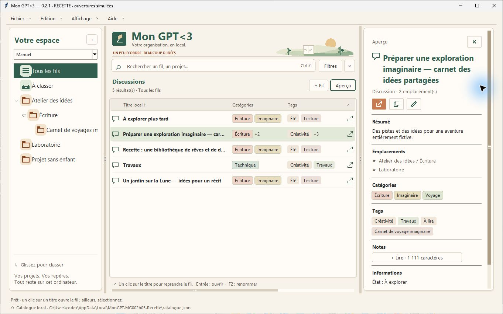
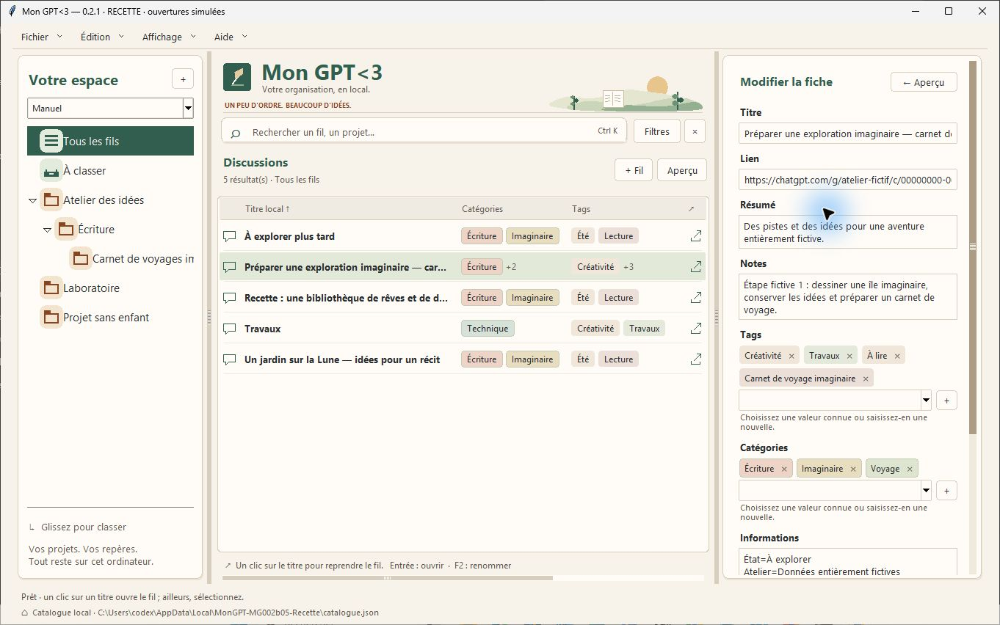
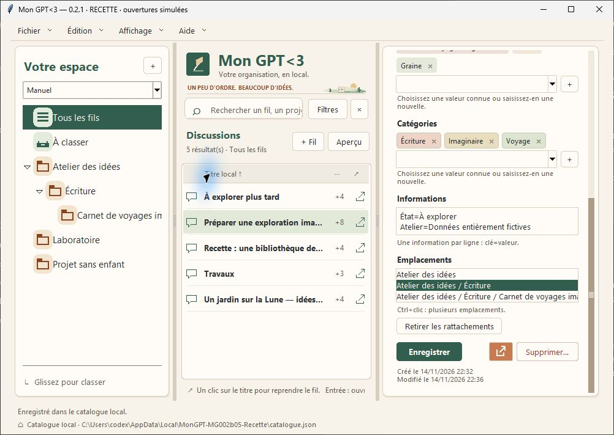

# MG-002b-05 — Éditeur, tags et catégories

14 novembre 2026 · Mon GPT<3 0.2.1 · CODEX-VM. Dépôt initial propre, synchronisé par avance rapide de `88330c9` vers `6ea8ecc`, publication de la mission. Aperçu validé examiné dans l’application, rapport MG-002b-04 lu, trois maquettes consultées localement sans modification ni duplication.

## Présentation livrée

| Aperçu validé / demande | Éditeur exécuté |
|---|---|
| Identité sobre, même papier et même typographie | En-tête « Modifier la fiche » avec « ← Aperçu » sur la même ligne ; libellés courts en casse normale : Titre, Lien, Résumé/Description, Notes, Tags, Catégories, Informations, Emplacements/Projet parent |
| Filets fins, champs lisibles | Entrées papier avec styles dédiés ; Text sans relief ni bord noir, bordure de focus de 1 px et marges internes réduites. Contenu long toujours accessible par édition/défilement |
| Pastilles cohérentes et variées | Couleurs déterministes par valeur, palettes distinctes pour catégories et tags, même famille que Liste/aperçu. Retour à la ligne selon la largeur réelle, sans grille de deux colonnes ; long libellé et retrait × accessibles |
| Saisie exploitant le panneau | Combobox extensible sur toute la largeur restante, petit + réservé à droite. Valeurs connues, filtrage, normalisation et suppression conservent leur logique |
| Actions discrètes et compréhensibles | Enregistrer sapin, ouverture par petit pictogramme, Supprimer… en rouge ; même rangée. Aides `clé=valeur` et sélection multiple séparées des intitulés |

Les champs multiligne conservent les contrôles Tk natifs avec des traits fins, plutôt que des coins artificiellement arrondis. Leurs données restent éditables intégralement. Tab/Shift+Tab déplacent explicitement le focus dans ce formulaire, sans insérer de tabulation. Aucun nouveau framework, thème global ni police à installer.

## Trois captures natives maximum

Catalogue strictement fictif `C:\Users\codex\AppData\Local\MonGPT-MG002b05-Recette`, mode `--simulate-open`, aucun catalogue utilisateur réel consulté. Les deux premières captures montrent **la même fiche avant les modifications de recette**, en 1360×820. La troisième suit les ajouts/retraits de tags enregistrés, en 1000×680.

**Aperçu validé — inchangé :**



**Éditeur du même fil — champs, tags et catégories :**



**Éditeur compact après défilement — informations, rattachements et actions :**



## Recette réelle sur CODEX-VM

- Titre long, URL fictive longue avec chemin GPT et paramètres, résumé, notes de 11 étapes, métadonnées et deux emplacements chargés. Éditeur contrôlé en **1360×820 puis 1000×680**, avec molette, scrollbar existante et focus visible. Les notes sont visibles dans la capture normale ; la capture compacte montre le bas du formulaire et ses actions.
- Choix de **Été** dans les valeurs connues ; saisie de **Graine**, ajout par Entrée ; retrait de la pastille **Travaux**. Les autres valeurs restent en place et les pastilles se redisposent.
- Retour à l’aperçu avec changements : avertissement existant affiché ; Échap/Annuler garde la saisie. Titre vidé puis Ctrl+S : « Le titre est obligatoire », catalogue non remplacé, saisie conservée. Titre restauré puis **Ctrl+S enregistre la fiche**, sans export global.
- Relecture dans l’aperçu : cinq tags attendus, catégories distinctes. Vérification du JSON fictif : titre et URL longue complets, notes intégrales, métadonnées et **deux rattachements conservés**. Tags finaux : Créativité, À lire, Carnet de voyage imaginaire, Été, Graine ; catégories : Écriture, Imaginaire, Voyage.
- Projet fictif sans enfant édité : absence de champ Lien, champs génériques disponibles, parent **Laboratoire** choisi et enregistré. Champs initialement vides utilisables. Aucun rattachement de discussion modifié par cette opération.
- Fermeture puis réouverture réelles : les tags modifiés, l’URL, les notes et les deux emplacements sont présents ; projet affiché sous Laboratoire. **10 enregistrements conservés, schéma 1**, données de recette hors Git.
- Parcours clavier corrigé et rejoué dans l’application finale : Résumé → Tab → Notes → Shift+Tab → Résumé, sans modification de texte. Choix connu à la souris, ajout par Entrée et enregistrements par Ctrl+S effectivement exécutés.

## Tests et frontières

**60 tests réussis**, dont les **57 tests existants inchangés**. [Sortie complète](tests.txt). Trois tests ciblés ajoutés : disposition des pastilles et largeur des saisies aux deux formats, bordures fines et parcours Tab/Shift+Tab sans mutation, ordre clavier Enregistrer/Ouvrir/Supprimer ; ajout/retrait/normalisation avec persistance des autres champs et emplacements ; édition du parent et des champs génériques d’un projet. Compilation Python et `git diff --check` réussis.

Comparaison AST : **seule `render_editor()` change dans DetailEditor** ; `save_record`, transactions, validations et protections restent identiques. Dans ChipPicker, `known`, `suggest`, `add`, `remove` et `get` sont identiques à la base : changements limités à présentation/disposition, avec retour du focus à la saisie après retrait. Les styles Editor sont dédiés et ne modifient pas les styles globaux.

`ui.py`, `inspector.py`/show_summary, `atelier.py`/CatalogList/Masthead, `main_menu.py`, géométrie/marges, recherche, moteur, adaptateur ChatGPT, stockage et trois PNG sont inchangés. Aucun travail sur les vues futures ou l’anomalie de doublons. Version et lanceur conservés.

## Limites et validation attendue

Titre et URL sur une ligne : contenu long accessible au caret/défilement horizontal. Les multiligne conservent une hauteur contenue et leur défilement natif ; le panneau défile pour atteindre tous les champs et actions. Les popdowns de combobox restent ceux de Tk. Autres DPI, lecteur d’écran et Zenith Ice non évalués. L’approbation visuelle est laissée à David et GPT ; aucune MG-002b-06 engagée.

```powershell
& 'C:\Users\codex\Documents\Projets\mon-gpt\lancer.cmd'
```

Publication sur `origin/main` sans forcer ; le compte rendu final fournit le lien du commit et le SHA distant vérifié.
