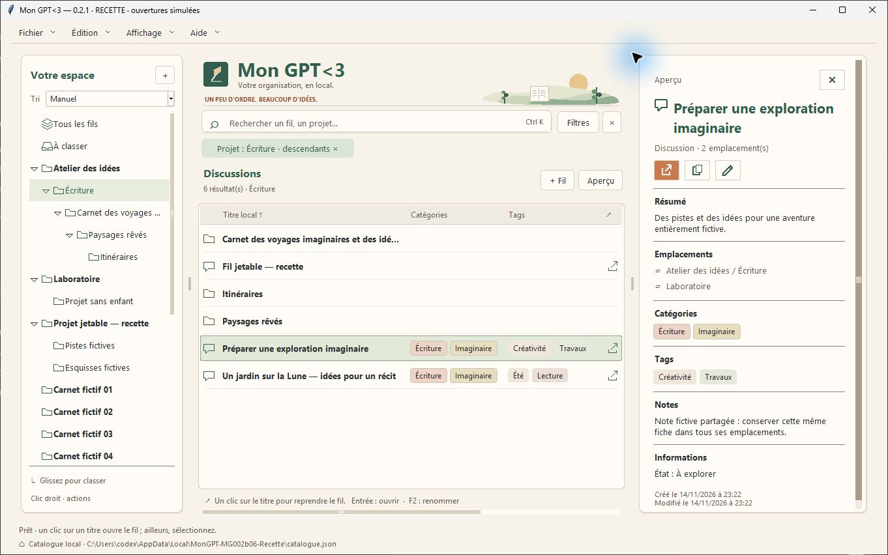
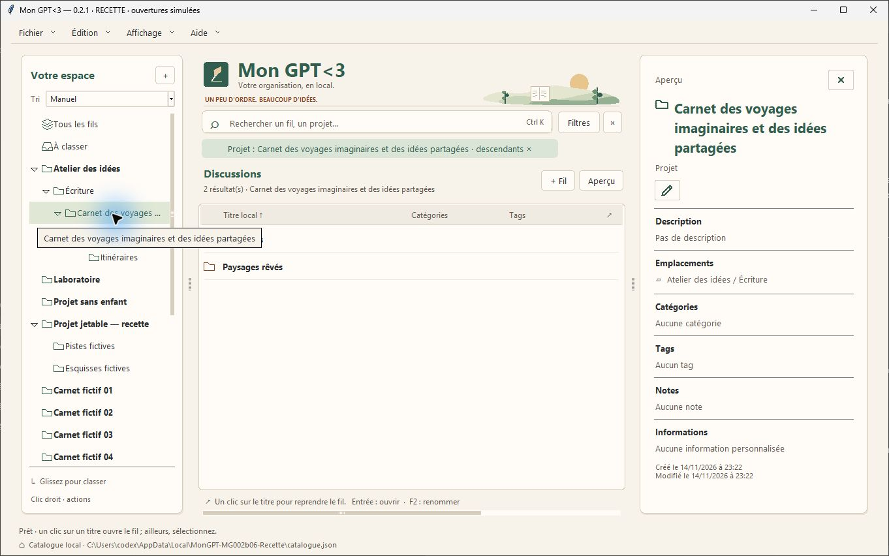
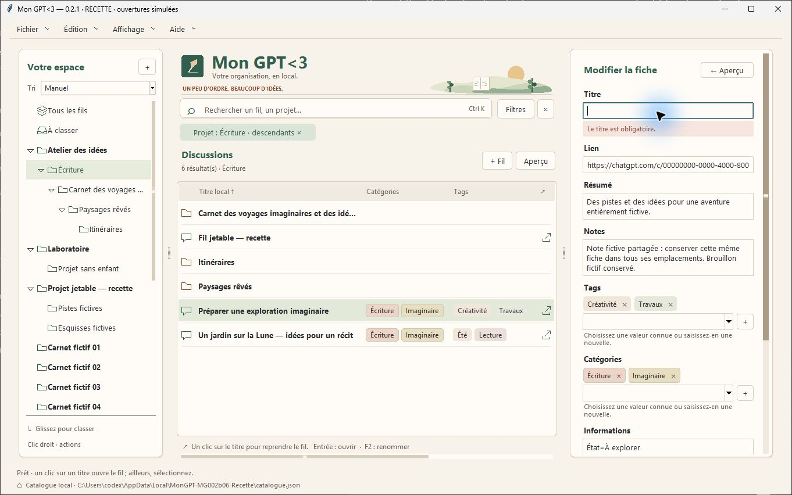
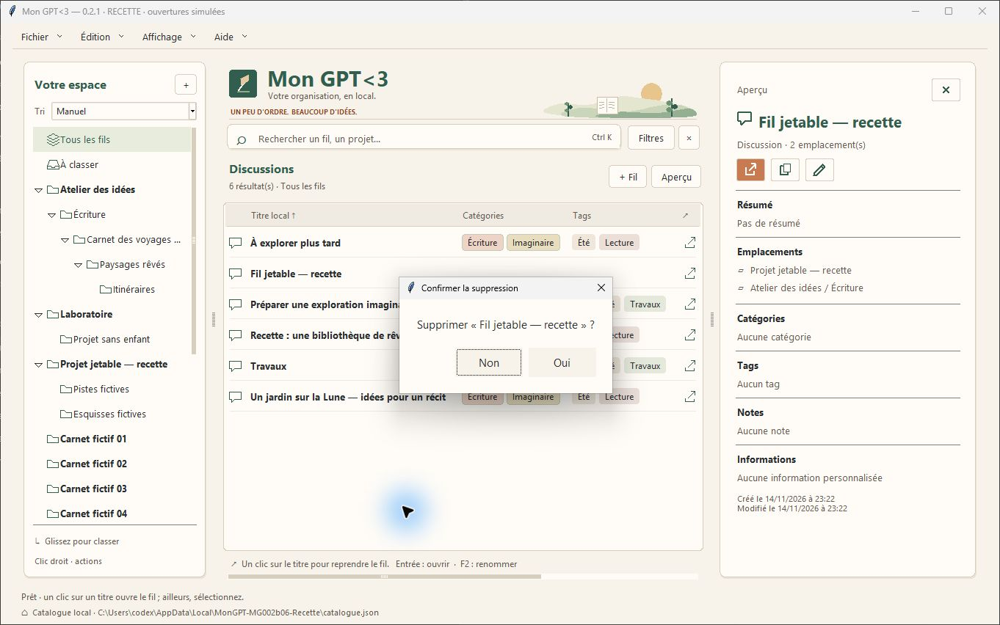

# MG-002b-06 — Navigation et finitions ciblées

Réalisé sur CODEX-VM le 14 novembre 2026, à partir de `adddcfa9a2e19b40961f5d65f54344a4354c9a96`. Synchronisation en avance rapide ; dépôt initialement propre. Version applicative conservée : 0.2.1. Validation esthétique laissée à David et GPT.

## Avant / après

Comparaison avec les captures MG-002b-05 et consultation locale de la troisième maquette :

| Point | Avant | Maintenant |
| --- | --- | --- |
| Icônes | Dossiers dans des carrés beiges | Traits fins transparents ; dossiers, pile et corbeille de classement distincts |
| Sélection | Vert foncé, texte blanc | Sauge douce, texte pin ; survol léger et focus natif conservé |
| Hiérarchie | Lignes de 40 px, gros en-tête | Lignes de 34 px, indentation régulière de 18 px, racines en gras, en-tête discret |
| Titres longs | Troncature | Ellipse calculée selon la profondeur et la largeur ; libellé intégral après survol |
| Respiration | Marges externes de 18 px, haut de 3 px | 24 px aux côtés, 10 px en haut ; cadres internes de 6 px, gouttières ivoire |
| Informations | Plusieurs lignes de slogans | Aide au dépôt et court repère « Clic droit · actions » |

Le Treeview natif conserve les identifiants, les parents, l’ordre, les chevrons et les gestes. L’habillage est isolé dans `navigation.py` ; aucune règle métier nouvelle. La scrollbar se replace avant l’arbre lorsqu’elle réapparaît. Un survol périmé après défilement a été corrigé pendant la recette.

## Deux dialogues ciblés

Titre vide : aide terracotta pastel directement sous le champ, focus restitué, brouillon conservé, aucune mutation. Même traitement pour la syntaxe du lien et les informations `clé=valeur`, en réutilisant les règles existantes. Une erreur technique de stockage garde son alerte et son rollback.

Suppression : petit dialogue papier dédié, Non puis Oui, focus initial sur Non. Non, Entrée initiale, Échap et croix annulent ; seul Oui accepte. La boîte Windows Oui/Non initialement essayée ignorait Échap : elle a été remplacée après constat réel. Pour un projet, une seule ligne indique le nombre d’enfants directs et de rattachements affectés. Effets MG-001 conservés.

## Vérifications

- `python -m unittest discover -s tests -v` : **65 tests réussis en 61,689 s**. Les 60 scénarios existants restent présents. Deux adaptations ciblées : seuil de marge sous le menu porté de 8 à 20 px conformément à cette mission ; mock de confirmation redirigé vers le nouveau dialogue. Cinq tests ajoutés : libellés/parents, titre sans écriture, autres erreurs et panne de stockage, effets de suppression, dialogue réel Tk Non/Échap/croix/Oui.
- Recette native Windows : 1360×820, 1000×680, puis fenêtre maximisée, aperçu ouvert et fermé. Le centre récupère sa largeur à la fermeture ; le panneau gauche défile. En compact avec aperçu, les repères secondaires de la Liste se replient comme auparavant.
- Arbre fictif à cinq niveaux : sélection, survol complet, repli/déploiement au clavier, tri manuel/alphabetique et retour à l’ordre manuel ; Alt+↑ puis Alt+↓ ; clic droit ; glisser gauche d’un projet dans Laboratoire. Déplacement d’Atelier des idées vers son descendant refusé, arbre intact.
- Recherche « exploration » dans Écriture : un seul résultat ; ouverture directe simulée par clic sur le titre puis Entrée. Aucun navigateur réel ouvert.
- Éditeur : note fictive ajoutée, titre vidé, Ctrl+S. Message sous le titre sans popup ; empreinte SHA-256 du catalogue identique avant/après (`84BCB569A05416D952C4C8D621732B7B2D4CCC56CC1B5150227C7916A4AACF5A`). Correction puis Ctrl+S : note, tags, catégories et deux rattachements vérifiés dans le JSON.
- Suppressions fictives : Non par défaut et Échap sans écriture ; après autorisation du clic Oui, projet retiré, deux enfants remontés à la racine, fil conservé dans Écriture ; puis fil retiré et cinq autres discussions conservées. Croix testée dans le dialogue Tk automatisé.
- `git diff --check` : propre. `core.py`, `chatgpt.py`, `storage.py`, `main_menu.py`, `build_menus()`, `atelier.py`, `inspector.py`, `widgets.py` et les trois PNG de référence inchangés. Schéma 1 et données utilisateur intacts.

Jeu exclusivement fictif, hors dépôt : `%LOCALAPPDATA%\MonGPT-MG002b06-Recette`, avec `--simulate-open`. Aucun catalogue ni journal de recette versionné.

## Captures réelles









## Lancement et limites

Depuis PowerShell :

```powershell
& 'C:\Users\codex\Documents\Projets\mon-gpt\lancer.cmd'
```

Le tri conserve sa liste déroulante native pour la fiabilité clavier. Le glisser droit physique, les autres facteurs de zoom Windows et Zenith Ice restent à valider ; le menu équivalent et ses gestionnaires restent couverts. Le cas suspect des doublons d’URL n’est pas corrigé. Aucune vue Détaillée/Mosaïque ni autre zone graphique reprise.
