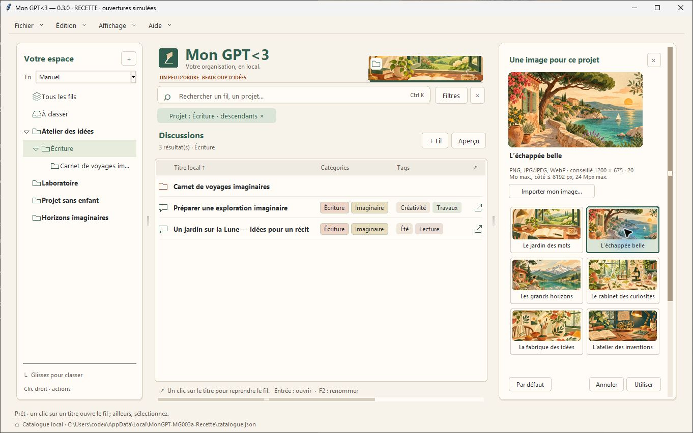
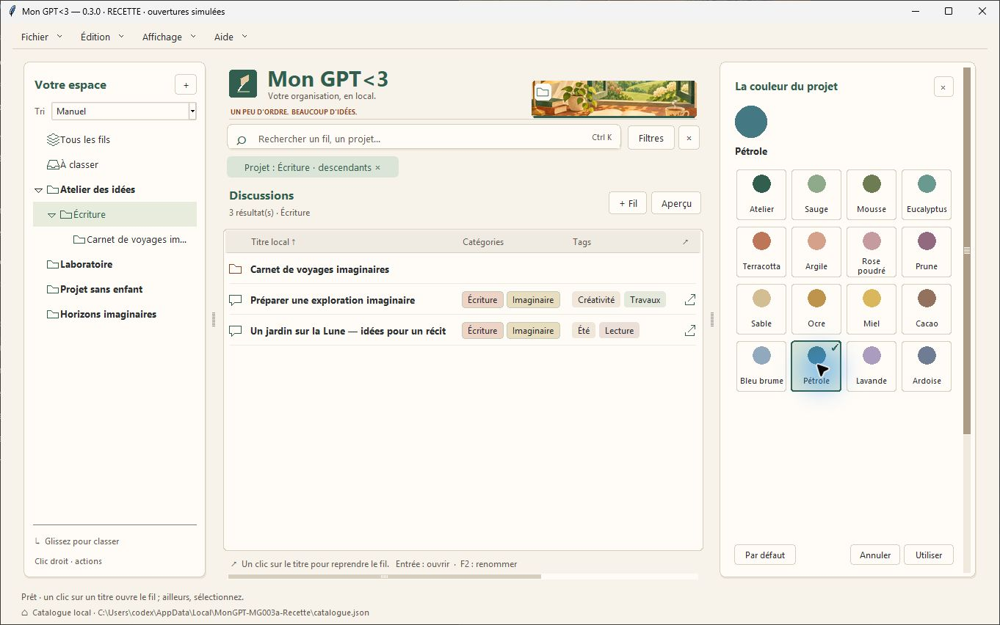
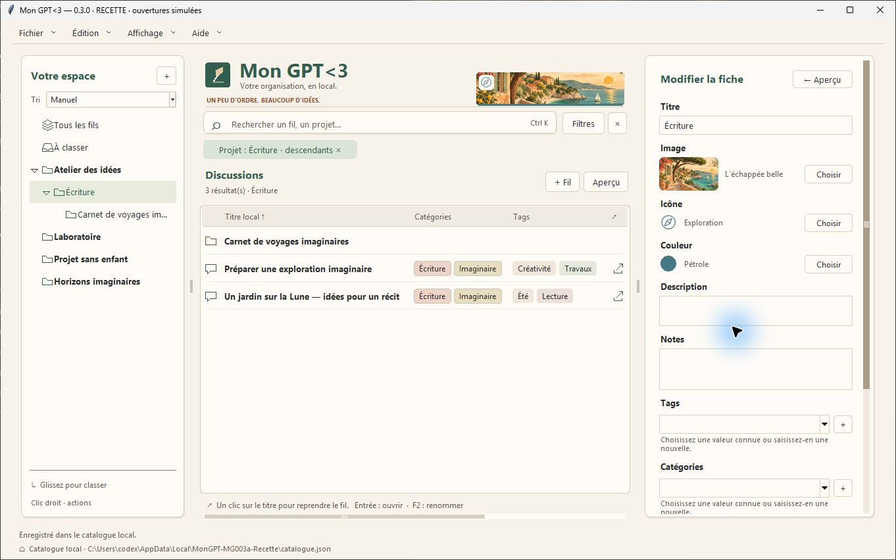
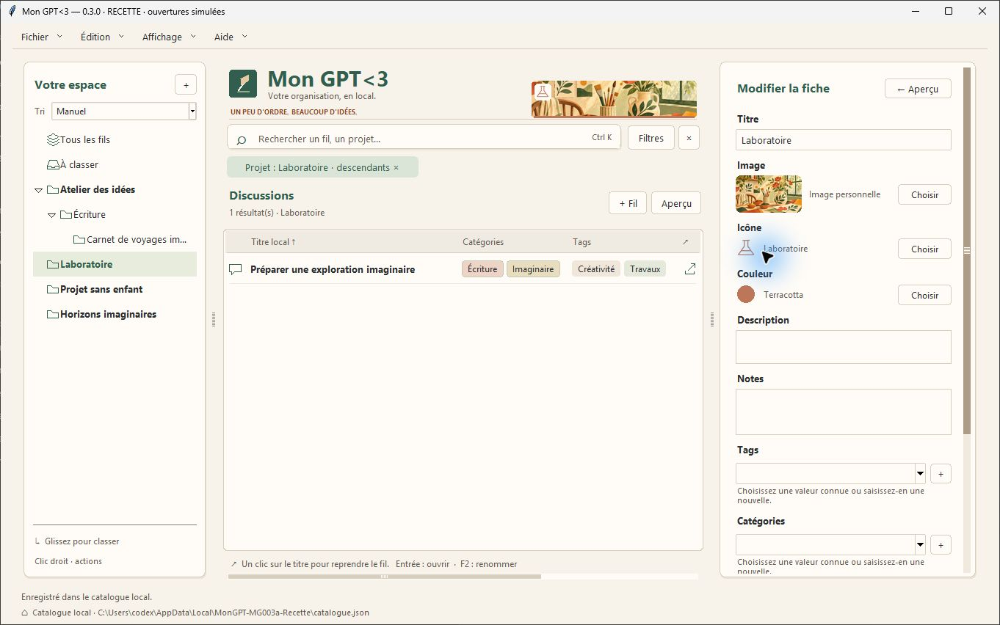
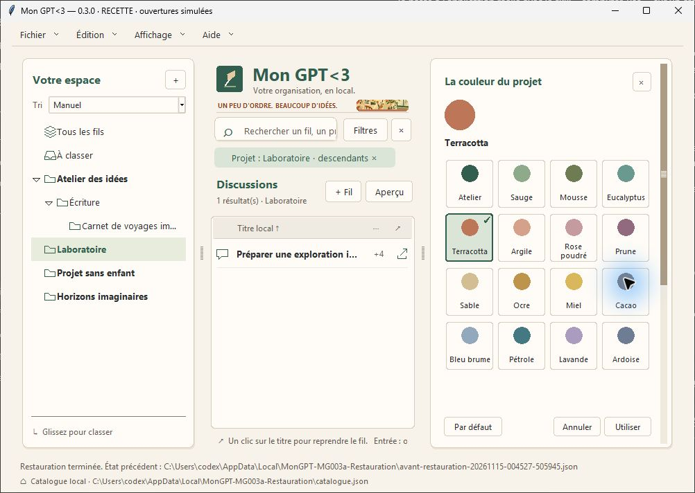

# MG-003a — Identité visuelle des projets

**Mon GPT<3 0.3.0**, livré le 15 novembre 2026 sur CODEX-VM. Base synchronisée en avance rapide depuis `origin/main` (`2fb7bbb`), dépôt initialement propre. Identité projet, héritage, migration et sauvegarde portable réalisés ; validation visuelle laissée à David et GPT. Aucune vue Détaillée/Mosaïque commencée.

## Réalisation

Trois propriétés intégrées à la fiche **projet** : Image, Icône, Couleur. Six illustrations originales locales 1200×675, huit icônes au trait et palette 4×4 de seize nuances. Chaque layer offre prévisualisation, Utiliser, Par défaut, Annuler, croix et Échap. Tab/flèches/Entrée restent utilisables ; la galerie défile en compact et conserve ses actions visibles. Le choix rejoint le brouillon existant ; Enregistrer/Ctrl+S valide toute la fiche, avec les protections `dirty` habituelles. Un Ctrl+S depuis le layer applique aussi sa prévisualisation.

La seule illustration du bandeau devient contextuelle, à sa place et à ses dimensions précédentes. Une petite icône et un trait de couleur l’accompagnent. La résolution unique `identity.resolve_identity` est pure, indépendante de Tk, du stockage et de ChatGPT : projet sélectionné ; pour un fil, projet actif directement rattaché, sinon premier rattachement dans l’ordre existant ; sans projet, paysage neutre. Les fils ne reçoivent aucun sélecteur personnel et leurs liens ne sont pas réécrits.

Les couvertures ont été créées avec le skill **imagegen**, en mode outil intégré, et livrées dans `mon_gpt/assets/covers/`. [Fichiers et prompts exacts](../../docs/illustrations-MG-003a.md). Pas de stock, de maquette recyclée ni d’accès réseau pour afficher la galerie.

## Données et sauvegardes

- Schéma **2** strict : seul ajout générique `visual` ; dictionnaire vide sur les fils. Adaptateur ChatGPT inchangé. Le format 1 strict reste accepté. Une copie exacte `avant-migration-v1-DATE.json` précède toute réécriture du catalogue ancien. Versions futures refusées sans réinitialisation.
- Import réel PNG/JPEG/WebP, y compris vérification du contenu et non de la seule extension. Images fixes, 16 px minimum par côté, 8192 px par côté et 24 Mpx maximum, 20 × 1024² octets maximum ; recommandation 1200×675 annoncée avant sélection. Orientation EXIF corrigée, métadonnées retirées, copie PNG normalisée au plus à 2400 px par côté. L’original n’est pas modifié. Un refus conserve le choix précédent avec une aide pastel.
- Références `asset:<sha256>` et copies dans `<data-dir>/images`, sans dépendance au chemin source. Aucune suppression automatique des ressources : un projet ne peut pas détruire l’image d’un autre. Les copies non référencées après remplacement/annulation restent sur disque, hors export.
- Fichier/Sauvegarder propose un **ZIP complet** : catalogue et toutes les images personnelles actuellement référencées. Les JSON historiques restent restaurables. L’API d’export JSON refuse un catalogue qui utilise des images personnelles plutôt que les oublier silencieusement.
- Restauration : validation avant confirmation, contrôle des noms/chemins, doublons, symlinks, empreintes, contenu et limites ; aucune extraction aveugle. Sauvegarde préalable complète de l’existant (ZIP s’il possède des images, sinon JSON). Ressources immuables installées avant remplacement atomique du catalogue ; un échec laisse les anciennes références intactes. Une ressource existante incohérente bloque la restauration sans écrasement.

## Matrice de recette

Recette native via le skill **computer-use**, uniquement avec `--simulate-open` dans `%LOCALAPPDATA%\MonGPT-MG003a-Recette` puis `MonGPT-MG003a-Restauration`. Les données, originaux fictifs, archives et journaux restent hors Git.

| Cas | Résultat et preuve |
| --- | --- |
| Créer sans personnalisation | **OK réel** : Horizons imaginaires créé avec Ctrl+Maj+P ; couverture fournie immédiatement, aucune saisie d’image imposée. |
| Trois sélecteurs et enregistrement | **OK réel** : Écriture → Voyage / Exploration / Pétrole ; Laboratoire → image personnelle / Laboratoire / Terracotta. Choix enregistrés ensemble par Ctrl+S, bandeau mis à jour immédiatement. |
| Annulation et protection | **OK réel** : changement de couverture puis Échap restitue le choix et le focus ; retour à l’aperçu avec icône non enregistrée déclenche l’avertissement existant ; Annuler garde le brouillon. Retour Par défaut couvert également par test Tk. |
| Héritage | **OK réel** : fil partagé dans Laboratoire → image personnelle ; contexte global → Voyage du premier lien Écriture ; À classer et démarrage sans sélection → paysage neutre. Deux emplacements toujours visibles, aucun doublon de fil. |
| Images personnelles | **OK réel** : PNG puis JPEG puis WebP importés, prévisualisés et enregistrés ; originaux fictifs déplacés, copies relues indépendamment. Image WebP présente dans le nouveau catalogue restauré après fermeture/réouverture. |
| Imports refusés | **OK réel** : faux PNG, fichier de 20 Mo + 1 octet et PNG de 9000 px refusés, couverture précédente intacte. Animation, contenu déguisé et plafond de pixels couverts par tests. |
| Catalogue v1 | **OK réel** au lancement : migration contrôlée, copie préalable identique à l’archive v1 fictive ; comparaison des champs, identifiants, relations, ordre et URL sans perte. Lecture/restauration de JSON historique également testée. |
| Sauvegarde portable | **OK réel** : ZIP créé depuis Fichier, relu puis restauré via l’UI dans un dossier neuf vide. 11 fiches et image référencée identiques au catalogue source ; sauvegarde préalable de l’état vide créée. Sauvegarde préalable ZIP avec images et panne de commit couvertes par tests. |
| Archive corrompue | **OK réel** : empreinte de ressource incorrecte rejetée avant confirmation ; SHA-256 du catalogue identique, aucune écriture ou sauvegarde préalable. Traversées de chemins, doublons, extras et versions futures refusés par tests. |
| Régressions | **OK réel** : recherche « exploration », ouverture simulée par titre puis icône, changement de fil, ordre manuel Alt+↑/↓, glisser gauche d’Horizons vers Écriture, ajout de tag/catégorie puis bouton Enregistrer, fermeture/réouverture d’aperçu. Le tri alphabétique reste couvert par les tests existants. |
| Dimensions | **OK réel** : 1360×820, 1000×680, fenêtre maximisée, aperçu ouvert/fermé ; palette compacte complète et fin de galerie accessible au défilement. Aucune déformation d’image, marque/recherche/colonnes conservées. |

## Vérifications automatiques et périmètre

**80 tests réussis en 70,179 s** : les 65 scénarios existants conservés, plus 15 tests ciblés sur migration, héritage, import réel des trois formats, images partagées, archive portable et relecture, chemins/limites/collisions, rollback et comportements des layers Tk. Les anciennes attentes `schema: 1` ont été adaptées au format 2, sans retirer de scénario. [Journal complet](tests.txt).

`chatgpt.py`, `main_menu.py`, `atelier.py`, `navigation.py`, `inspector.py`, `widgets.py`, `theme.py` et les trois PNG de référence sont inchangés. Dans `build_menus()`, seul le texte À propos a été corrigé : les couvertures ne sont plus annoncées comme non livrées. Commandes, disposition et style des menus conservés. L’éditeur de fils, les messages pastel, les confirmations courtes et la Liste n’ont pas été redessinés. Le socle conserve ses frontières ; le résolveur est réutilisable pour les prochaines vues.

## Captures réelles











## Lancer et limites

Prérequis : Python 3.13 avec Tcl/Tk et **Pillow 13.0.0**, installé et vérifié sur CODEX-VM (JPEG et WebP actifs). Depuis le dépôt : `python -m pip install -r requirements.txt`, une fois. Puis dans PowerShell :

```powershell
& 'C:\Users\codex\Documents\Projets\mon-gpt\lancer.cmd'
```

Les bornes sont explicites : catalogue 10 Mo, ZIP 100 Mo, contenu décompressé 200 Mo, 512 images au maximum. Elles sont vérifiées avant écriture pour éviter de produire un fichier que le lecteur ne peut rouvrir. Le bandeau reste volontairement une petite illustration panoramique : il recadre l’image sans déformer l’original. Les copies inutilisées ne sont pas nettoyées automatiquement. Le glisser droit physique, les autres zooms Windows et Zenith Ice restent à valider ; les doublons d’URL restent hors lot. La validation esthétique vous appartient.
