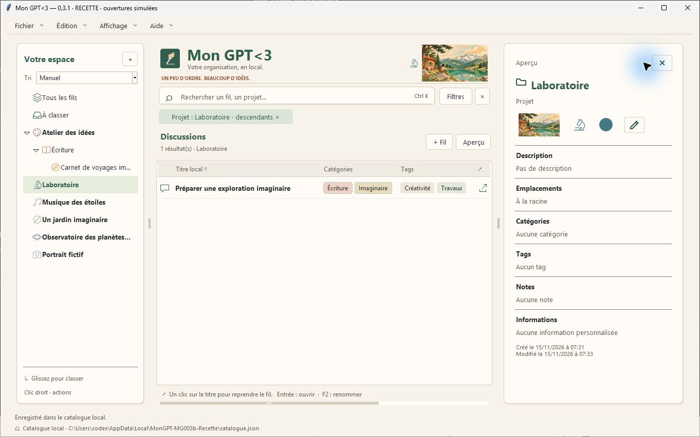
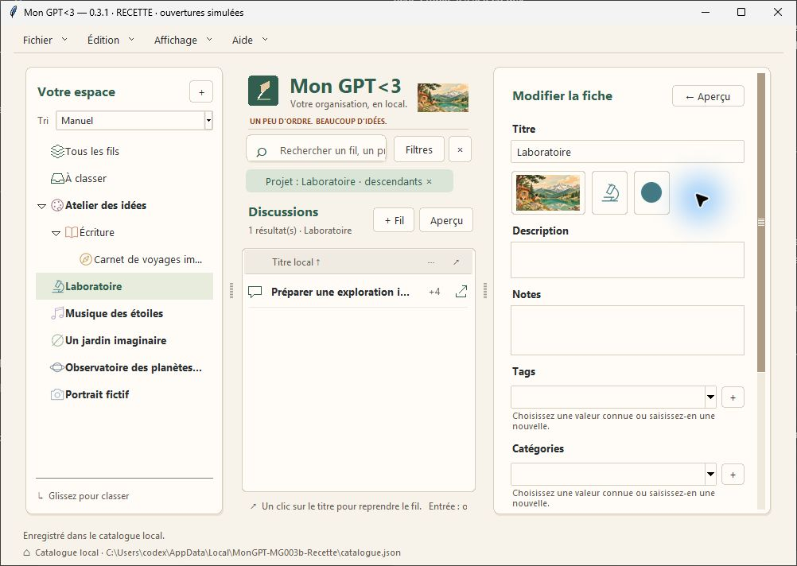
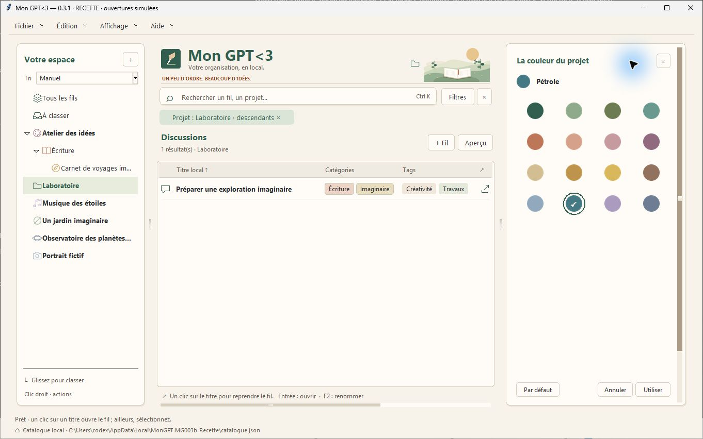
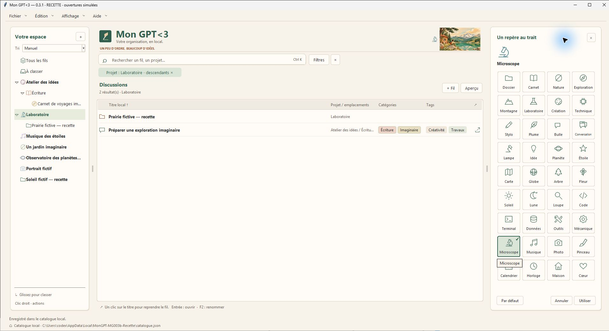
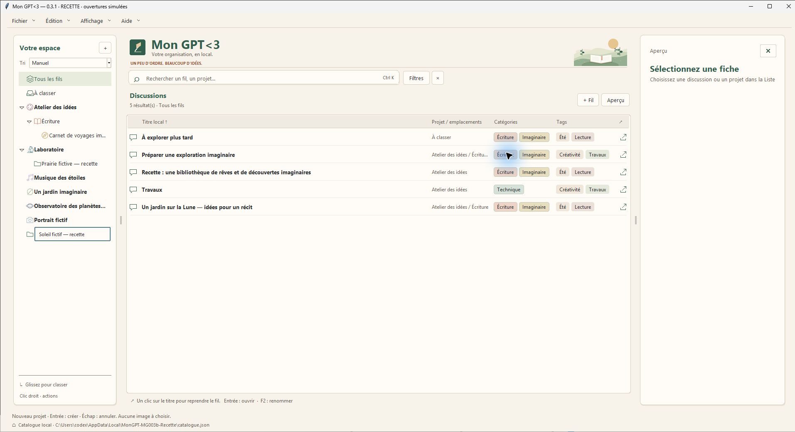

# MG-003b — Corrections visuelles

15 novembre 2026 · Mon GPT<3 **0.3.1** · CODEX-VM / Windows 11, Python 3.13, Tk 8.6, Pillow 13.

Livraison proposée à la recette utilisateur. La validation esthétique reste à David et GPT ; aucune vue Détaillée ou Mosaïque engagée.

## Retour utilisateur et résultat présenté

| Avant, selon la recette MG-003a | Après MG-003b |
| --- | --- |
| Les choix d’icône et de couleur ne se voient pas dans l’arbre. | Chaque projet et sous-projet utilise son pictogramme teinté, conservé dans un cache PhotoImage icône/couleur/taille. Tous les fils et À classer gardent leurs pictogrammes. |
| Les couvertures sont réduites à une bande horizontale recadrée. | La scène entière est contenue dans un cadre 16:9, au plus 128×72. Hauteur du bandeau **80 px inchangée** ; icône à l’extérieur de l’image. |
| Le vrai paysage solaire n’est pas le défaut des nouveaux projets. | Nouvelle illustration locale `pack:soleil`, prairie, soleil, arbres et livre, commune au défaut et à l’état neutre. Aucun choix explicite existant remplacé. |
| Image, Icône, Couleur occupent trois rangées. | Trois petites commandes adjacentes sous le titre ; noms au survol et au focus, activation clavier. Même rangée passive en aperçu projet. |
| Huit icônes et une palette en grandes cartes. | 36 dessins au trait ; huit identifiants historiques conservés. Les mêmes seize teintes en pastilles 4×4 avec sélection et focus. |
| Ancien dossier beige pendant la création. | Même dossier au trait que l’arbre. Le champ tient compte de la profondeur pour laisser l’icône visible aussi pendant la saisie d’un sous-projet. |

## Périmètre et préservation

Synchronisation initiale depuis `origin/main`, sans travail local à écarter. Référence de départ : `042fab6`. Changements de présentation dans `identity_ui.py`, `project_icons.py`, les branchements ciblés de `ui.py` et l’espacement de la rangée projet dans `details.py` ; ajout compatible des repères dans `identity.py`.

`core.py`, `chatgpt.py`, `storage.py`, `images.py`, menu principal, navigation native et ses gestes, recherche, Liste, aperçu des fils, tokens du thème, bandeau de base et structure des colonnes restent inchangés. Le résolveur reste indépendant de Tk, du stockage et de ChatGPT. Schéma 2 inchangé ; aucun système de plugins.

Les six couvertures précédentes et les trois PNG de référence restent intacts. La nouvelle couverture 1200×675 est un dessin original reproductible avec `python -m examples.create_solar_cover`, dans le langage du paysage historique. Aucune photo externe ni duplication des maquettes.

Les layers gardent le brouillon et les commandes existantes : Utiliser applique à la fiche, Annuler/Échap préserve le choix ; Enregistrer/Ctrl+S persiste. Comme en MG-003a, Ctrl+S depuis un layer valide explicitement son choix puis enregistre. Un simple clic de prévisualisation ne modifie pas le catalogue.

## Vérifications automatisées

Commande : `python -m unittest discover -s tests -v`. **86 tests réussis**, dont les **80 tests existants conservés sans modification** et six régressions supplémentaires. [Journal complet](tests.txt).

Les nouveaux tests vérifient les 36 dessins distincts, les seize valeurs hexadécimales inchangées, le cache Tk et la teinte pétrole dans les pixels du Treeview, le maintien après tri/déplacement/collecte mémoire et l’icône inline non masquée. Ils contrôlent aussi les trois commandes sur une rangée aux deux tailles, leurs activations et annulations indépendantes, l’aperçu passif, les pastilles/focus/infobulles et le défilement jusqu’à la dernière icône.

Des images à bandes sur les bords rendent tout recadrage détectable : paysage et portrait conservés, ratio 16:9, aucun appel à `ImageOps.fit` dans le bandeau, absence de superposition, hauteur/menu/recherche inchangés après redimensionnement. Migration v1, anciens choix v2, retour au défaut, réouverture et ZIP avec image personnelle sont également couverts. Les protections de saisie et gestes précédents restent dans la suite historique.

## Recette Windows réelle

Application Tk lancée et pilotée avec Computer Use, souris et clavier, sans maquette ni navigateur simulant l’interface. Catalogue exclusivement fictif : `C:\Users\codex\AppData\Local\MonGPT-MG003b-Recette`, avec `--simulate-open` pour les URL ChatGPT fictives. Aucun autre catalogue consulté ou modifié.

| Geste réellement exécuté | Observation |
| --- | --- |
| Formats 1360×820, 1000×680 et fenêtre agrandie 1920×1032 | Trois contrôles visibles sur une rangée ; la couverture conserve son ratio dans l’espace libre ; gabarit global conservé. |
| Laboratoire → Modifier → microscope, pétrole, montagne → Utiliser et Ctrl+S | Arbre immédiatement mis à jour ; scène de montagne entière dans le bandeau ; trois repères visibles dans l’aperçu. |
| Parcours clavier de la galerie, flèches puis Entrée | Dernières rangées atteintes et défilées ; microscope choisi ; les 36 icônes sont visibles dans la grande fenêtre. |
| Palette puis sélection pétrole ; galerie annulée avec Échap | Seize pastilles rondes ; sélection cochée ; retour à la commande de la fiche sans autre modification. |
| Image → Par défaut → Ctrl+S ; retour à `pack:ecriture` puis à montagne | Prairie solaire réellement enregistrée ; ancien choix explicitement re-sélectionnable ; icône/couleur conservées. |
| Création d’un sous-projet puis d’un projet à la racine avec Entrée | `visual: {}` conservé, image solaire effective. Après correction et relance, icône au trait visible pendant les deux types de saisie. |
| Nouvelle création imbriquée, Échap | Brouillon retiré sans projet résiduel. |
| Écriture / Laboratoire / portrait / fil partagé ; fermeture et réouverture de l’inspecteur ; tri alphabétique | Ancien choix Écriture conservé, portrait complet avec bandes haute/basse visibles et marges latérales ; contexte du fil partagé correct ; aucun ancien paysage superposé. |
| Entrée sur le fil partagé dans la Liste | Ouverture directe simulée journalisée, sans passage par l’éditeur. Deux rattachements et notes communes conservés. |
| Quitter puis relancer | Icône microscope et couleur pétrole conservées dans l’arbre ; image enregistrée et anciens choix retrouvés. |

Après la recette, contrôles des fichiers via les API existantes : archive fictive `reference-MG003b.zip` contenant `catalogue.json` et le PNG personnel référencé ; lecture et restauration dans `MonGPT-MG003b-Restaure`, catalogue et octets d’image identiques. Migration séparée dans `MonGPT-MG003b-v1` : copie préalable strictement identique, champs et liens conservés, tous les projets sans choix explicite résolus vers le soleil. Ces catalogues et le ZIP de recette restent hors Git.

## Cinq captures natives

Les fichiers sont des captures intégrales de la vraie fenêtre, sans retouche ni assemblage. Les premières vues précèdent l’ajout des deux projets fictifs de création.

1. [Navigation, microscope pétrole, montagne entière et aperçu](01-navigation-montagne.png) — 1360×820.
2. [Éditeur : trois commandes côte à côte](02-editeur-compact.png) — 1000×680.
3. [Palette ronde 4×4](03-palette.png) — seize nuances conservées.
4. [Bibliothèque des 36 icônes](04-icones.png) — grande fenêtre ; infobulle du focus microscope.
5. [Création inline sans dossier beige, paysage solaire neutre](05-creation-soleil.png).











## Limites et lancement

Le bandeau a une hauteur fixe : sa couverture reste petite (128×72 au format confortable, plus petite quand le centre est étroit). Les portraits ont volontairement des marges. Les contrôles Canvas sont utilisables au clavier, mais la restitution par lecteur d’écran n’a pas été qualifiée ; autres DPI/écrans physiques non testés. Le geste physique du glisser droit reste la réserve historique ; ses gestionnaires et le menu équivalent restent testés. Aucun nouveau stockage ni nouvelle vue.

Lancement normal depuis PowerShell :

```powershell
& 'C:\Users\codex\Documents\Projets\mon-gpt\lancer.cmd'
```

Lancement du seul jeu de recette :

```powershell
python -m mon_gpt --data-dir "$env:LOCALAPPDATA\MonGPT-MG003b-Recette" --simulate-open
```
