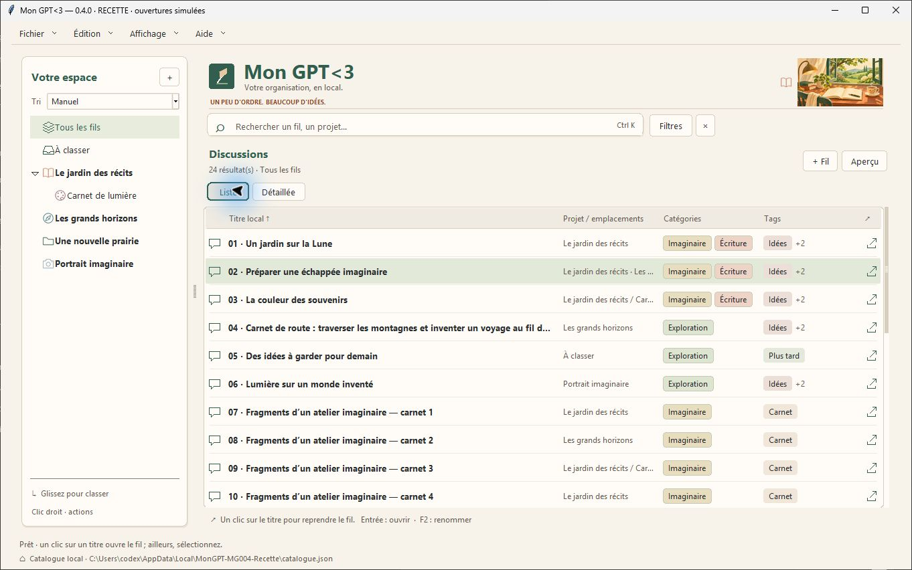
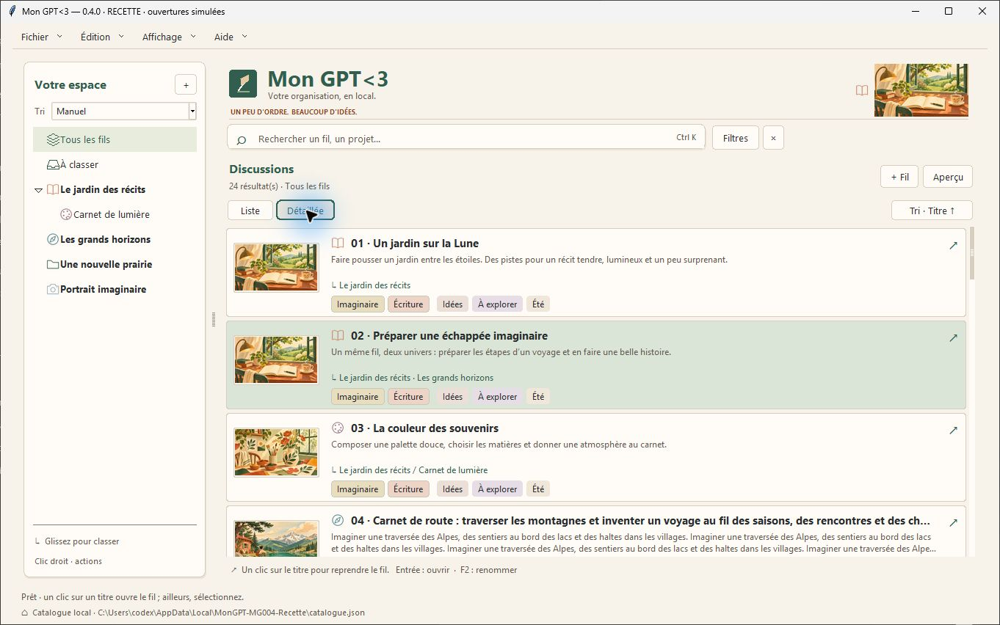
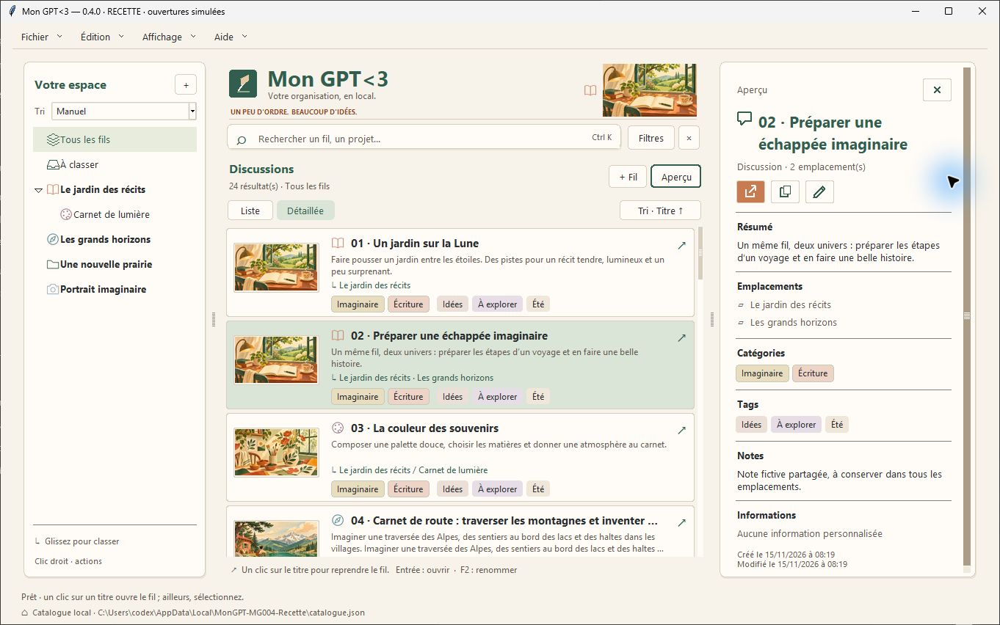
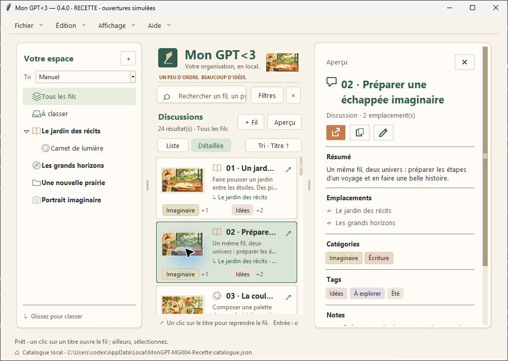
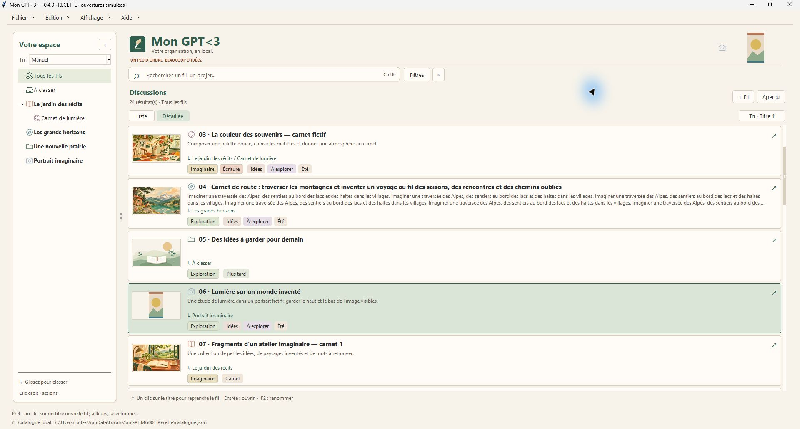

# MG-004 — Vue Détaillée

Mon GPT<3 **0.4.0** · 15 novembre 2026 · CODEX-VM / Windows 11, Python 3.13, Tk 8.6, Pillow 13.

Livraison prête pour la recette de David et GPT. La validation graphique reste à l’utilisateur. **Mosaïque n’est pas commencée.**

## Présentation livrée

Liste et Détaillée sont deux rendus du même composant de résultats. La Liste conserve ses lignes de 42 px, colonnes, hitboxes, tri et défilement horizontal historiques. Détaillée présente des cartes de 126 px, séparées par un peu d’ivoire : couverture entière 112×63 (80×45 en petite largeur), icône colorée, titre affirmé, extrait sur deux lignes au maximum, emplacements et pastilles. L’image est contenue, jamais recadrée ; le portrait conserve des marges. Un résumé vide ne produit pas de texte répétitif.

Le commutateur **Liste | Détaillée** occupe une petite rangée sous l’en-tête central. Le mode actif est teinté sauge. Les deux commandes existent également dans Affichage, sans redessiner la barre validée. Détaillée remplace les en-têtes de colonnes par un petit bouton **Tri**, reprenant les quatre tris existants ; un second choix du même tri inverse son sens. Aucun raccourci supplémentaire.

Le titre et ↗ ouvrent un fil. La vignette, les pastilles et le reste de la carte sélectionnent seulement. Double-clic et Entrée gardent le comportement existant ; les projets n’ont pas de lien ChatGPT et Entrée/double-clic navigue vers leur périmètre. Le survol donne accès au titre, au résumé et aux repères complets ; les flèches et le focus d’action restent disponibles. En compact, les pastilles exploitent aussi l’espace sous l’image et peuvent se replier en `+N`.

## Architecture et préservation

Départ synchronisé proprement sur `origin/main` au commit de mission `c9a3103`, sans travail local à écarter. La base MG-003b était `349a882`.

`results.ResultsView` hérite de l’API de `CatalogList`. Les branches Liste délèguent aux méthodes d’origine ; **`atelier.py` n’a pas changé**. Une seule collection de lignes et un seul widget conservent les identités, événements, menus contextuels et DnD. La bascule conserve les filtres, le périmètre, l’ordre, la sélection et l’inspecteur, y compris son brouillon non enregistré ; le renommage inline est repositionné sans perdre sa saisie.

`ui.refresh_results` conserve l’unique recherche et tri existants. Il transmet le résumé et `resolve_identity(catalog, record_id, scope)` au rendu. Le composant ne connaît ni URL, ni catalogue, ni mutation. Les PhotoImage de couvertures visibles sont retenues dans un cache LRU de 192 entrées référence/taille ; le cache d’icônes existant est réutilisé. Les survols ne redécodent pas les images déjà affichées.

`interface.json` reste en version 1 et accepte `view: list` ou `detail`. Le mode choisi est sauvegardé à la fermeture ; un ancien fichier `list` reste accepté et une valeur inconnue produit un repli sûr avec avertissement. Recherche et filtres restent des états de session. **Catalogue schéma 2, cœur générique, adaptateur ChatGPT, résolveur, images/imports, migration et ZIP inchangés.** Pas de nouveau framework, thème ou couverture de production ; maquettes PNG intactes.

## Vérifications

Commande : `python -m unittest discover -s tests -v`.

**92 tests réussis : les 86 tests existants conservés sans modification, plus six tests ciblés MG-004.** [Journal complet](tests.txt).

Ils vérifient : bascule avec recherche/tag/catégorie/périmètre/tri/sélection et brouillon ; héritage selon les deux contextes et absence de doublon ; portrait à bandes conservé jusque sur ses bords ; cache sans décodage au survol ; sélection par image/pastilles/espace, ouverture par titre et Entrée ; tailles, défilement, clavier, texte intégral et état vide ; projets, menu contextuel, renommage entre vues et déplacement conservant les autres liens ; préférences anciennes/nouvelles/inconnues et restauration du mode. Les contrats historiques Liste, menus, sauvegarde et protections restent testés.

## Recette dans la vraie application

Catalogue exclusivement fictif `C:\Users\codex\AppData\Local\MonGPT-MG004-Recette`, créé par `examples.create_detail_demo` (refus de remplacer un catalogue existant). Cinq projets, dont un sous-projet, trois univers de galerie, un projet au défaut solaire et un portrait synthétique. Six fils de cas particuliers — partagé, non classé, titre long, résumé long, résumé vide, portrait — complétés par 18 fils pour vérifier le défilement. Aucun catalogue utilisateur touché ou versionné.

Application Tk réellement exécutée et pilotée avec Computer Use. Les ouvertures passent par `--simulate-open`, sans navigateur réel.

| Parcours exécuté | Résultat observé |
| --- | --- |
| Liste → Détaillée → Liste → Détaillée, même fil partagé sélectionné | Même collection de 24 fils, même recherche et périmètre, même sélection ; différence de densité immédiatement visible dans les deux captures comparatives. |
| Clic sur vignette puis titre, ↗, Entrée et double-clic sur vignette | Vignette seule : sélection. **Exactement quatre lignes** dans `ouvertures-recette.log`, toutes pour l’URL fictive du fil 02 : une par geste d’ouverture. |
| Sélection depuis Tous les fils, puis Les grands horizons et Carnet de lumière | Univers Écriture en global, Montagne dans le second rattachement, puis Création après déplacement vers le sous-projet. Une seule fiche à chaque contexte. |
| Glisser gauche du fil partagé depuis sa couverture vers Carnet de lumière, puis retour vers Les grands horizons | Seul le lien du contexte de départ change. Les deux liens initiaux sont rétablis à la fin ; notes communes inchangées, contrôlées dans le catalogue. |
| Menu droit → Renommer, saisie puis Entrée ; F2 puis Échap | Renommage enregistré et retrouvé en aperçu ; seconde saisie annulée sans changement. |
| Filtre Tag Idées + recherche « couleur », bascules, inversion du tri | Même résultat et même sélection dans les deux vues ; recherche et tag conservés ; direction du tri mise à jour. |
| Catégorie Imaginaire choisie dans les suggestions | Pastille de catégorie active, sept résultats du sous-projet conservés, sans recréation de fiche. |
| Modification du titre dans l’éditeur, retour vers l’aperçu puis Non | Protection « Modifications en cours » affichée ; seul le brouillon fictif est abandonné, titre enregistré conservé. |
| Ctrl+K, recherche introuvable puis effacement | Aucun résultat et aucune carte fantôme ; retour aux résultats existants. |
| Recherche du projet Carnet de lumière dans le périmètre parent, clic sur sa couverture puis Entrée | Couverture et icône propres au projet, aucune action ↗ ; navigation vers le sous-projet, aucune ouverture ChatGPT. |
| Ctrl+N/Échap, Ctrl+Maj+P/Échap | Créations intégrées disponibles, icône inline au trait, aucun enregistrement résiduel. |
| Formats 1360×820, 1000×680 et maximisé 1920×1032, inspecteur affiché/masqué, défilement | Couvertures visibles, scrollbar verticale, sélection et aperçu utilisables. Portrait entier avec bandes haute/basse et marges ; soleil pour le fil non classé. |
| Deux fermetures/relances avec Détaillée choisie | `view: detail` restauré, y compris en compact avec inspecteur affiché. Ancien `view: list` et valeur inconnue vérifiés par les tests. |

Contrôle final des données fictives : 29 objets dont 24 fils uniques, deux rattachements initiaux du fil partagé et notes conservés, aucun titre « brouillon » persistant. Les gestes existants de recherche, classement, éditeur et ouverture utilisent toujours les mêmes opérations.

## Captures natives comparatives

Captures intégrales de la vraie fenêtre, sans retouche ni assemblage. Les captures 1, 2 et 3 précèdent le renommage de recette et montrent les mêmes données, le même contexte et le même fil sélectionné. Les captures 4 et 5 suivent les gestes de recette.

1. [Liste, 1360×820, aperçu fermé](01-liste.png).
2. [Détaillée, même contexte et sélection](02-detaillee.png).
3. [Détaillée avec aperçu du fil partagé](03-detaillee-apercu.png).
4. [Détaillée compacte, 1000×680 avec aperçu](04-detaillee-compacte.png).
5. [Grande fenêtre : montagne, défaut solaire et portrait entier](05-detaillee-portraits-soleil.png).











## Limites et lancement

Le format compact avec inspecteur réduit fortement l’espace central : titres et emplacements sont écourtés, pastilles excédentaires en `+N`, texte complet au survol. Les couvertures restent petites et les portraits ont volontairement des marges. Le déplacement physique par glisser droit conserve sa réserve historique ; ses gestionnaires et son menu équivalent restent disponibles et testés. Lecteurs d’écran, autres DPI et catalogues massifs de plusieurs milliers d’objets non qualifiés ; recette native sur 24 fils, tests sur 30. Aucune capacité connue supprimée en Détaillée ; validation visuelle utilisateur attendue.

Lancement normal depuis PowerShell :

```powershell
& 'C:\Users\codex\Documents\Projets\mon-gpt\lancer.cmd'
```

Rejouer la recette dans le catalogue fictif déjà créé :

```powershell
python -m mon_gpt --data-dir "$env:LOCALAPPDATA\MonGPT-MG004-Recette" --simulate-open
```

Pour un nouveau jeu fictif, `python -m examples.create_detail_demo <dossier-neuf>`.
