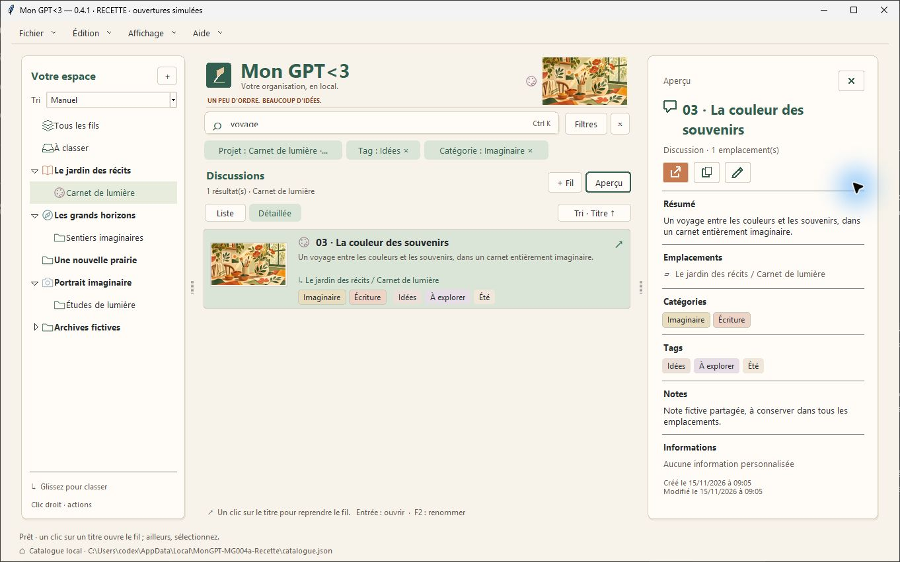
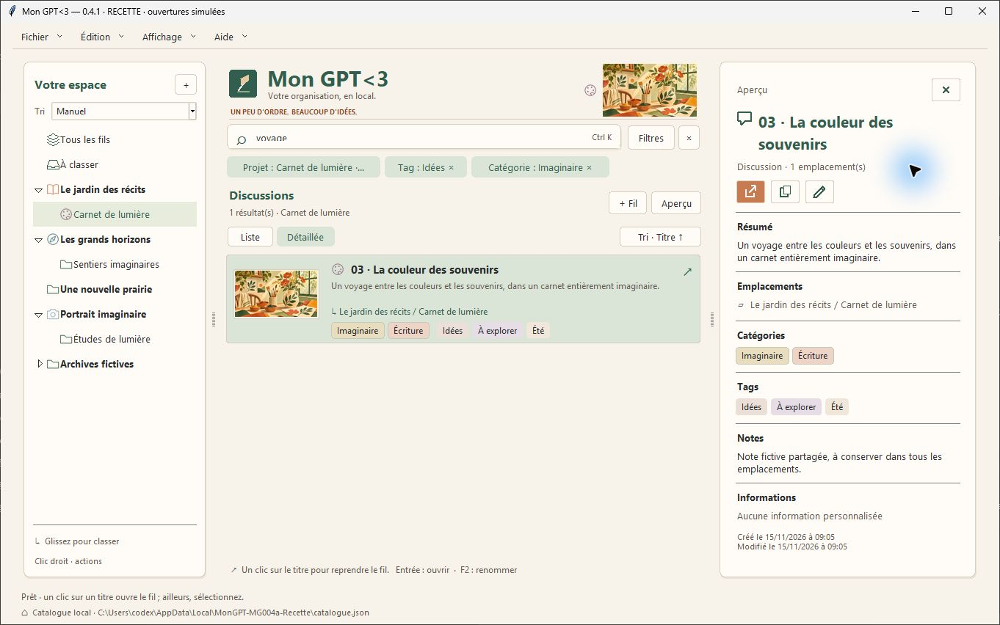
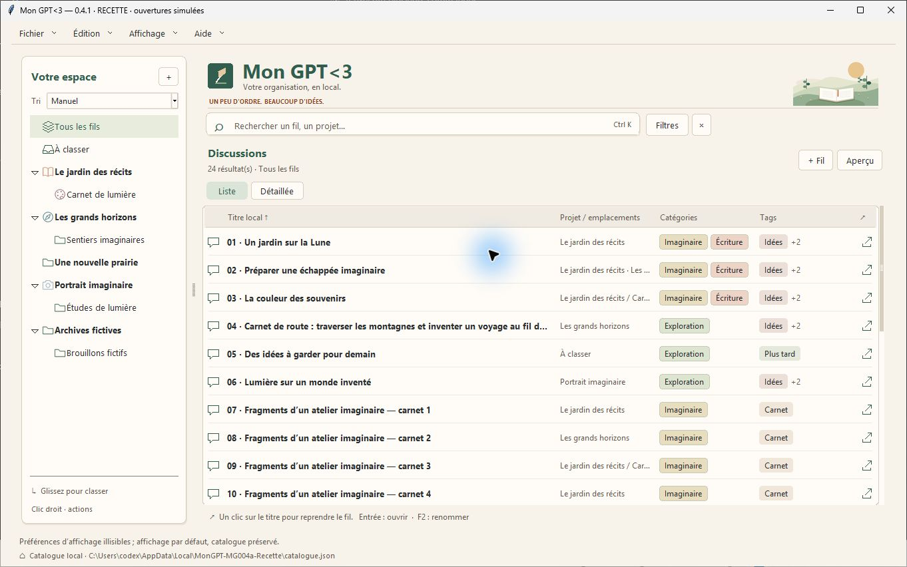

# MG-004a — Reprendre là où j’en étais

Mon GPT<3 **0.4.1** · 15 novembre 2026 · CODEX-VM, Windows 11 / Python 3.13 / Tk 8.6.

La fermeture normale mémorise désormais recherche, tag, catégorie, périmètre de gauche, branches ouvertes et sélection centrale, avec la vue, la géométrie et l’état de l’inspecteur. La relance retrouve l’aperçu **en lecture seule**, sans ouvrir de discussion. Livraison soumise à la recette utilisateur ; aucune Mosaïque développée.

## Réalisation et préservation

Synchronisation depuis `origin/main` au commit de mission `4e1f8c2`, dépôt initialement propre. Changements fonctionnels concentrés dans `ui_state.py` et `ui.py` ; les rendus, menus, recherche métier, gestes, couvertures, stockage et catalogue schéma 2 ne changent pas.

`interface.json` reste en version 1. Les anciens fichiers à quatre propriétés sont acceptés sans avertissement. Les nouveaux champs sont optionnels et validés : types, limites de texte, taille de fichier, UUID locaux, branches uniques et modes explicitement admis (`list`, `detail`). Une structure mal formée, trop profonde ou trop volumineuse est refusée avant application.

La reprise applique critères et branches, remplit les résultats, puis restaure seulement une fiche visible. Une garde neutralise les événements de sélection initiaux ; projet et résultat sont ensuite rendus visibles. L’ensemble « toutes les branches fermées » est distingué d’un premier lancement. Aucun clic programmatique, appel à `open_thread` ou écriture dans le journal d’ouverture au démarrage.

Préférences corrompues, vue inconnue ou référence de périmètre/fiche absente : retour aux défauts complets et message discret dans le statut. Fiche existante mais exclue par les critères : critères conservés, sélection et aperçu vides. Les anciennes références de branches absentes sont ignorées. Seuls les ancêtres nécessaires pour rendre le projet sélectionné atteignable peuvent être ouverts.

L’écriture atomique intervient toujours **après `can_leave()`**. Annuler la fermeture ne touche pas aux préférences. Un brouillon d’édition n’est pas sérialisé. Aucun champ ajouté au catalogue, aucune URL/notes/image dans les propriétés de sélection ; ces préférences restent hors ZIP métier.

## Vérifications

`python -m unittest discover -s tests -v` : **100 tests réussis**, dont les **92 existants conservés sans modification** et huit tests MG-004a. [Journal complet](tests.txt).

Nouveaux contrôles : ancien format, lecture/écriture et limites, types invalides et JSON trop profond, échec d’écriture sans remplacement, reprise Liste/Détaillée avec critères/scope/sélection/aperçu, branches toutes fermées après rafraîchissement, visibilité du résultat restauré, références périmées, sélection exclue, état vide, À classer, protection de fermeture et réouverture en lecture seule. Les mocks d’ouverture ne reçoivent aucun appel au démarrage ; les octets du catalogue restent identiques.

## Recette Windows réelle

Catalogue isolé et entièrement fictif : `C:\Users\codex\AppData\Local\MonGPT-MG004a-Recette`, 24 fils et neuf projets/sous-projets. Application réellement lancée avec `--simulate-open`, fermée et relancée pour chaque cas ci-dessous. Aucun autre catalogue utilisé.

| Parcours réel | Résultat |
| --- | --- |
| Fichier historique `version/view/inspector/geometry` | Démarrage en Détaillée, sans avertissement ; nouvel espace aux défauts. |
| Sous-projet Carnet de lumière ; recherche `voyage`, tag Idées, catégorie Imaginaire ; fil 03 sélectionné ; aperçu ouvert | Après fermeture/relance : même résultat, même fiche et aperçu, même illustration héritée. Archives reste repliée ; Les grands horizons et Portrait imaginaire gardent leurs branches ouvertes. |
| Passage en Liste, aperçu fermé, fermeture/relance | Même périmètre, recherche, filtres et sélection, vue Liste restaurée et inspecteur fermé. Réouvrir l’aperçu montre bien la fiche restaurée. |
| Brouillon de titre, Alt+F4 puis Annuler | Fenêtre et brouillon conservés ; empreinte SHA-256 d’`interface.json` strictement inchangée. |
| Nouvelle fermeture, Non pour abandonner le brouillon, puis relance | Dernier état valide restauré ; aperçu en lecture seule, titre enregistré intact. |
| JSON volontairement corrompu, vue `mosaic` inconnue, tag de type liste | À chaque relance : Liste par défaut, Tous les fils, aucun filtre/sélection, inspecteur fermé, statut discret, aucun dialogue intrusif. |
| UUID de périmètre absent du catalogue | Même repli sûr, aucun projet fantôme. Aucune suppression métier nécessaire pour simuler une référence périmée. |
| Fiche enregistrée encore présente, recherche ne donnant aucun résultat | Critères et branche conservés, résultat vide, aucune sélection, aperçu « Sélectionnez une fiche ». |
| Clic explicite sur le titre après la première reprise | Une seule ouverture simulée ; après tous les redémarrages, le journal contient toujours **exactement cette unique ouverture explicite**. |

Contrôles de fichiers : catalogue final **identique octet pour octet** à celui d’avant recette ; aucun titre brouillon enregistré. Le démarrage avec JSON corrompu ne remplace ni ce JSON ni le catalogue. Seule une fermeture acceptée écrit l’état courant. Le dernier état valide a été rétabli dans le dossier fictif et la fenêtre laissée en Liste avec recherche, filtres et aperçu correspondants.

## Trois captures natives

Sans retouche ni assemblage, même catalogue et même contexte pour les deux premières :

1. [Avant fermeture — Détaillée, sous-projet, trois critères, aperçu](01-avant-fermeture.png).
2. [Après redémarrage — même lieu, même résultat, même aperçu](02-apres-redemarrage.png).
3. [Préférences corrompues — défauts et statut discret](03-preferences-corrompues.png).







## Limites et lancement

Ce lot mémorise les états demandés, pas les brouillons, le tri, les séparateurs ni la position exacte de défilement : la sélection restaurée est rendue visible. Les limites de lecture sont 256 Kio, 4096 caractères de recherche, 1024 par filtre et 4096 branches. Les réserves historiques de DPI/lecteurs d’écran et glisser droit physique ne changent pas.

```powershell
& 'C:\Users\codex\Documents\Projets\mon-gpt\lancer.cmd'
```

Recette fictive déjà préparée : `python -m mon_gpt --data-dir "$env:LOCALAPPDATA\MonGPT-MG004a-Recette" --simulate-open`.
