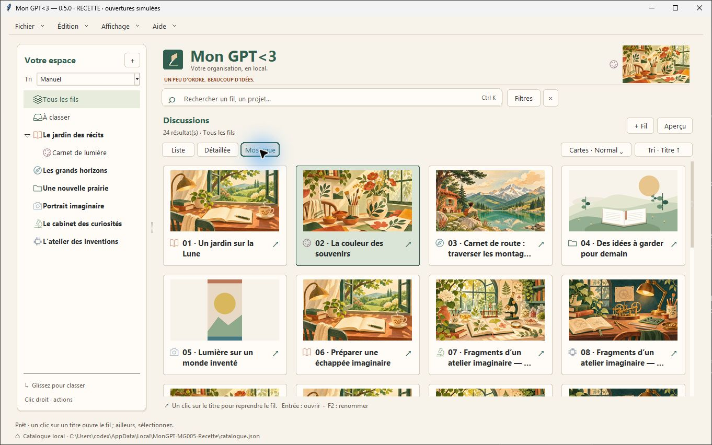
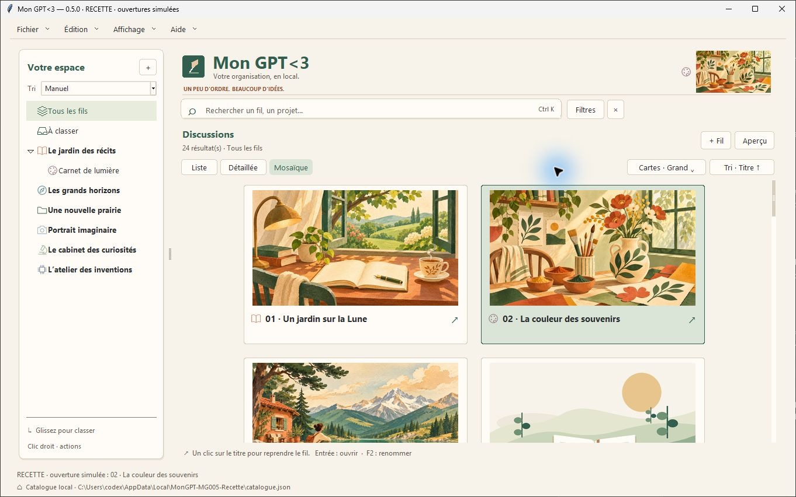

# MG-005 — Vue Mosaïque

Mon GPT<3 **0.5.0** · 15 novembre 2026 · CODEX-VM, Windows 11 / Python 3.13 / Tk 8.6.

La troisième vue est une grille de couvertures entières, avec deux tailles Normal/Grand. Sur chaque carte : image, icône colorée, titre sur deux lignes au plus et ↗ pour les fils. Aucun chemin, description, date, URL ou ensemble de badges sur la face. Livraison soumise à la validation visuelle de David.

## Réalisation

Dépôt initialement propre, synchronisé en avance rapide jusqu’au commit de mission `2c4c3e8`. Les dessins et hitboxes Liste/Détaillée sont conservés. `mosaic.py` isole géométrie responsive et rendu ; les trois vues utilisent les mêmes résultats, UUID, sélection et orchestration d’actions. Aucun changement du moteur métier, de ChatGPT, du résolveur d’identité, des imports, du schéma 2, de la migration ou des sauvegardes ZIP. Les maquettes et illustrations existantes sont intactes ; aucune image de production ajoutée.

En confortable sans aperçu : quatre colonnes Normal, cartes d’environ 240 px et couvertures 208×117 ; deux colonnes Grand, cartes 384 px et couvertures 352×198. En maximisé, Grand affiche quatre colonnes. Les images portrait sont contenues avec marges, sans étirement ni recadrage. Cache LRU existant limité à 192 références/tailles et dessin des seules cartes visibles.

Le sélecteur Normal/Grand n’apparaît qu’en Mosaïque. En largeur réduite, ses contrôles occupent une seconde ligne dans l’en-tête central ; les trois boutons de vue restent accessibles. Le Tri de Détaillée s’abrège en « Tri » quand nécessaire pour accueillir le troisième bouton. Bandeau, recherche, marges, arbre, menu et panneau droit gardent leur géométrie. Un renommage Mosaïque actualise également le titre de l’aperçu en lecture seule.

`interface.json` reste en version 1 : `view` accepte aussi `mosaic`, et `mosaic_size` accepte `normal|large`, avec défaut `normal` pour les anciens fichiers. Les critères et la sélection reprennent le mécanisme MG-004a, sans ouverture automatique ni champ métier supplémentaire.

## Vérifications automatisées

`python -m unittest discover -s tests -v` : **108 tests réussis**. [Journal complet](tests.txt).

Les 100 tests MG-004a sont conservés ; seules deux valeurs de test « vue inconnue » passent de `mosaic` à `future`, puisque Mosaïque devient valide. Huit tests supplémentaires couvrent géométrie/tailles/espaces vides, hitboxes par colonne et ouvertures uniques, quatre flèches et visibilité, F2/Menu/annulation/aperçu actualisé, filtres et héritage multirattaché, bascule avec brouillon intact, DnD/refus, préférences et fermeture/réouverture sans appel d’ouverture.

Le contrôle de rendu utilise aussi 2 000 résultats synthétiques : seules les cartes visibles sont dessinées, le cache reste borné et un nouveau dessin sans changement de taille n’ouvre pas à nouveau les images. Les tests contrôlent le portrait entier, le ratio 16:9 et l’absence de métadonnées sur les faces. Les tests existants de stockage, migration, ZIP et frontières d’architecture restent réussis.

## Recette Windows réelle

Application Tk native lancée avec `--simulate-open` dans `C:\Users\codex\AppData\Local\MonGPT-MG005-Recette`. Catalogue entièrement fictif : **7 projets/sous-projets et 24 fils**, dont un non classé, un fil partagé, un titre long, un résumé vide, un portrait personnel PNG et des imports JPEG/WebP issus des illustrations locales existantes. Les captures sont des fenêtres réellement exécutées, sans retouche ni reconstruction.

| Parcours | Résultat observé |
| --- | --- |
| Liste → Détaillée → Mosaïque sur les mêmes 24 fils | Même sélection et ordre ; présentation nettement différente. Nouvelle bascule avec projet, recherche, tag/catégorie et aperçu : critères et fiche conservés. |
| Image, titre, ↗, Entrée et double-clic | Image : sélection seule. Les quatre gestes d’ouverture produisent exactement quatre lignes au journal simulé, une par geste. |
| Carte projet, puis Entrée | Navigation dans Carnet de lumière, sans navigateur ni ligne supplémentaire au journal. |
| Quatre flèches, molette, titre long au survol | Parcours entre colonnes/rangées, sélection rendue visible, titre complet accessible. |
| Normal/Grand ; 1360×820, 1000×680 et maximisé ; aperçu ouvert/fermé | Colonnes recalculées, sélection et zones d’action cohérentes ; une colonne avec aperçu en compact. Pas de défilement horizontal en Mosaïque. |
| F2, Échap ; clic droit Renommer ; validation puis rétablissement | Saisie visible dans la carte, annulation sans modification, titre et aperçu actualisés après validation. |
| Ctrl+N puis Échap ; Ctrl+Maj+P puis Échap | Créations intégrées accessibles, aucun fil/projet fantôme. |
| Fil partagé déplacé depuis la deuxième colonne vers Carnet de lumière | Seul le lien du périmètre de départ change ; autre lien, UUID et notes conservés. |
| Dépose du même fil sur Tous les fils | Cible interdite refusée sans écriture. |
| Clic droit → Déplacer, choix du lien actif et destination initiale | Rattachements d’origine rétablis par le menu équivalent. |
| Projet Carnet de lumière + recherche `couleur` + tag Idées + catégorie Imaginaire + fil 02 + aperçu + Grand ; fermeture Alt+F4 et relance | Même état en compact, même branche et aperçu en lecture seule, taille Grand restaurée. Journal toujours à quatre lignes : zéro ouverture automatique. |
| Recherche sans résultat | Message vide sobre, aucune carte fantôme ; critères modifiables normalement. |

Après rétablissement, comparaison complète avec le catalogue fictif initial : toutes les données sont identiques hors dates `modified` dues aux renommages et transferts normaux. Aucun catalogue utilisateur ni export de données utilisateur n’a été utilisé ou versionné.

## Captures natives

1. [Mosaïque Normal, confortable, mêmes 24 fils](01-mosaique-normale.png).
2. [Mosaïque Grand, même sélection et résultats](02-mosaique-grand.png).
3. [Compact avec aperçu, après fermeture et relance](03-compact-apercu.png).
4. [Grand maximisé : plusieurs univers, portrait entier et défaut solaire](04-grand-plusieurs-univers.png).
5. [Détaillée : même catalogue et sélection que les captures 1 et 2](05-detaillee-comparaison.png).





## Limites et lancement

En centre très étroit, Normal et Grand convergent vers la largeur physiquement disponible. La position exacte du scroll et le tri ne sont pas de nouvelles préférences ; la sélection restaurée est rendue visible. Le glisser droit physique et l’anomalie historique de doublons d’URL restent hors mission ; le menu Déplacer équivalent est testé. Les 2 000 résultats concernent le widget en test, sans prétendre à une mesure de performances métier massive. Accessibilité lecteur d’écran et autres zooms Windows non évalués. La validation esthétique appartient à David.

Lancement normal depuis PowerShell :

```powershell
& 'C:\Users\codex\Documents\Projets\mon-gpt\lancer.cmd'
```

Reprendre la recette fictive depuis le dépôt :

```powershell
python -m mon_gpt --data-dir 'C:\Users\codex\AppData\Local\MonGPT-MG005-Recette' --simulate-open
```
