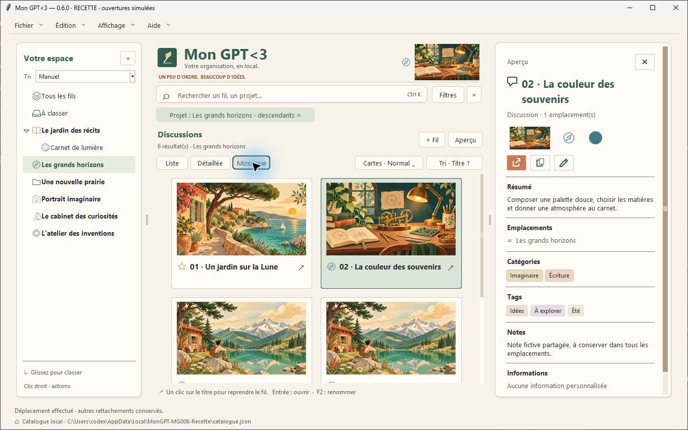

# MG-006 — Personnalisation graphique des fils

Mon GPT<3 **0.6.0** · 15 novembre 2026 · CODEX-VM, Windows 11 / Python 3.13 / Tk 8.6.

Les discussions disposent des **mêmes trois commandes Image, Icône, Couleur que les projets**, dans la même rangée compacte sous le titre. Chaque propriété est personnelle ou héritée indépendamment. Les trois vues, le bandeau et le petit repère de l’aperçu exploitent la combinaison effective. Livraison soumise à la validation utilisateur.

## Réutilisation et périmètre

Dépôt initialement propre, synchronisé en avance rapide sur la mission `e90a566`. `ProjectVisualFields`, `ProjectVisualStrip`, `IdentityControl`, `VisualLayer` et les caches existants sont réutilisés par paramétrage. **Aucune nouvelle galerie, palette, icône, illustration ou bibliothèque graphique.** Aucun changement des préférences, URL, moteur de classement ou géométrie des trois vues.

Pour les fils, les contrôles affichent les valeurs effectives ; les infobulles indiquent Personnalisée ou Héritée du projet/du défaut. Le sélecteur existant propose **Revenir à l’héritage** : la propriété reprend immédiatement sa base en prévisualisation, puis Utiliser confirme seulement ce choix dans le brouillon. Enregistrer/Ctrl+S reste nécessaire ; Annuler/Échap ne change pas le choix précédent. Les projets conservent Par défaut et leur présentation.

L’aperçu réutilise la même petite bande en lecture seule, sur une ligne au-dessus des trois actions afin qu’elles restent accessibles en compact. Le seul ajustement du dessin de Liste remplace sa bulle historique par l’icône effective au même emplacement, sans élargir la ligne ni changer les hitboxes. Détaillée et Mosaïque restent graphiquement inchangées.

La base d’héritage suit la règle existante : projet actif si lien direct, sinon premier rattachement, sinon défaut solaire. Les surcharges sont appliquées clé par clé, sans copie des valeurs héritées dans les fiches. Une sélection personnelle égale à la valeur actuelle du projet reste personnelle. Le résolveur demeure pur, sans Tk, stockage ou ChatGPT.

Les tests ont révélé qu’une édition de fil pouvait réordonner ses emplacements selon l’ordre alphabétique de la liste de saisie. La sauvegarde conserve maintenant l’ordre des liens existants encore choisis et ajoute les nouveaux après eux ; un simple choix d’image ne change donc pas le projet de référence dans Tous les fils. Aucune règle de transfert métier modifiée.

## Format et sauvegardes

Évolution explicite au **schéma 3**. `visual: {}` signifie héritage complet pour les fils ; seules les clés locales image/icon/color sont persistées. Même validation d’identifiants que pour les projets ; clés, valeurs et formats inconnus refusés. Le format v2 reste strict et refuse une surcharge de fil sous un numéro de version ancien.

Migration directe des v1/v2 valides, avec copie fidèle préalable `avant-migration-v1-DATE.json` ou `avant-migration-v2-DATE.json`. Une copie refusée empêche la réécriture. Le v3 n’est pas destiné aux anciennes versions de l’application ; la copie préalable permet de retrouver le catalogue antérieur avec celles-ci. Les versions futures restent refusées sans effacement.

`image_references` parcourt désormais les projets **et les fils**. Le même gestionnaire valide et transporte les copies locales immuables dans les ZIP complets, même si une image n’est utilisée que par un fil. Les anciens JSON v1/v2 et ZIP v2 restent restaurables. Un export JSON incomplet, une image absente/corrompue ou une collision incohérente est refusé ; aucune suppression automatique d’asset partagé.

## Tests

`python -m unittest discover -s tests -v` : **117 tests réussis**, dont les **108 tests existants** et neuf tests MG-006. [Journal complet](tests.txt).

Adaptations des anciennes attentes : numéro de schéma écrit, conservation du refus des surcharges en v2, et deux assertions UI qui interdisaient auparavant la bande visuelle sur un fil. Aucun scénario existant retiré.

Nouveaux cas : surcharges partielles et complètes ; valeur explicite égale à l’héritage ; projet actif/premier lien/déplacement/À classer ; pureté ; migration v1/v2 et copie refusée ; validation stricte ; images propres aux fils PNG/JPEG/WebP, original retiré et ZIP neuf ; ancien ZIP v2 et archives incomplètes/corrompues ; contrôles partagés, retour indépendant à l’héritage, annulation et brouillon ; sauvegarde, aperçu, trois vues, bandeau et relance sans ouverture. Le test Liste contrôle aussi l’image **réellement dessinée**, au-delà des seules données du widget.

## Recette Windows réelle

Catalogues exclusivement fictifs dans `C:\Users\codex\AppData\Local\MonGPT-MG006-Recette` et les dossiers voisins `MonGPT-MG006-Restaure`, `MonGPT-MG006-AncienV1`, `MonGPT-MG006-AncienZIP`. Base réelle de recette v2 : **7 projets et 24 fils**, dont sous-projet, fil partagé et À classer. Aucun catalogue utilisateur utilisé ou versionné. Les images d’import fictives proviennent uniquement du pack local existant.

| Geste ou contrôle réel | Résultat |
| --- | --- |
| Fil 01 rattaché à Les grands horizons | Montagne, Boussole et Pétrole hérités dans carte, bandeau, aperçu et éditeur. |
| Choisir uniquement Voyage, Utiliser puis Ctrl+S | Image changée immédiatement ; Boussole et Pétrole restent hérités. |
| Choisir Étoile puis Ocre ; Ctrl+S depuis le sélecteur | Les trois propriétés personnelles sont sauvegardées sans quitter le mécanisme de brouillon existant. |
| Revenir à l’héritage sur Image, puis Ctrl+S | Montagne revient immédiatement ; vérification JSON : clé image absente, `icon: star` et `color: ocre` conservées. |
| Import personnel PNG sur fil 01 ; seconde couverture sur fil 02 du même projet | Deux cartes nettement distinctes, petit repère et bandeau cohérents. |
| Imports JPEG puis WebP sur fil 02 via les mêmes dialogues | Sauvegarde effective après chaque import, icône/couleur toujours héritées. |
| Fil partagé 06 sélectionné, passage de Les grands horizons à Le jardin des récits | Même UUID et notes ; montagne/boussole/pétrole deviennent écriture/carnet/terracotta sans modifier ses deux liens. |
| Liste → Détaillée → Mosaïque | Identité effective dans les trois vues ; titre et ↗ gardent l’ouverture directe. Deux ouvertures explicites au journal simulé. |
| Glisser le fil 02 vers Le jardin des récits puis le ramener | Image personnelle stable ; icône/couleur suivent le projet ; rattachement initial rétabli. |
| Couleur temporaire, Échap ; puis Utiliser, retour Aperçu et Annuler la sortie | Échap du sélecteur ne change rien ; annuler la sortie garde le brouillon. Nouvelle sortie avec Non : couleur enregistrée héritée retrouvée. |
| 1360×820, 1000×680 et maximisé, aperçu ouvert/fermé | Rangée compacte accessible, grille et panneaux existants préservés. |
| Fermeture normale, recherche couleur, projet A, fil 02, aperçu, Mosaïque Grand ; relance après renommage des trois sources originales | Même état restauré, image personnelle visible depuis sa copie locale, aucune ouverture automatique. |
| ZIP complet restauré dans un data-dir neuf, puis application réellement lancée sur ce dossier | Mêmes UUID/données/surcharges, fichiers identiques ; couverture et contrôles du fil restauré visibles en compact. |

Les vérifications de stockage ont été effectuées via l’API réelle sur les fichiers fictifs, puis contrôlées dans l’application pour le ZIP v3 : [résultats](verifications.txt). Migration v1/v2 : copie préalable exacte. Ancien ZIP v2 avec images de projets : restauration neuve identique au contenu ancien, en v3. Après les gestes, comparaison complète avec la base fictive initiale : seules les personnalisations de fils et les dates de modification diffèrent ; titres, notes, URL, tags, catégories, métadonnées, ordre et relations sont conservés.

## Cinq captures natives

1. [Éditeur de fil, trois commandes réutilisées](01-editeur-fil.png).
2. [Sélecteur existant avec Revenir à l’héritage](02-selecteur-heritage.png).
3. [Même projet, deux fils avec couvertures personnelles différentes et aperçu](03-mosaique-deux-fils.png).
4. [Fil partagé : identité héritée du second projet actif](04-heritage-second-projet.png).
5. [Éditeur compact dans le catalogue restauré depuis le ZIP](05-editeur-compact.png).



## Limites et lancement

Les brouillons ne sont pas sérialisés ; la reprise conserve l’état enregistré, comme auparavant. Le choix du projet de référence reste déterministe selon les liens existants, sans sélecteur supplémentaire. Les limites historiques de Mosaïque, du glisser droit physique et de l’accessibilité lecteur d’écran restent celles des missions précédentes. La validation graphique appartient à David et GPT.

Lancement normal PowerShell :

```powershell
& 'C:\Users\codex\Documents\Projets\mon-gpt\lancer.cmd'
```

Recette fictive depuis le dépôt :

```powershell
python -m mon_gpt --data-dir 'C:\Users\codex\AppData\Local\MonGPT-MG006-Recette' --simulate-open
```
