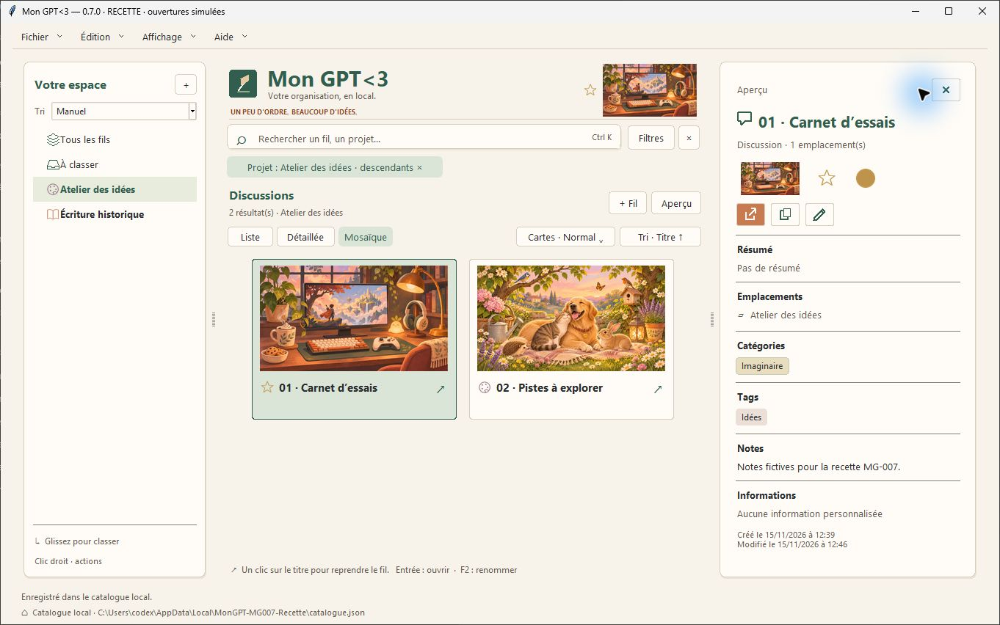

# MG-007 — Intégration des illustrations

Mon GPT<3 **0.7.0** · 15 novembre 2026 · CODEX-VM, Windows 11 / Python 3.13 / Tk 8.6.

Les **24 illustrations de David** rejoignent les sept couvertures historiques : **31 choix** dans la galerie existante, commune aux projets et aux fils. Aucune création graphique ni modification des sélecteurs. Livraison soumise à la validation utilisateur.

## Inventaire et optimisation

Synchronisation en avance rapide sur la mission `a7fd82c`, après la base d’illustrations `51dc63f` ; dépôt initialement propre. Les 24 fichiers ont été examinés visuellement localement, scène par scène, avant attribution des noms. **Les 24 associations attendues sont confirmées ; aucune ambiguïté constatée.** Toutes les sources sont des PNG RGB fixes, lisibles, de **1672×941**.

Conversion Pillow : `ImageOps.contain(..., (1200,675), LANCZOS)`, centrage sur fond ivoire `#F6F1E7`, JPEG RGB progressif, qualité **88**, sous-échantillonnage **4:4:4**, `optimize=True`. La scène entière est conservée ; le léger écart de ratio laisse seulement une marge d’un pixel, sans coupe ni étirement. Les versions Écriture · carnet, Gaming et Animaux ont aussi été comparées visuellement aux sources après conversion : sujets et détails conservés, pas d’artefact gênant observé.

Poids des 24 sources : **62 587 525 octets** ; pack ajouté : **7 684 893 octets**, soit **87,72 % de réduction**. Les originaux restent bit pour bit identiques. Les sept JPEG historiques et leurs clés restent eux aussi inchangés. Empreintes SHA-256, dimensions et poids exacts : [inventaire vérifiable](inventaire.json).

| Source locale complète | Thème observé | Clé stable → JPEG | Poids PNG → JPEG (Kio) |
| --- | --- | --- | ---: |
| Image ChatGPT 15 nov. 2026, 11_11_24-1.png | **Écriture · carnet** — Carnet manuscrit et stylo sur un bureau | `pack:ecriture_carnet` → `ecriture_carnet.jpg` | 2373.1 → 247.0 |
| Image ChatGPT 15 nov. 2026, 11_11_26-2.png | **Gaming** — Écran de jeu, manette et casque | `pack:gaming` → `gaming.jpg` | 2281.9 → 271.3 |
| Image ChatGPT 15 nov. 2026, 11_11_28-3.png | **Études** — Livres, cours sur ordinateur et cahier de révision | `pack:etudes` → `etudes.jpg` | 2195.7 → 241.9 |
| Image ChatGPT 15 nov. 2026, 11_11_30-4.png | **Administratif** — Dossiers, formulaires, calendrier et tampon | `pack:administratif` → `administratif.jpg` | 2243.4 → 245.8 |
| Image ChatGPT 15 nov. 2026, 11_11_33-5.png | **Langues** — Livre de langues, casque, globe et symboles de conversation | `pack:langues` → `langues.jpg` | 2322.8 → 269.0 |
| Image ChatGPT 15 nov. 2026, 11_11_35-6.png | **Développement** — Éditeur de code et schémas informatiques | `pack:developpement` → `developpement.jpg` | 2229.0 → 239.8 |
| Image ChatGPT 15 nov. 2026, 11_17_23-1.png | **Travaux** — Plans, casque de chantier et outils | `pack:travaux` → `travaux.jpg` | 2492.6 → 298.9 |
| Image ChatGPT 15 nov. 2026, 11_17_25-2.png | **Musique** — Piano, guitare, violon et partitions | `pack:musique` → `musique.jpg` | 2525.2 → 310.3 |
| Image ChatGPT 15 nov. 2026, 11_17_26-3.png | **Graphisme** — Tablette graphique, croquis et nuancier | `pack:graphisme` → `graphisme.jpg` | 2420.2 → 285.3 |
| Image ChatGPT 15 nov. 2026, 11_17_28-4.png | **Réflexion** — Carnet, penseur, sablier et ampoule | `pack:reflexion` → `reflexion.jpg` | 2464.1 → 292.3 |
| Image ChatGPT 15 nov. 2026, 11_17_30-5.png | **Institutions** — Bureau officiel, sceau et bâtiment institutionnel | `pack:institutions` → `institutions.jpg` | 2471.4 → 306.9 |
| Image ChatGPT 15 nov. 2026, 11_17_32-6.png | **Santé** — Stéthoscope, carnet de santé et cadre apaisant | `pack:sante` → `sante.jpg` | 2473.0 → 297.8 |
| Image ChatGPT 15 nov. 2026, 11_38_34-1.png | **Cuisine** — Cuisine, recettes, légumes et ustensiles | `pack:cuisine` → `cuisine.jpg` | 2778.3 → 362.7 |
| Image ChatGPT 15 nov. 2026, 11_38_36-2.png | **Finances** — Calculatrice, tirelire, pièces et carnet de budget | `pack:finances` → `finances.jpg` | 2568.5 → 327.3 |
| Image ChatGPT 15 nov. 2026, 11_38_37-3.png | **Maison** — Fauteuil, décoration et échantillons de couleurs | `pack:maison` → `maison.jpg` | 2779.8 → 334.4 |
| Image ChatGPT 15 nov. 2026, 11_38_39-4.png | **Jardinage** — Serre, semis et outils de jardin | `pack:jardinage` → `jardinage.jpg` | 2917.9 → 387.6 |
| Image ChatGPT 15 nov. 2026, 11_38_42-5.png | **Photo & vidéo** — Appareil photo, caméra, éclairage et montage vidéo | `pack:photo_video` → `photo_video.jpg` | 2660.5 → 333.7 |
| Image ChatGPT 15 nov. 2026, 11_38_44-6.png | **Cinéma** — Projection de film, bobines et salon de cinéma | `pack:cinema` → `cinema.jpg` | 2489.4 → 309.6 |
| Image ChatGPT 15 nov. 2026, 11_38_46-7.png | **Sport** — Course en nature, vélo et tapis de sport | `pack:sport` → `sport.jpg` | 2946.7 → 388.1 |
| Image ChatGPT 15 nov. 2026, 11_38_47-8.png | **Famille** — Album familial, jouets et souvenirs | `pack:famille` → `famille.jpg` | 2688.4 → 341.0 |
| Image ChatGPT 15 nov. 2026, 11_38_49-9.png | **Sciences** — Microscope, télescope, verrerie et modèles scientifiques | `pack:sciences` → `sciences.jpg` | 2692.7 → 368.2 |
| Image ChatGPT 15 nov. 2026, 11_38_50-10.png | **Fêtes** — Gâteau, cadeaux et table de fête | `pack:fetes` → `fetes.jpg` | 2572.9 → 339.9 |
| Image ChatGPT 15 nov. 2026, 11_47_45-1.png | **Entrepreneuriat** — Projet professionnel, ordinateur, planning et colis | `pack:entrepreneuriat` → `entrepreneuriat.jpg` | 2523.0 → 324.1 |
| Image ChatGPT 15 nov. 2026, 11_47_47-2.png | **Animaux** — Chien, chat, lapin et animaux du jardin | `pack:animaux` → `animaux.jpg` | 3010.5 → 381.7 |

Tous les JPEG résultants font **1200×675**, ratio 16:9. Le chemin d’exécution reste `ImageLibrary.open("pack:clé")` → JPEG local dans `mon_gpt/assets/covers`. Les PNG sous `missions/` ne sont ni importés par l’application ni copiés dans son pack.

## Préservation

Seuls `identity.COVERS`, la version et les nouveaux actifs changent dans le code d’exécution. Aucun changement de `VisualLayer`, galerie, défilement, contrôles, rendu des vues, bandeau, icônes/couleurs, préférences, héritage, moteur, URL, schéma 3, import personnel, migration ou ZIP. Les sept premières entrées historiques restent à leur place ; la nouvelle variante utilise `pack:ecriture_carnet` et ne remplace jamais `pack:ecriture`. La dernière entrée est `pack:animaux`.

## Vérifications automatisées

`python -m unittest discover -s tests -v` : **121 tests réussis**, dont les **117 tests MG-006 conservés sans modification** et quatre nouveaux tests ciblés. [Journal complet](tests.txt).

Contrôles ajoutés : 24 sources et JPEG, 31 clés/fichiers exacts, noms/thèmes, dimensions/formats/poids, empreintes sources et sept anciens JPEG ; chargement local des 31 références, distinction ancienne/nouvelle Écriture ; parcours clavier et molette jusqu’à Animaux en normal/compact ; choix projet/fil, sauvegarde, héritage indépendant, bandeau et trois vues, relecture et restauration ZIP standard. Aucun nouveau moteur de stockage ni protocole réseau.

## Recette Windows réelle

Application Tk native lancée avec `--simulate-open`, sur `C:\Users\codex\AppData\Local\MonGPT-MG007-Recette`, puis sur le dossier neuf `MonGPT-MG007-Restaure`. Deux projets et trois discussions entièrement fictifs, sans catalogue utilisateur. Les captures proviennent directement des fenêtres exécutées, sans retouche ni reconstruction.

| Parcours réel | Résultat observé |
| --- | --- |
| Projet, galerie au début en 1360×820 | Sept anciennes couvertures présentes, nouvelle variante Écriture à la suite ; mêmes contrôles et bouton Par défaut. |
| Molette, barre de défilement jusqu’au bas, puis flèches gauche/droite et Entrée | Dernière vignette Animaux atteinte, sélectionnable au clavier comme à la souris. |
| Animaux → Utiliser → Ctrl+S sur Atelier des idées | Image immédiatement visible dans le bandeau, la carte du projet et l’éditeur ; ses fils héritent d’Animaux. |
| Gaming sur le fil 01, Ctrl+S depuis le sélecteur | Couverture personnelle distincte de celle du projet et du fil 02 ; Étoile et Ocre conservées. Aperçu, bandeau, Détaillée et Mosaïque actualisés sans relance. |
| Recherche écriture dans Tous les fils | Ancien `pack:ecriture` et nouveau `pack:ecriture_carnet` côte à côte ; scène du fil sélectionné reprise dans le bandeau et l’aperçu. |
| Galerie du fil en 1000×680 : molette, barre jusqu’à Animaux, flèches gauche/droite | Fin de galerie accessible, dernière image et actions visibles. Aucun réglage du défilement nécessaire. |
| Revenir à l’héritage sur Image puis Ctrl+S | Animaux revient ; contrôle du JSON : clé image absente, `icon: star` et `color: ocre` intactes. Gaming est ensuite rétablie et enregistrée. |
| Fermeture normale et relance | Même projet, sélection, vue et aperçu ; Gaming toujours visible, sans ouverture de discussion. |
| Export ZIP, restauration standard dans un dossier fictif neuf, relecture puis lancement réel sur ce dossier | Catalogue strictement identique après restauration ; nouvelles références locales et aperçus utilisables, sans changement du stockage. |

Les vérifications de fichiers ont utilisé le gestionnaire de sauvegarde existant, puis le résultat a été ouvert dans l’application : [résultats](verifications.txt). Titres, URL fictives, notes, tags, catégories, icônes/couleurs personnelles et rattachements ont été contrôlés. Aucun journal d’ouverture de discussion créé pendant la recette ou les relances.

Chargement hors connexion : les 31 références sont lues par Pillow depuis le pack installé, sans appel réseau ni lecture des PNG de mission. Aucune modification des paramètres réseau Windows nécessaire. Les scènes affichées gardent leur composition entière et leur ratio dans le bandeau et les vues.

## Quatre captures natives

1. [Début de la galerie projet, format confortable](01-galerie-debut.png).
2. [Fin de la galerie fil, format compact, Animaux accessible](02-galerie-fin.png).
3. [Gaming personnelle et Animaux héritée dans le même projet](03-nouvelles-couvertures.png).
4. [Écriture historique et nouvelle variante côte à côte](04-ecriture-historique-variante.png).



## Limites et lancement

Aucune nouvelle limitation fonctionnelle identifiée pour l’intégration des 24 images. La galerie garde sa densité et son défilement existants ; les grandes scènes s’apprécient surtout dans les cartes et le bandeau. Les JPEG sont des versions réduites avec compression avec perte ; les PNG originaux inchangés restent disponibles dans le dépôt. La validation visuelle appartient aux utilisateurs.

Depuis PowerShell :

```powershell
& 'C:\Users\codex\Documents\Projets\mon-gpt\lancer.cmd'
```

Recette fictive, depuis le dépôt :

```powershell
python -m mon_gpt --data-dir 'C:\Users\codex\AppData\Local\MonGPT-MG007-Recette' --simulate-open
```
