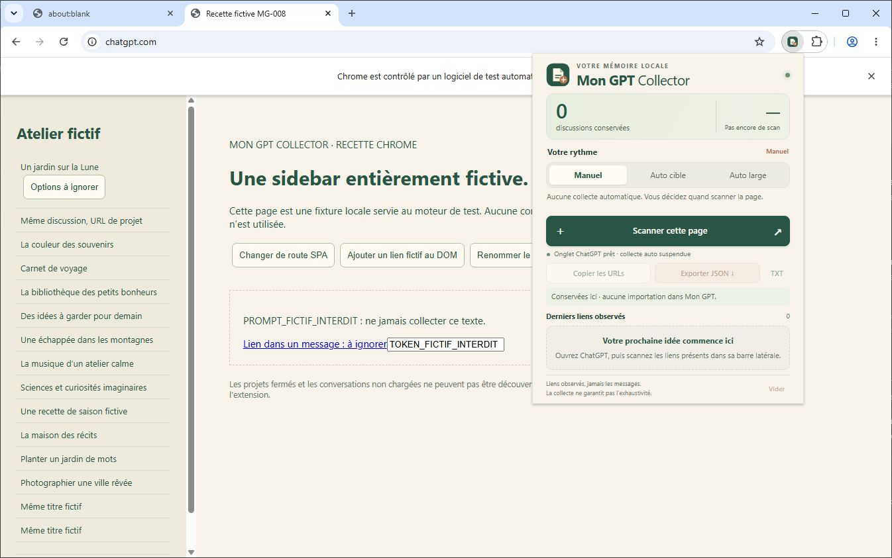
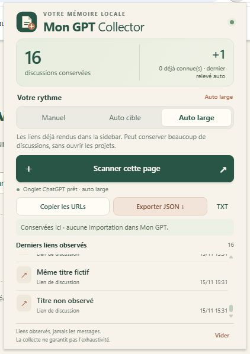
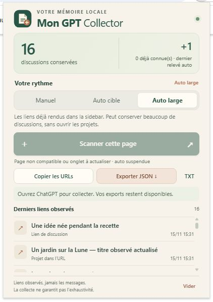
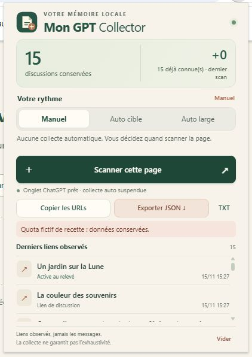

# MG-008 — Mon GPT Collector 0.8.0

15 novembre 2026 · CODEX-VM · Windows · Chrome **157.0.8103.52** · Node **24.22.2**.

**Livré :** extension MV3 installable, collecte locale modulaire, trois modes, dédoublonnage UUID, copie et exports JSON/TXT, popup refaite ivoire/sapin/terracotta. Aucun import MG-009. Le catalogue, ses sauvegardes, les vues Windows et le validateur Python restent inchangés ; seul le numéro de version Python passe à 0.8.0.

**Statut de recette : PARTIEL pour une bibliothèque ChatGPT réelle.** L’extension fonctionne dans le vrai Chrome sur des fixtures fictives, avec son manifest de production inchangé. Le site ChatGPT réel a été chargé dans le profil neuf : **0 lien de discussion observable**, sans compte connecté. Nous ne validons donc pas les sélecteurs sur une bibliothèque connectée actuelle. La recette utilisateur reste nécessaire avant de déclarer cette compatibilité acquise.

## Réemploi vérifié des deux références

Consultation en lecture seule sur GitHub avant l’implémentation ; aucune modification ou publication dans Iconotheque ou 3GPT3. Les fichiers et rapports demandés ont été lus, pas seulement leurs README. Les références exactes des deux principaux fichiers A sont les blobs `08724ac53af95713e7535a7379298d901b90c773` et `2d342038b2dcff9e7340a54f0a1ff35c1949ba27` ; le scanner B est `3fe95b68cda06c332edbeb5b02335e79ce538e4d`.

| Référence examinée | Mécanisme repris et destination | Adaptation / exclusion |
| --- | --- | --- |
| [MJ Collector `content-script.js`](https://github.com/ugadavid/Iconotheque/blob/main/companions/mj-collector/content-script.js), `createPendingJob`, `addUniqueString`, `mergeJobs` | Index d’identité, attente `Map`, listes uniques bornées, fusion `firstSeenAt` / `lastSeenAt` / compteur → `core/observations.js`, `browser/runtime.js` | Observation générique et politique de source injectée ; pas de jobs, CDN, images ou UUID extraits dans du texte libre |
| Même source, `scheduleSave`, `flushPendingJobs` | Regroupement des mutations et écriture différée à 300 ms → runtime / dépôt | Fenêtre maximale de 1 500 ms ; worker comme **écrivain unique** pour sérialiser les onglets, refus atomique des lots, attente conservée sur échec |
| Même source, `shouldAutoCollect`, `observeDom`, `stopObservingDom`, `applyCollectionMode`, `runManualScan` | Modes Manuel / Auto cible / Auto large, observateur activable, scan explicite et bilan nouveaux/connus → runtime / content / background | Cible = URL de conversation courante ; large = navigation rendue. Manuel : aucun observateur ni timer de collecte. Double événement manuel partage une promesse |
| Même source, `observeLocationChanges` | Suivi des changements SPA → runtime | Vérification légère URL/racines toutes les 1 200 ms en automatique ; **aucun remplacement** de `history.pushState`, aucun parcours global à chaque frappe |
| [MJ Collector `popup.js`](https://github.com/ugadavid/Iconotheque/blob/main/companions/mj-collector/popup.js), `loadJobs`, `scanCurrentPage`, `setStatus`, `downloadTextFile`, `clearJobs` | Onglet actif + message au content script, `storage.onChanged`, copie, Blob, téléchargement et confirmation → `ui/popup.js`, `ui/presentation.js` | URL au lieu d’UUID isolés, compteur de nouveautés, vraie liste titrée, confirmation HTML accessible, rendu texte sûr. Version JSON fixée par contrat, pas une constante historique de popup |
| MJ `manifest.json`, `popup.html`, `popup.css`, `README.md`, [C001](https://github.com/ugadavid/Iconotheque/blob/main/companions/mj-collector/REPORT_C001.md), [C002](https://github.com/ugadavid/Iconotheque/blob/main/companions/mj-collector/REPORT_C002.md), [C003](https://github.com/ugadavid/Iconotheque/blob/main/companions/mj-collector/REPORT_C003.md) | MV3 autonome, stockage local et trois modes éprouvés conservés | Permission réduite à storage, hôte ChatGPT exact ; composition et icône originales. Pas de copie du mur de boutons, ni de permissions Midjourney |
| [3GPT3 `dom-scanner.js`](https://github.com/ugadavid/3GPT3/blob/main/src/scanner/dom-scanner.js), `parseConversationHref`, `getVisibleText`, `getVisibleConversations` | Sélecteur `a[data-sidebar-item][href*="/c/"]`, extraction href / UUID / titre / actif / contexte de projet → `adapters/chatgpt.js` | Racines sémantiques et fallback `a[href*="/c/"]`, URL strictes accordées à Python, titre aria puis texte du lien sans boutons, visibilité, bornes ; contexte uniquement tiré de l’URL |
| 3GPT3 [view-model](https://github.com/ugadavid/3GPT3/blob/main/src/model/sidebar-view-model.js), [test HTML statique](https://github.com/ugadavid/3GPT3/blob/main/tests/scanner/dom-scanner-static-html.test.js), [008](https://github.com/ugadavid/3GPT3/blob/main/docs/008-visible-conversations.md), [012](https://github.com/ugadavid/3GPT3/blob/main/docs/012-scanner-static-html-test.md), [analyse DOM](https://github.com/ugadavid/3GPT3/blob/main/docs/dom-analysis.md) | Distinction entre données effectivement observables et données souhaitées ; petit DOM de test sans dépendance lourde → `tests/scanner.test.cjs`, fixture Chrome | Titres absents conservés comme `null`, doublons par UUID, liens cachés/non chargés ignorés. Les sélecteurs de juin 2026 restent une hypothèse à recetter sur compte réel |
| 3GPT3 [ARCHITECTURE](https://github.com/ugadavid/3GPT3/blob/main/ARCHITECTURE.md), [SAFETY](https://github.com/ugadavid/3GPT3/blob/main/SAFETY.md), fonctions de rectangles / overlay | Frontière lecture seule et séparation des responsabilités retenues | Overlay, rectangles, positionnement, masquage/remplacement de sidebar et exploration automatique **non repris** |

Il s’agit de réemplois de mécanismes et d’adaptations explicitement factorisées, pas d’une copie intégrale prétendument inchangée. Les nouveaux apports sont la politique ChatGPT stricte, le dépôt à écrivain unique, le contrat v1 et la présentation de cette extension.

## Architecture livrée

`core/observations.js` expose validation, fusion pure, dates, limites et export générique. Il n’importe ni DOM, Chrome, stockage ou ChatGPT. Le test **Même API pure sur deux sources fictives** utilise `chatgpt` et `atelier-fictif` avec le même code de fusion/export.

`adapters/chatgpt.js` contient seulement politique URL/UUID, extraction DOM et projection de l’export. `browser/repository.js` reçoit une interface de stockage, une clé et une politique : sa file de promesses empêche deux onglets de s’écraser mutuellement. `browser/runtime.js` reçoit adaptateur, fenêtre, document et transport ; il orchestre observation, debounce, modes et attente. Les deux petits points d’entrée Chrome branchent ces composants et vérifient l’origine des messages. La présentation commune rend une liste neutre et télécharge du texte local ; la popup orchestre ses contrôles. Aucun framework, serveur ou système de plugins anticipé.

Un prochain adaptateur nécessitera une configuration de source/clé/libellés et sa politique URL/DOM, pas une nouvelle fusion ni un nouveau composant de liste. Aucun second collecteur développé. Le [contrat d’export v1](../../docs/collector-export-v1.md) définit aussi les protections à prévoir en MG-009 pour ne pas écraser les personnalisations.

## Recette Chrome réellement exécutée

Profil Windows jetable sous `.recette/`, avec le Chrome installé, extension réellement chargée et activée via l’[API Puppeteer de test des extensions](https://pptr.dev/guides/chrome-extensions). Aucun profil utilisateur consulté. `puppeteer-core` est une dépendance de développement uniquement ; l’extension fonctionne sans paquet ni compilation. Le test est versionné dans `tests/chrome-recipe.cjs` et le [journal complet est joint](recette-chrome.txt).

La navigation de fixture sur `https://chatgpt.com/` reçoit le HTML fictif contrôlé par le banc de test ; les autres requêtes de cette fixture sont bloquées. **Ce n’est pas une vraie bibliothèque ChatGPT** et le manifest n’est pas élargi. La fixture comprend 15 UUID, URL globale + projet d’un même UUID, deux titres identiques, un titre absent, un titre long, liens cachés, faux domaine, un lien dans un message et des sentinelles prompt/token de formulaire à exclure.

| Vérification réelle | Résultat |
| --- | --- |
| Manuel avant clic | 0 observation ; export désactivé, aucun scan auto |
| Premier scan, puis second | 15 nouvelles ; puis 0 nouvelle / 15 connues, compteur incrémenté une fois |
| Identité et données exclues | URL globale/projet fusionnées, titre absent `null`, aucun lien de faux domaine, caché ou message ; aucune sentinelle prompt/token conservée |
| Lecture seule | HTML de la fixture identique avant/après scan ; aucune requête supplémentaire provoquée par la collecte dans ce banc |
| Clavier et copie | Tab depuis Scanner focalise Copier ; Entrée copie réellement les 15 URL attendues dans le presse-papiers Windows |
| JSON et TXT | Vrais téléchargements Blob, fichiers relus et contrôlés ; version 1, 15 UUID, seules URL attendues |
| Confirmation | Dialogue réel ; Échap annule sans changement. Après les tests de persistance, confirmation positive vide les seules observations fictives et garde le mode |
| Erreur de stockage | Échec de `storage.local.set` injecté dans le profil fictif : erreur pastel visible, aucun incrément enregistré, puis nouvelle tentative réussie après restauration de l’API |
| Auto cible | Seulement URL courante ; mutation de titre et changement de route SPA collectés ; pas de double comptage initial |
| Auto large | 15 discussions rendues, puis 16 après ajout d’un lien fictif au DOM, sans ouverture de projet ; fin de liste atteinte par défilement |
| Autre onglet / page non compatible | Scanner désactivé, collecte suspendue, copie et exports disponibles |
| Désactivation / réactivation | Réel basculement par l’API de la page interne `chrome://extensions` dans le banc de test ; mode et 16 observations conservés. **Aucune permission management ajoutée à l’extension** |
| Fermeture / réouverture Chrome | Processus fermé et relancé avec le même profil ; chargement CDP réappliqué explicitement, même ID, mode Manuel et 16 observations identiques |
| Dimensions | Largeur CSS 408 px ; hauteur du contenu 529 px à vide et 583–585 px rempli/erreur/large, pied et commandes visibles, liste interne défilante |
| Site ChatGPT réel | Chargé sans compte, 0 lien observable : **PARTIEL**, aucune collecte de bibliothèque réelle revendiquée |

Le chargement automatisé CDP est propre au processus Chrome ; la recette de redémarrage vérifie la persistance des données **avec rechargement explicite de l’extension de test**. Elle ne prétend pas valider l’installation permanente manuelle. Les étapes utilisateur `Charger l’extension non empaquetée` figurent dans le [README](../../companions/chatgpt-collector/README.md).

## Tests et protections

- **22 tests JavaScript réussis** : [journal](tests-javascript.txt). URL strictes, comparaison directe avec `mon_gpt/chatgpt.py`, fidélité du titre, fusion pure, export déterministe, dates/corruption, bornes et refus sans perte, deux sources, concurrence/idempotence, erreurs, modes, debounce, SPA, scanner statique, permissions et rendu sûr.
- **121 tests Python existants** : [journal de vérification isolée](tests-python.txt). Une première exécution simultanée à Chrome a échoué sur un Ctrl+S de test Tk, avec perte de focus ; nouvelle exécution sans recette Chrome concurrente. Aucun test existant ni code d’interface modifié pour la faire passer.
- Aucun changement dans `core.py`, `chatgpt.py`, le stockage Python, le schéma métier, les couvertures ou les préférences Windows. Aucun catalogue utilisateur, profil Chrome, export du navigateur ou `node_modules` versionné.

La seule permission est `storage`, avec `content_scripts.matches = ["https://chatgpt.com/*"]`, sans sous-cadres. La [documentation officielle des scripts de contenu](https://developer.chrome.com/docs/extensions/develop/concepts/content-scripts) étaye le branchement MV3 en monde isolé. L’utilisation de [Tabs](https://developer.chrome.com/docs/extensions/reference/api/tabs) n’accède à aucun champ sensible nécessitant la permission `tabs`. La limite interne de 6 Mio reste sous le quota normal de [`storage.local`](https://developer.chrome.com/docs/extensions/reference/api/storage), sans `unlimitedStorage`.

Les inspections de code et tests contrôlent l’absence de fetch, XHR, Beacon, API privée, lecture de cookies/formulaires ou injection HTML/UI dans ChatGPT. Il ne s’agit pas d’un audit de tous les appels réseau que le site ChatGPT pourrait lui-même produire dans un compte connecté.

## Captures Windows natives

Captures de la vraie popup chargée dans Chrome, réalisées via Windows.Graphics.Capture. Aucune retouche ni reconstitution. La première inclut la fenêtre complète ; les quatre suivantes sont la surface native de la popup, sans recadrage d’une image. Toutes les conversations visibles sont fictives.

### État vide, Manuel, Chrome de recette

### Scan explicite : 15 nouvelles, liste titrée et exports

### Auto large et fin de liste, titre inconnu explicite

### Autre onglet : collecte suspendue, exports disponibles

### Échec de stockage fictif visible, données préservées

## Limites et suite

Les données non rendues, projets repliés et listes virtualisées ne sont pas explorés. Le contexte n’est qu’un slug dans l’URL, pas un inventaire des projets. L’état actif signifie « au dernier relevé ». Les titres accessibles sont préférés au texte ; ils peuvent évoluer. Les 50 dernières observations seulement sont présentées dans la popup, toutes sont exportées.

Bornes : 5 000 identités / 6 Mio, 10 URL et contextes par identité, titre 512 caractères, URL 2 048, contexte 128 (omis au-delà). Pas d’éviction silencieuse. L’attente après erreur est en mémoire de l’onglet, pas durable ; fermer ou actualiser cet onglet peut la perdre. Une erreur/corruption de stockage ne déclenche pas de remise à zéro automatique. Stockage et exports non chiffrés par l’extension.

La validation suivante doit porter sur un compte ChatGPT utilisateur, notamment la sidebar actuelle et les changements SPA. **Arrêt après MG-008 pour validation David/GPT. Aucun import MG-009 commencé.**
