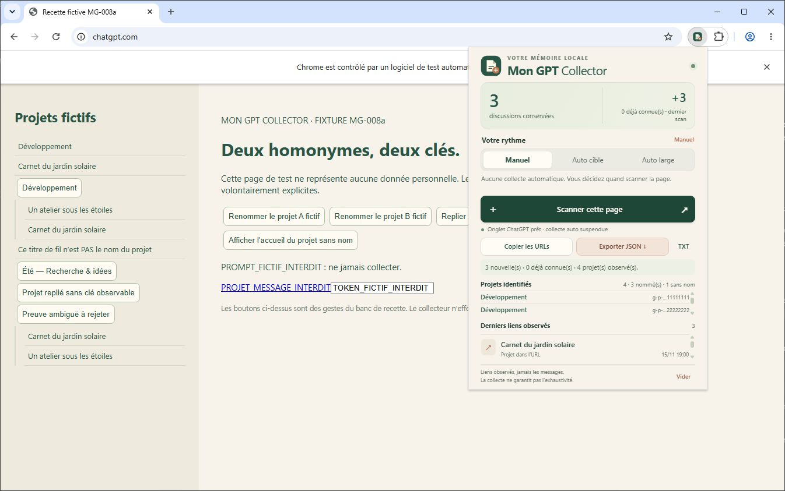
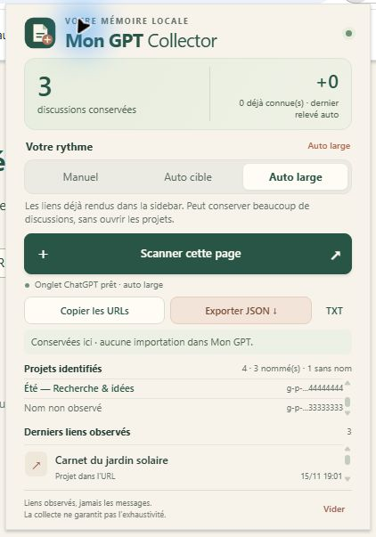
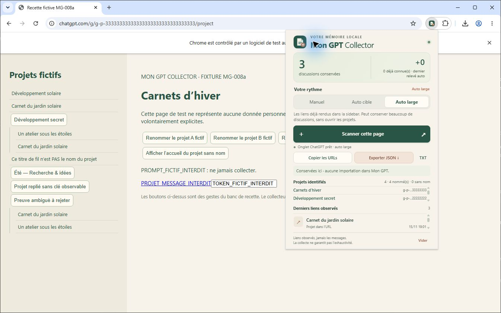
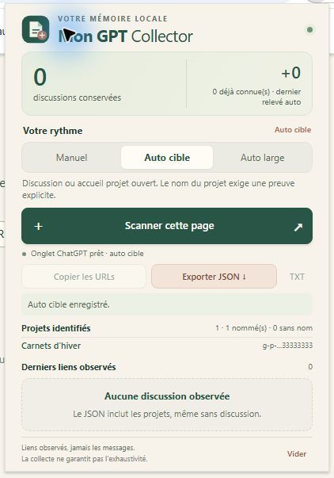

# MG-008a — Projets ChatGPT : clé et nom

15 novembre 2026 · Mon GPT Collector **0.8.1** · Chrome **157.0.8103.52** sur CODEX-VM.

**Livré :** projets distincts par clé, noms uniquement sur preuve DOM, renommage sans changement d’identité, projets sans nom explicites, nouveau stockage et export **v2**, popup enrichie sans refonte. Dossier de distribution propre de **16 fichiers, 78 557 octets** ; ZIP **35 869 octets**. Aucun import MG-009 ni modification de l’application/catalogue Python.

**Statut : PARTIEL sur association nom/GUID du vrai compte connecté.** La recette passe dans le Chrome Windows installé, sur fixtures contrôlées et données fictives. ChatGPT public a été chargé sans compte et n’expose aucun projet. La collecte MG-008 connectée a été confirmée par David dans la mission ; la nouveauté MG-008a exige encore sa validation DOM connectée. Aucune association réelle de noms n’est revendiquée ici.

## Audit effectué avant code

Le [journal d’audit préalable](audit-dom.md) consigne la lecture du collecteur et la relecture GitHub de `3GPT3/docs/dom-analysis.md` et `src/scanner/dom-scanner.js`, sans toucher au dépôt source. Les blobs relus sont identiques à ceux de MG-008. L’analyse de juin 2026 constate les liens de projets et les boutons ; elle ne garantit pas une association par voisinage. L’audit du DOM public actuel a trouvé 7 conteneurs de navigation, **0 lien projet et 0 attribut projet**. Ces surfaces ne permettent donc pas une validation réelle du raccord connecté.

La stratégie est volontairement conservatrice :

| Preuve | Exemple fictif minimal | Confiance / refus |
| --- | --- | --- |
| Directe par lien | `<a href="/g/g-p-111…/project">Développement</a>` | Même contrôle porte la clé et le nom ; URL strictement validée |
| Directe par attribut | `<button data-project-key="g-p-222…">Développement</button>` | Clé explicite sur le contrôle ; actions secondaires et attributs contradictoires exclus ; attribut à confirmer sur compte réel |
| Groupe développé | `button#p[aria-controls=g][aria-expanded=true]` + `div#g[role=group][aria-labelledby=p]` avec enfants portant tous la même clé | Niveau inférieur ; relation réciproque, IDs non ambigus, absence de sous-projet concurrent et concordance des enfants obligatoires. Treeitem propriétaire ou liens réellement contenus dans le bouton également acceptés |
| Accueil ouvert | URL `/g/g-p-333…/project` + un seul H1 visible dans main | Nom du projet sous ce contrat de page ; jamais le H1 d’une conversation |
| Clé seule | Lien `/g/g-p-333…/c/UUID`, titre de fil visible | Identité connue, nom **null** ; le titre du fil ne devient pas le nom du projet |
| Groupe mixte / voisin / conflit | Deux clés sous un groupe, noms contradictoires de même niveau, section globale | Aucun nouveau nom choisi, aucune correspondance devinée |

Les ellipses ci-dessus abrègent les exemples ; elles ne sont pas des clés acceptées. Les fixtures utilisent des clés fictives complètes. Les classes générées, index, noms semblables, noms de fils et GUID transformés ne sont pas des preuves. Aucun préfixe d’action découpé approximativement. Les labels génériques de section sont exclus du fallback ; un projet légitimement nommé « Projets » devra fournir une preuve directe.

## Modifications ciblées

Le socle existant est étendu : `core/observations.js` gère des conteneurs nommés **génériques**, indexés par identité, avec validation, fusion, dates et niveau de preuve. Aucun DOM, Chrome ou ChatGPT dans ce cœur. Les tests démontrent aussi deux conteneurs homonymes d’une source fictive non ChatGPT.

L’adaptateur ChatGPT ajoute `scanProjects`, `scanBatch`, les routes d’accueil et la politique des preuves. Il fournit des observations neutres au cœur. Le runtime envoie **conversations + projets du même scan** au worker existant ; sa file d’écriture unique est préservée. Un lot invalide ou refusé ne laisse aucune écriture partielle. Les projets accompagnent les fils du relevé, y compris après un vidage sans changement de mode. Un changement de nom seul déclenche un relevé utile, sans changement d’URL de fil.

À niveau égal, un nom fiable plus récent actualise la même clé. Une preuve plus faible ou inconnue n’efface pas une preuve directe. Les conflits de meilleur niveau restent sans nouveau nom, jamais résolus par ordre du DOM. `nameObservedAt` date le nom retenu ; `lastSeenAt` peut avancer avec une simple observation de clé. Pas d’historique de noms supplémentaire.

**Stockage vierge `monGptCollectorStateV2`, schéma 2, canal v2.** Aucun code lisant l’ancienne clé, aucun lecteur v1, migration, récupération ou sauvegarde d’ancien cache. Le document v1 reste seulement une archive marquée obsolète. [Nouveau contrat complet](../../docs/collector-export-v2.md).

La popup garde sa composition et ses commandes MG-008. Elle ajoute une petite liste de projets avec total / nommés / sans nom, clés abrégées et infobulles complètes. Les homonymes apparaissent séparément. La liste de discussions reste disponible ; les deux listes défilent dans le panneau. Les 50 premiers projets et 50 dernières discussions sont présentés, tous sont exportés. JSON fonctionne avec des projets seuls ; TXT/copie restent réservés aux URL de conversations. L’état vide « aucune discussion » n’est plus coupé lorsqu’un projet seul a été collecté.

## Tests et recette Windows

**35 tests JavaScript réussis** : les 22 tests MG-008 sont conservés et adaptés au contrat neuf, plus 13 tests ciblés. [Journal JS](tests-javascript.txt). **121 tests Python existants réussis**, sans changement de code/test de l’application : [journal Python](tests-python.txt). Exécution Python isolée des interactions Chrome pour préserver le focus Tk.

Les ajouts couvrent : preuves directes/groupe/page, deux homonymes, renommage, inconnus, contexte multiple pour un UUID, conflits et faux domaines, noms localisés, preuves faibles, types/longueurs/caractères/dates/source de preuve, limites et refus atomique, stockage vierge, export v2 déterministe, runtime après erreur, présentation et distribution propre/reproductible. Aucun test de migration ajouté.

Le [journal Chrome](recette-chrome.txt) provient du **dossier distribué**, chargé comme vraie extension MV3 dans Chrome Windows, profil jetable. Le manifest de production reste inchangé ; les seules navigations des fixtures sont remplacées par le HTML fictif du banc de test. Le site n’est pas contourné ou modifié par l’extension. Le chargement de test CDP est réappliqué explicitement après redémarrage ; il ne prouve pas une installation manuelle permanente.

| Scénario réellement exécuté | Résultat |
| --- | --- |
| Modes, scan, dédoublonnage MG-008 | Manuel reste vide avant clic ; 15 nouveaux puis 15 connus ; Auto cible, SPA et mutations ; Auto large, 16 après ajout ; groupe fermé non deviné |
| Gestes MG-008 | Tab/Entrée, presse-papiers Windows réel, téléchargements JSON/TXT relus, annulation et confirmation de vidage, page non compatible, liste défilante |
| Erreur de stockage simulée | Erreur visible, lot refusé sans perte, reprise après rétablissement de l’API |
| Désactivation/réactivation et redémarrage | Mode et observations conservés ; pas de permission management dans l’extension (API de la page interne Chrome utilisée seulement par le banc) |
| Deux homonymes | Clés fictives `g-p-111…` et `g-p-222…` : deux projets « Développement », une preuve directe et une preuve de groupe |
| Inconnus / noms localisés | 4 projets : 3 nommés, 1 sans nom ; « Été — Recherche & idées » conservé ; aucune clé du projet invisible ou du lien dans un message |
| Multi-contexte | 3 conversations uniques ; un même UUID sous les deux projets reste une conversation avec deux `observedProjectKeys` |
| Renommage et repli | A devient « Développement solaire », même clé. B replié conserve le nom prouvé précédent ; après réouverture manuelle, devient « Développement secret », toujours la même clé |
| Accueil d’un projet inconnu | C devient « Carnets d’hiver » depuis le H1 de son URL d’accueil, preuve `project-page` ; 4 noms connus, aucune création de projet supplémentaire |
| Auto cible sur accueil seul | Stockage de recette vidé ; 1 projet C, **0 conversation**, JSON actif, copie/TXT désactivés ; autres projets rendus non collectés |
| Lecture seule | HTML de la fixture identique après scan ; sentinelles prompt/token, faux projets dans les messages et liens cachés absents ; aucune requête supplémentaire dans le banc contrôlé |
| Dimensions | Largeur CSS 408 px, 588–590 px aux états projets présentés ; pied, commandes et état vide lisibles, sous le plafond Chrome de 600 px |
| ChatGPT réel sans compte | 0 discussion observable, aucun nom de projet validable : **PARTIEL** |

## Distribution propre

À la racine :

```powershell
python tools/package_collector.py
```

Dossier à charger : `dist/Mon-GPT-Collector-0.8.1`, ZIP : `dist/Mon-GPT-Collector-0.8.1.zip`. Liste blanche de **16 fichiers** : manifest, quatre couches JS/HTML/CSS et icônes locales. **78 557 octets** décompressés, **35 869 octets** en ZIP pour cette livraison. ZIP reproductible à fichiers identiques ; test de comparaison binaire et d’absence de profils/tests/dépendances dans le livrable. Le script ne supprime rien et refuse une sortie contaminée par des fichiers inattendus.

Les sources et outils de développement restent séparés. `node_modules` / `.recette` sont ignorés et ne sont jamais copiés dans la distribution ni versionnés. Aucun export de navigateur, catalogue utilisateur ou titre personnel publié. Aucune dépendance graphique ou réseau à l’exécution.

## Captures natives

Windows.Graphics.Capture via Computer Use, sans retouche. Les deux fenêtres complètes montrent le Chrome de fixture ; les deux panneaux sont les surfaces natives de la popup, sans recadrage d’une image. Les données sont entièrement fictives. Le défilement de la liste de projets a aussi été effectué par un vrai geste Windows pour voir le nom inconnu.

### Deux homonymes, deux clés ; Manuel



### Nom non observé et accents, fin de liste ; Auto large



### Accueil projet, nom désormais connu ; renommage B conservé



### Auto cible : un projet, aucune conversation, JSON disponible



## Recette connectée indispensable et limites

La [procédure courte pour David](../../companions/chatgpt-collector/README.md#recette-courte-sur-le-chrome-connecté-de-david) décrit chargement propre, actualisation, 2–3 projets ouverts/repliés **manuellement**, scan, accueil d’un inconnu, vérification des clés homonymes dans l’export v2 et renommage éventuel d’un projet de recette. Comparer URL/attribut, libellé exact et `evidence`, pas seulement le nombre de projets. Aucune donnée personnelle ne doit être committée.

Les formes DOM courantes peuvent différer de ces preuves explicites ; un projet réel peut rester sans nom. Les projets repliés/non chargés ne sont pas explorés. Un nom précédemment connu est conservé si le nouveau relevé est moins fiable ; revoir l’accueil permet une preuve directe. Les noms commençant par des libellés d’action ou les noms génériques de section peuvent être refusés prudemment. L’extension ne promet pas l’exhaustivité.

Bornes : 5 000 conversations, 1 000 projets, 6 Mio cumulés, noms 256 caractères, clés 128, URL 2 048, 10 variantes/contextes par conversation ; aucune éviction silencieuse. Attente en mémoire non durable en cas de fermeture/actualisation. Données locales et exports non chiffrés. Permissions inchangées : **storage seulement**, domaine exact ChatGPT, aucun overlay, API privée, cookie, formulaire ou message collecté.

**Arrêt après MG-008a pour validation David/GPT.** Aucun dossier local, choix de fusion ou import MG-009 développé ; aucune modification de Python ou de ses données métier.
