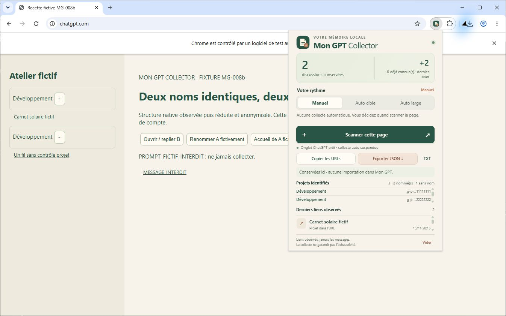
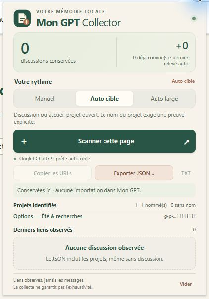

# MG-008b — Correction fondée sur le vrai DOM connecté

15 novembre 2026 · Collector **0.8.2** · Chrome **157.0.8103.52** · CODEX-VM.

**Statut : PARTIEL.** La session Chrome authentifiée préparée par David a réellement été inspectée ; la cause de l’échec est prouvée sur deux contrôles de projets réels distincts. Le scanner est corrigé, les tests et la recette Chrome sur reproduction fidèle passent. **La comparaison finale DOM réel → scanner corrigé → export v2 sur deux projets n’a pas encore pu être exécutée dans cette session**, car Chrome bloque le collage de diagnostic dans DevTools (protection self-XSS). Une prise en main utilisateur a été demandée ; aucune barrière contournée. **Aucun GO revendiqué.**

## Ce qui a été réellement observé

L’[audit réel anonymisé](audit-dom-reel-anonymise.md) détaille les attributs et relations avant code. Deux projets réels, A développé et B d’abord replié puis développé manuellement, ont été examinés dans la navigation de la session existante. Pour chacun : clé source valide, libellé sémantique sur le même contrôle, titre affiché concordant, propriétaire portant cette même clé. Les clés A/B sont distinctes. Les copies réduites des contrôles ont été analysées **en mémoire seulement** ; leurs vrais noms/GUID ne sont pas dans le dépôt.

Ces deux paires vérifiées dans le DOM **ne sont pas présentées comme deux paires vérifiées dans l’export corrigé**. La seconde étape attend encore l’exécution connectée de production.

L’accueil d’un projet a été ouvert par l’action native **Page d’accueil du projet** ; son URL concorde avec la clé du contrôle. Cet écran contient aussi des aperçus de messages : retour à l’accueil général, puis DevTools détaché pour éviter leur capture pendant la suite. Aucun écran personnel n’est enregistré dans les preuves publiées. Les autres projets, messages, formulaires, cookies, tokens, API internes et profils n’ont pas servi à la collecte de preuves.

## Cause racine prouvée

Le vrai contrôle est un **div de rôle button**, pas un élément HTML button muni de `data-project-id` ou `data-project-key`. Il porte :

```html
<div role="button" aria-expanded="true"
     data-app-action-sidebar-project-row
     data-app-action-sidebar-project-id="g-p-11111111111111111111111111111111"
     data-app-action-sidebar-project-label="Projet A"
     aria-labelledby="project-a-label">
  <span id="project-a-label"><span data-marquee-content="true">Projet A</span></span>
</div>
```

Extrait **anonymisé** de la relation réellement constatée. Le propriétaire est marqué `data-sidebar-project-kind="local"` et `data-sidebar-project-container-id="project:CLÉ"`. Les liens enfants sont dans un contenu voisin du contrôle, sous ce propriétaire, pas dans le contrôle nommé. Le repli change `aria-expanded`, `data-app-action-sidebar-project-collapsed` et la visibilité des enfants, **pas** le couple clé/libellé.

Le chemin direct 0.8.1 ignore les nouveaux attributs ; le fallback développé exige HTML button ou treeitem. `projectName` ne reçoit donc pas ces contrôles dans le chemin direct. Les href de fils restent reconnus, ce qui explique les clés accumulées avec `key-only`. La cause ne réside ni dans une fusion par nom ni dans le stockage.

## Réparation ciblée

L’adaptateur ajoute le sélecteur `[data-app-action-sidebar-project-row][data-app-action-sidebar-project-id]` dans les racines de navigation existantes. Il vérifie rôle button, clé stricte, propriétaire exact `project:CLÉ`, absence d’autre contrôle propriétaire concurrent et concordance du libellé avec le titre propre visible/accessiblement relié **dans le même contrôle**. Les liens enfants visibles utilisables ne doivent pas porter une autre clé. Aucun ordre DOM, index de ligne, classe générée ou titre de fil utilisé comme nom.

La preuve reste **`direct-control`**, avec `url: null` puisque la clé vient de l’attribut. Les vrais noms comportant un mot générique ou un préfixe d’action sont conservés intégralement quand cette preuve concordante existe. Une action secondaire n’est jamais prise comme nom. Un désaccord, propriétaire contradictoire, ID de titre ambigu, texte absent ou bloc mixte donne un nom inconnu.

Le H1 d’accueil reste un fallback seulement **en l’absence de contrôle natif identifié pour cette clé** : un titre générique ne doit pas remplacer ou arbitrer ce contrôle. Le runtime observe les mutations des attributs natifs ainsi que le texte de titre ; les modes et le debounce sont conservés.

**Schéma JSON v2, stockage `monGptCollectorStateV2`, writer unique et cœur inchangés.** Aucun vidage, migration, lecteur v1 ou changement d’identité. Les projets restent indexés par clé, les fils par UUID. Aucun code de l’application Python ni de ses tests modifié ; aucun import MG-009.

## Vérifications terminées

| Vérification | Résultat / preuve |
| --- | --- |
| Audit du Chrome authentifié déjà ouvert | **Réalisé**, deux contrôles réels distincts examinés, titre/clé/propriétaire concordants, repli/dépli manuel et accueil projet observés |
| Scanner + export v2 corrigés sur deux vrais projets | **En attente**, pas encore exécuté dans la session connectée ; protection de collage Chrome nécessitant une action utilisateur |
| Tests JavaScript | **43 réussis**, dont les 35 tests précédents et 8 tests ciblés du contrat natif : [journal](tests-javascript.txt) |
| Tests Python existants | **121 réussis**, application inchangée : [journal](tests-python.txt) |
| Recette du vrai Chrome sur reproduction anonymisée | **Réussie**, extension MV3 0.8.2 réellement chargée depuis la distribution propre : [journal](recette-chrome.txt). Ce profil de test ne remplace pas la session connectée |
| Homonymes natifs fictifs | Deux « Développement », deux clés, nom connu même pour le contrôle replié ; ses fils restent non observés tant que cachés |
| Renommage fictif et mutation native | « Options — Été & recherches » conservé sans tronquer, même clé, sans changement d’URL de fil |
| Cible et SPA | Accueil du projet courant : un seul projet, pas les voisins ; H1 générique ignoré, JSON disponible sans discussion |
| Export et rattachements fictifs | v2 inchangé, UUID dédoublonnés, deux projets distincts et conversations rattachées à leurs bonnes clés |
| Non-contamination et sécurité | Propriétaire/texte contradictoires, IDs ambigus, clé absente, groupe mixte et titre manquant testés ; aucun lien de message ou contenu exclu collecté |
| Fonctions MG-008a | Manuel sans auto, scan répété nouveaux/connus, trois modes, SPA, mutations, quotas/erreurs sans perte, copie réelle, JSON/TXT téléchargés et relus, confirmation, désactivation/réactivation, redémarrage et stockage conservés |
| Diagnostic de production anonymisant | Généré sans données privées, syntaxe vérifiée et exécuté sur fixture ; ce résultat n’est **pas** publié comme résultat connecté |

Le banc de recette a été adapté à la fermeture native d’une popup lors de l’activation de son parent : il rouvre un contexte vivant après capture. Cette adaptation concerne uniquement le test, pas les interactions du produit.

## Dernière vérification connectée préparée

`tests/build-connected-probe.cjs` génère `.recette/connected-probe-readonly.js`. Il embarque les sources de production actuelles du cœur et de l’adaptateur, plus l’adaptateur 0.8.1 du commit de référence pour le diagnostic comparatif. Ce dernier reste un outil de test, **aucun lecteur d’ancien format n’est ajouté à l’extension**.

Le script généré est une expression autonome à variables locales : aucune écriture DOM, stockage, réseau ou fichier personnel. Il relève les titres propres des contrôles de navigation, scanne le vrai DOM, fusionne en mémoire, sérialise/relit le **véritable exporteur v2**, puis compare deux clés/noms aux contrôles et à leurs liens enfants. La sortie ne contient que `Projet A` / `Projet B`, compteurs et booléens (`keyExact`, `nameExactAgainstRendered`, `allLinkedConversationsCorrect`, etc.), jamais les valeurs privées. Les deux projets doivent être développés manuellement pour vérifier leurs rattachements.

Après lecture du script et prise en main utilisateur de l’avertissement Chrome, l’exécuter dans la console de l’onglet connecté. **Il reste à constater** `checkedProjectCount: 2`, les comparaisons vraies, `exportSchemaVersion: 2` et `GO: true`, puis à joindre cette seule sortie anonymisée. Si ce contrôle échoue, garder PARTIEL et diagnostiquer le seul contrôle concerné ; ne pas présenter les tests de fixture comme une réussite connectée.

Blocage concret : le Chrome existant n’expose pas de port de débogage externe et le connecteur navigateur ne fournit pas son onglet DOM. Le contrôle natif a permis l’audit via Elements ; la console refuse le collage avec l’avertissement self-XSS. Aucune authentification, profil ou protection n’a été manipulé pour éviter ce blocage. La console DevTools détachée a été laissée accessible pour la prise en main demandée.

## Distribution et mise à jour

```powershell
python tools/package_collector.py
```

Produit `dist/Mon-GPT-Collector-0.8.2` et son ZIP : **16 fichiers**, **81 806 octets** décompressés, **36 622 octets** en ZIP sur cette VM. Aucun `node_modules`, profil, test, export ou capture personnelle embarqué. Liste blanche et reproductibilité testées.

Pour préserver le stockage v2 déjà collecté, remplacer les fichiers exécutables **dans le même dossier déjà chargé par Chrome**, puis **Actualiser** l’extension et les onglets ChatGPT. Ne pas désinstaller/recharger depuis un autre chemin pour cette mise à jour, ce qui changerait l’identité locale et perdrait le cache. Le dossier peut garder son ancien nom ; vérifier **0.8.2** sur la carte Chrome. [Procédure complète](../../companions/chatgpt-collector/README.md).

## Captures publiées : fixtures uniquement

Captures natives de l’application réellement exécutée, dans le profil fictif séparé, **après** observation du vrai DOM. Aucune capture du Chrome personnel, aucun faux floutage de noms réels. Les exemples sont entièrement fictifs.





## Limites et arrêt

La reconnaissance dépend de ces attributs rendus et de leur concordance. Un projet hors DOM, un contrôle caché ou une preuve contradictoire peut rester sans nom ; aucun déroulement/scroll automatique. Les bornes et protections MG-008a restent applicables. Une copie du collecteur lancée depuis un nouveau chemin n’a pas le même stockage Chrome : utiliser la procédure de mise à jour.

**Correction livrable, recette connectée finale non validée : PARTIEL.** La prochaine étape est exclusivement la vérification réelle préparée ci-dessus, puis le contrôle David/GPT. Aucun MG-009 commencé.
