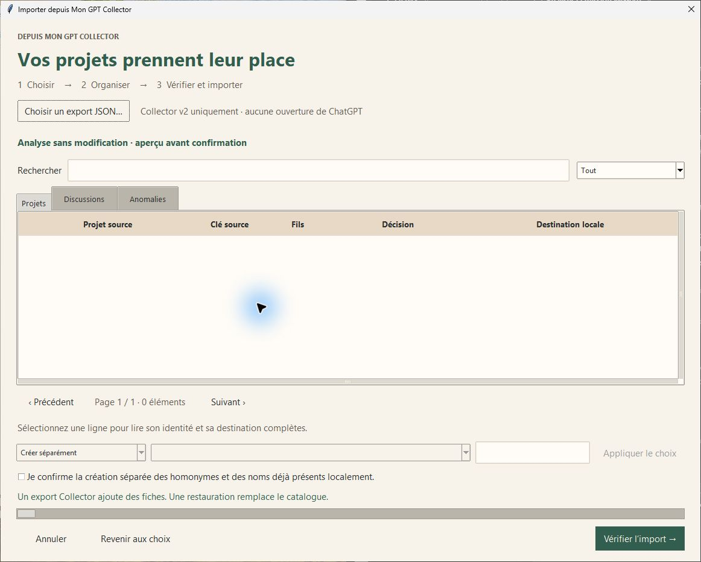
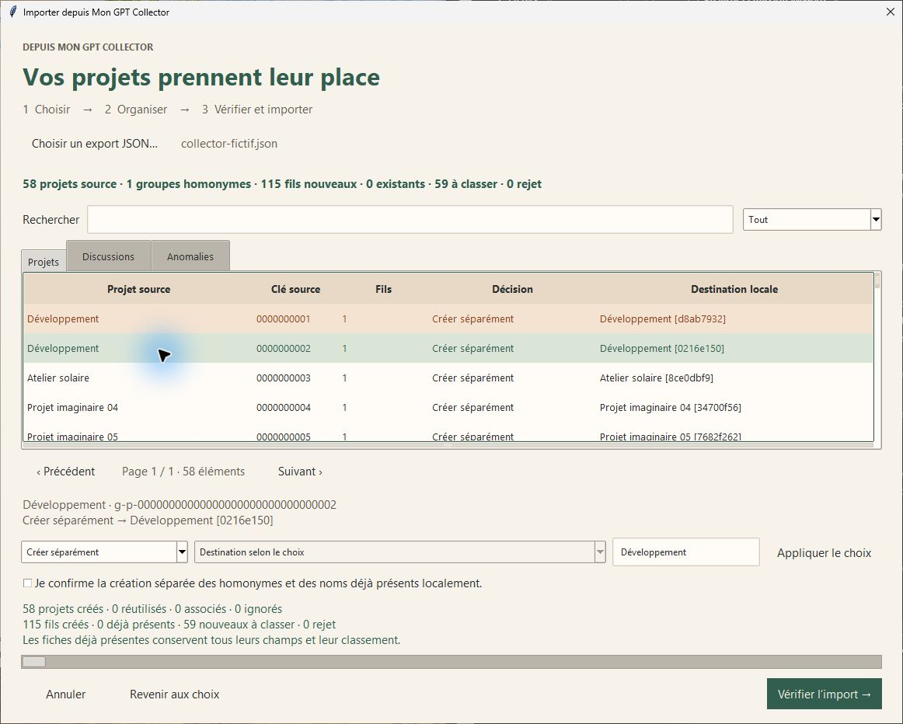
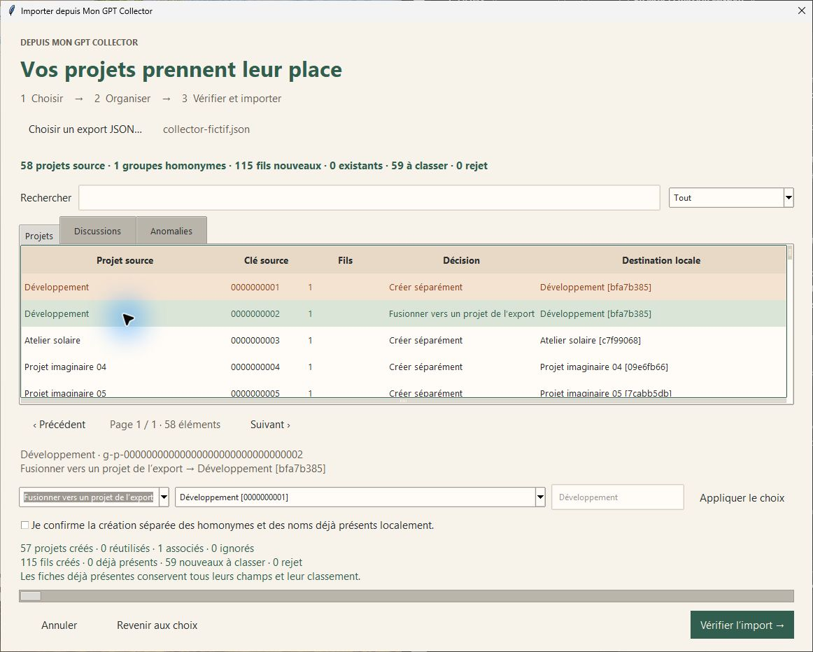
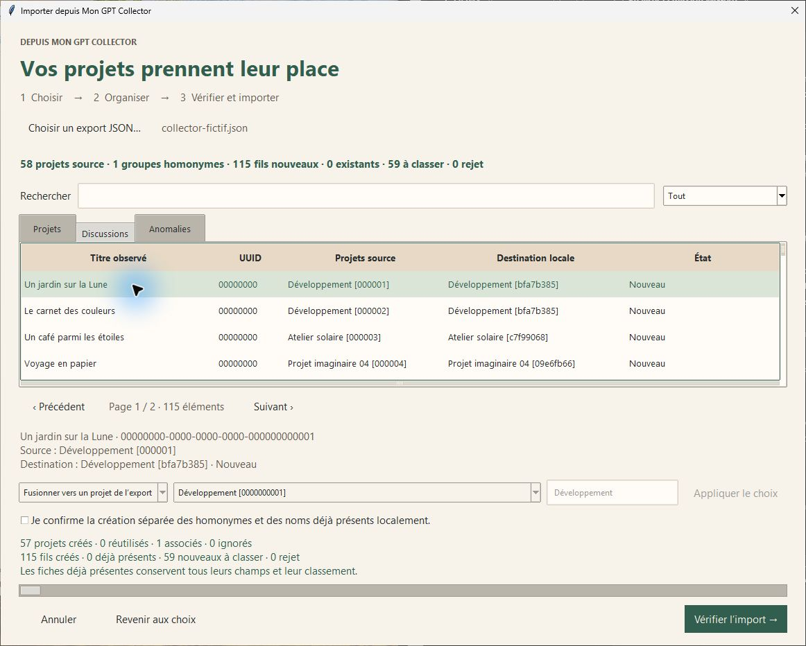
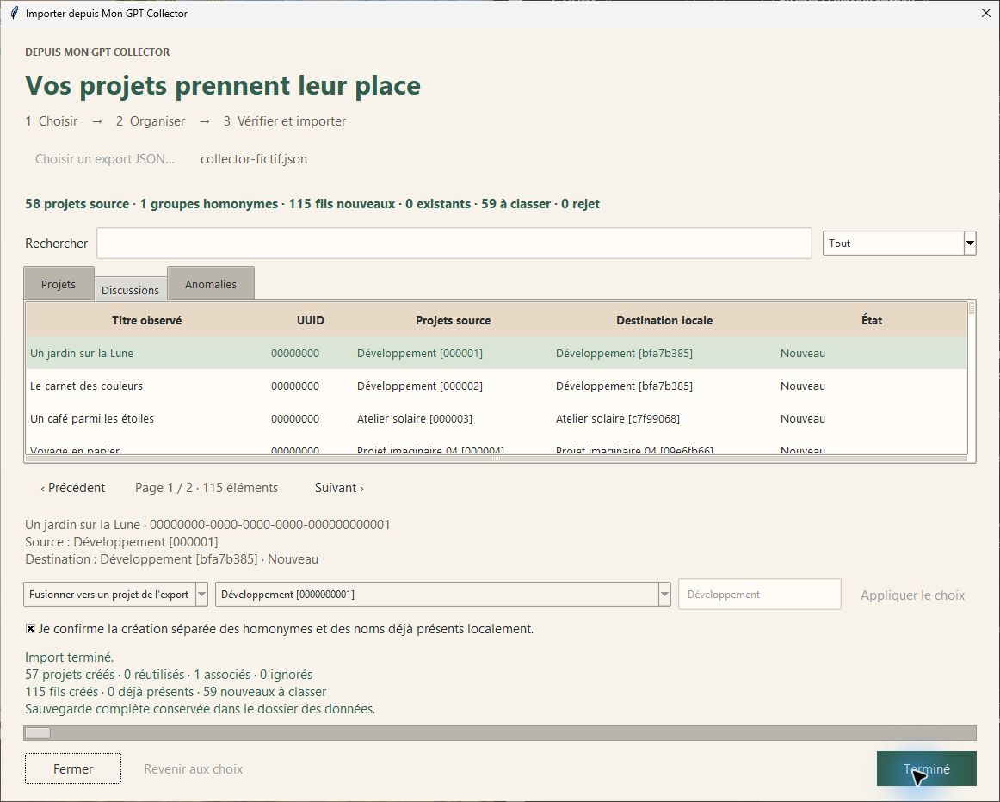
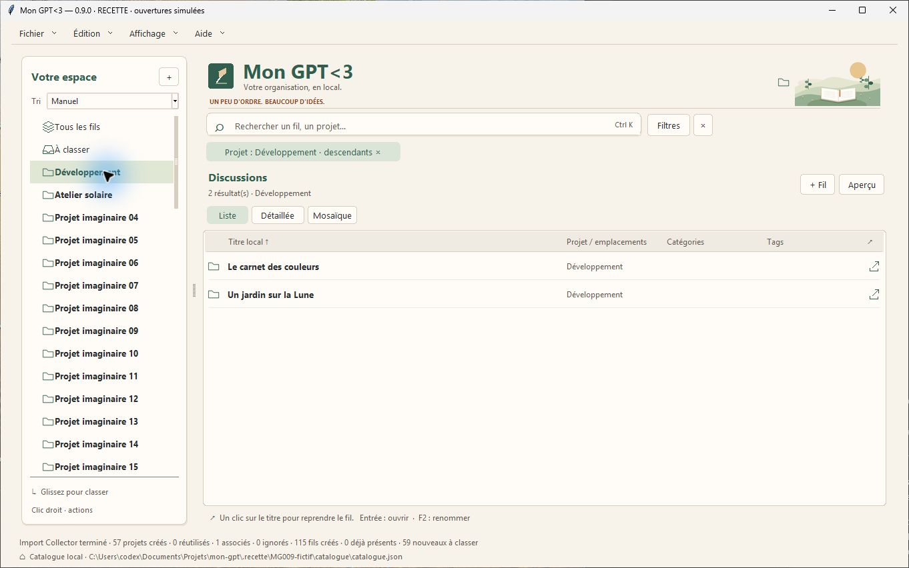

# MG-009 — Import intelligent dans Mon GPT<3

Mon GPT<3 **0.9.0** · CODEX-VM · Windows 11, Python 3.13 / Tk 8.6 · 15 novembre 2026.

**GO technique, soumis à validation David/GPT.** L’assistant ajoute projets et discussions depuis le JSON Collector v2, avec aperçu, correspondances explicites et sauvegarde avant confirmation atomique. Aucun changement de ChatGPT ni du Collector Chrome 0.8.2. Pas de synchronisation développée.

## Résultat sur le fichier réel fourni

Recette dans un catalogue isolé sous `.recette/`, jamais dans le catalogue utilisateur habituel. Le fichier personnel fourni est resté intact ; aucune copie de l’export, valeur nominative ou capture de ce jeu n’est ajoutée aux livrables. Les preuves ci-dessous sont **uniquement statistiques**.

| Contrôle | Résultat |
| --- | --- |
| Analyse réelle sans mutation, puis annulation | Réussie ; catalogue inchangé |
| Premier import, création séparée | **58 projets**, **58 destinations distinctes**, **115 fils** |
| Classement | **56 fils rattachés**, **59 à classer**, aucune inférence |
| Homonymes | Deux groupes, quatre clés conservées vers quatre projets locaux distincts |
| Sauvegarde avant application | Un ZIP complet relisible, contenant l’état initial vide |
| Fermeture et relance dans un second processus Windows | Réussies ; correspondances persistées |
| Second import du même fichier | **0 projet créé, 0 fil créé**, 58 correspondances réutilisées, 115 fils déjà présents |
| Nombre de sauvegardes d’import après répétition | **1**, aucune sauvegarde supplémentaire pour un état inchangé |
| Sauvegarde complète / restauration / nouvel aperçu | État et mappings identiques ; nouvel import sans effet |
| Ouverture automatique de liens | **0** au premier et au second lancement/import |

Le pilote [`recipe_mg009.py`](../../tools/recipe_mg009.py) exécute les **vraies fenêtres et méthodes Tk** (`App`, `ImportWizard`, boucle d’événements) en deux processus distincts. Il ne remplace pas le sélecteur Windows par une imitation : son chargement appelle directement la méthode de l’assistant. Le sélecteur natif et les gestes physiques ont été vérifiés séparément sur les seules données fictives. [Résultats anonymes](recette-reelle-statistiques.json).

## Ce qui est livré

La nouvelle commande Fichier est distincte de Restaurer. L’assistant utilise ivoire, sapin et accents pastel, avec étapes, compteurs, trois onglets, recherche, filtres, pages de 60 lignes et détails complets sélectionnables à l’écran. Les choix sont conservés lorsqu’on revient de la confirmation. Le tableau cède la hauteur nécessaire pour garder Annuler et Confirmer accessibles en fenêtre compacte.

Par défaut, une clé inconnue crée son dossier indépendant. Un nom identique est une suggestion, jamais une identité. L’association vise un UUID local ; la fusion de sources garde chaque clé. Ignorer est limité à cet import. Nom absent ou ancien dossier supprimé demandent un choix visible. Les destinations sont désambiguïsées par leurs identifiants et chemins. Les cycles de fusion sont refusés.

Les fils sont dédoublonnés par UUID. Un fil nouveau conserve une URL réellement observée, ses destinations retenues et les valeurs locales par défaut. Un fil déjà connu reste **strictement intact**, même si son titre, ses notes, ses catégories, son URL, son classement et ses images ont été personnalisés. Aucune donnée d’observation n’est injectée dans les métadonnées du socle.

## Architecture et fiabilité

`collector_import.py` est indépendant de Tk et de Chrome. `import_ui.py` est dédié à l’assistant ; `ui.py` reçoit seulement la commande et l’entrée de menu. Le cœur générique, le résolveur graphique et les trois vues restent inchangés.

Le catalogue **schéma 4** ajoute `chatgpt_projects` au même JSON atomique, sous responsabilité de l’adaptateur. Les UUID internes restent indépendants des GUID source. Le schéma 3 continue d’être utilisé sans correspondances ; les anciens catalogues sont toujours lisibles. Première écriture en schéma supérieur : copie exacte du fichier antérieur. Avant un import modifiant l’état : **ZIP complet, images personnelles incluses**, puis validation stricte et remplacement atomique. Les sauvegardes/restaurations incluent les mappings. Aucun fichier parallèle susceptible de se désynchroniser.

Le candidat est construit sur copie ; son état d’origine est revérifié avant application. Les erreurs de sauvegarde, de taille, de migration ou de remplacement empêchent l’import ; les objets actifs restent antérieurs et le ZIP éventuellement créé est conservé. Un import inchangé ne réécrit rien. Le verrou mono-instance existant est préservé. La lecture, la planification et l’écriture de l’import sont hors du thread Tk ; le rendu est paginé.

## Vérifications et gestes

- **144 tests Python réussis** : les 121 précédents et 23 nouveaux contrôles d’import et d’interface. [Journal](tests-python.txt).
- **43 tests JavaScript réussis**, Collector inchangé. [Journal](tests-javascript.txt).
- Fixtures : homonymes séparés/fusionnés, liaison explicite à un existant, noms/titres absents, projets vides, multi-rattachements sans doublon, source ignorée, renommage distant, préservation des champs, relance, restauration, trois fils supplémentaires et aucun projet supplémentaire.
- Refus : format v1/futur, enveloppe/champs inconnus, dates impossibles, domaines trompeurs, mauvais UUID, preuve d’un autre projet, clés inconnues, doublons, longueurs et bornes. Tout le fichier est refusé, avec motifs ; aucune omission silencieuse ni import partiel.
- Défaillances : sauvegarde refusée, écriture/remplacement refusés, limite du catalogue et candidat périmé. Sauvegarde avec vraie ressource image personnelle fictive relue et vérifiée.
- Volumes : **1 000 projets / 5 000 fils** sur fixture, puis second plan sans effet ; rendu limité à 60 lignes par page.
- Windows natif sur fixture de **58 projets / 115 fils** : Alt+F, commande d’import, sélecteur Windows, Entrée pour choisir, annulation Échap, sélection de la seconde source homonyme, fusion explicite vers la première, bilan **57 projets + 1 association / 115 fils**, confirmation par Entrée. Les **58 clés** restent mémorisées vers **57 dossiers**.
- Après import fictif : arbre et compteurs à jour, dossier fusionné contenant ses deux fils, passage Liste → Détaillée → Mosaïque, sélection d’une carte, **Entrée = une ouverture simulée**, Ctrl+K puis recherche de titre = un résultat dans le périmètre. Aucun navigateur sollicité.

## Captures natives — données fictives exclusivement

Les six images sont des captures non retouchées des composants réellement exécutés. Les UUID de destination peuvent différer entre deux aperçus : ils sont créés dans le candidat, puis seuls ceux du plan confirmé sont persistés.













## Limites et utilisation

Import **v2 uniquement**, sans import partiel : corriger un fichier invalide avant de recommencer. Aucun enrichissement des rattachements des fiches existantes dans cette version. Une source hors export n’est pas inventée. Une ancienne version de Mon GPT ne lit pas le schéma 4 : conserver les sauvegardes de retour. Bornes de catalogue/sauvegardes existantes inchangées, table de correspondances limitée à 10 000 clés.

Depuis PowerShell :

```powershell
& 'C:\Users\codex\Documents\Projets\mon-gpt\lancer.cmd'
```

[Guide d’utilisation, format et procédure reproductible](../../docs/MG-009-import.md). Arrêt après MG-009 pour validation utilisateur.
