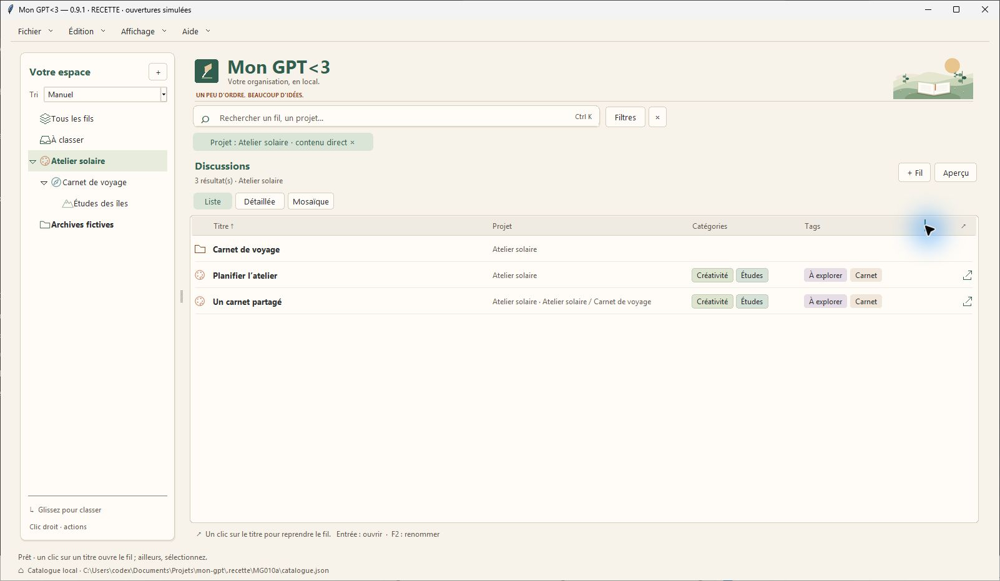
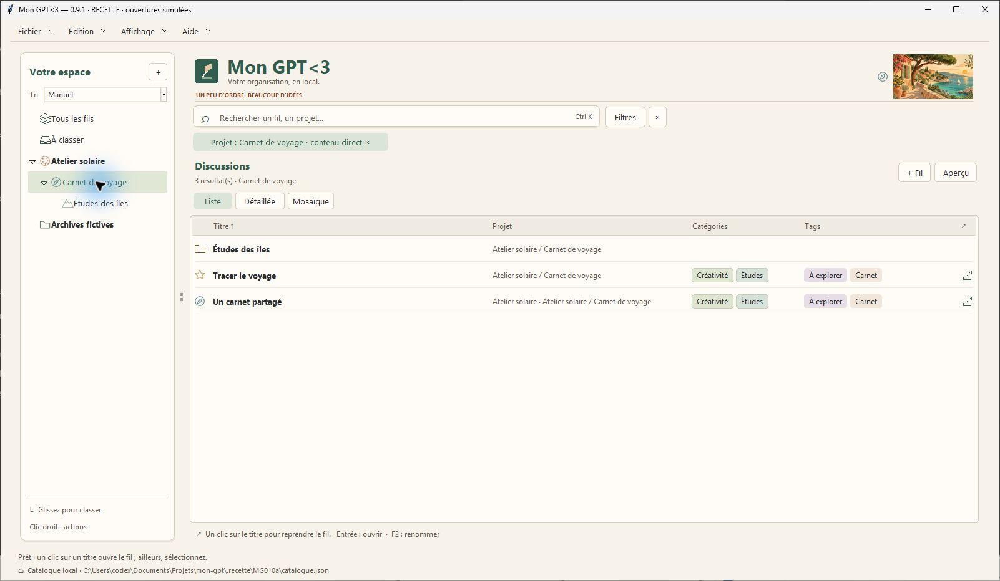
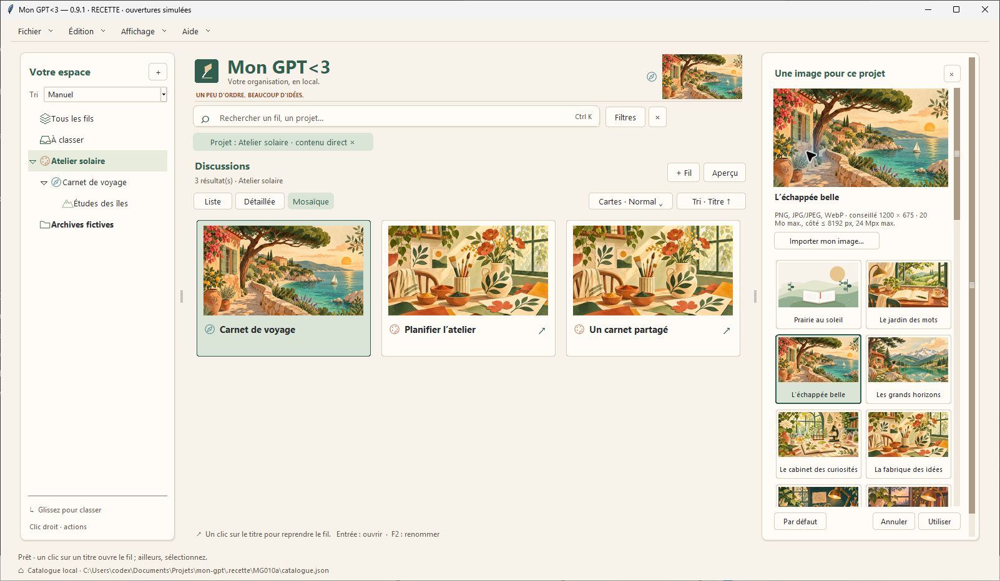
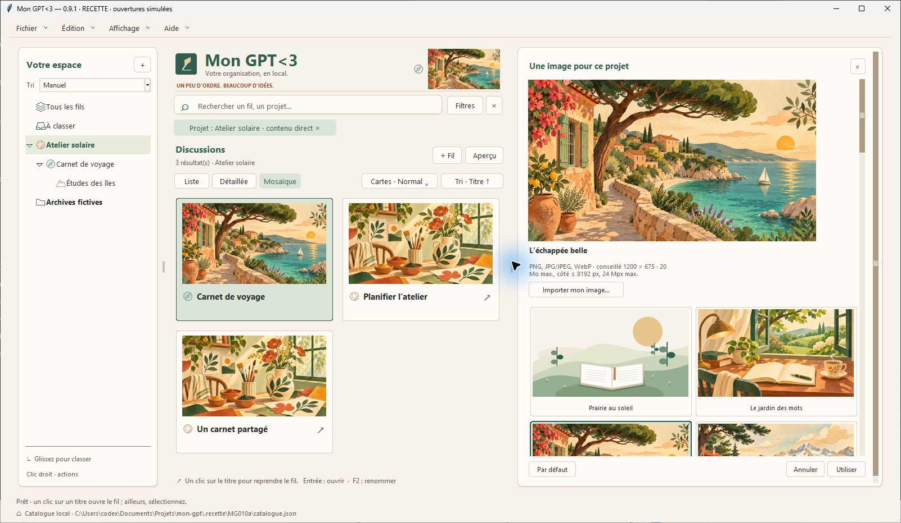
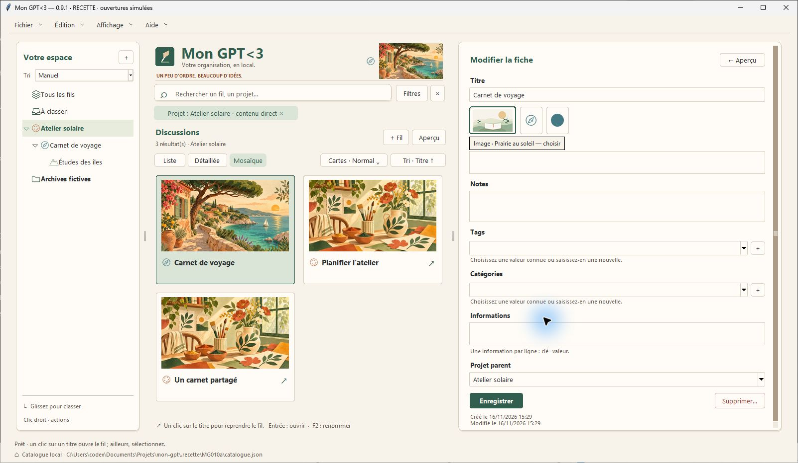

# MG-010a — Premières corrections de recette fonctionnelle

Mon GPT<3 **0.9.1** · 16 novembre 2026 · CODEX-VM, Windows 11 / Python 3.13 / Tk 8.6.

**Périmètre : les trois corrections demandées seulement.** Le parking `docs/idees-et-finitions.md` reste inchangé. Aucun développement de sélection multiple, configuration persistante des colonnes, tableau de bord ou installateur. Collector Chrome 0.8.2 inchangé.

**GO technique, soumis à validation David/GPT.**

## Contenu direct des dossiers

La vue centrale reprenait intégralement la portée récursive de `Catalog.search(project=P)`. Elle filtre maintenant ce résultat pour garder **les fils directement rattachés à P** et **les projets immédiatement enfants**. Un fil partagé P + enfant reste présent une seule fois ; un fil exclusivement rattaché à un descendant n’apparaît plus dans P.

Le filtrage est commun à Liste, Détaillée et Mosaïque dans `App.refresh_results()`. La recherche générique du cœur conserve sa sémantique récursive pour les autres appelants ; `core.py` n’est pas modifié. Aucun rattachement changé. La pastille de périmètre indique désormais « contenu direct ». Tous les fils, À classer, recherche, filtres et tri gardent leurs fonctions.

Fixture P → E → F avec quatre fils (P, E, F, P+E) : **P = 2 fils + E ; E = 2 fils + F ; F = 1 fil**. Les trois vues ont les mêmes identifiants et décomptes. La recherche globale retrouve le fil de F, absent de P.

## Colonnes de Liste

Les libellés deviennent **Titre** et **Projet**. Les cellules et leurs rattachements multiples sont conservés.

Trois causes rendaient le redimensionnement trompeur : la largeur stockée du titre pouvait différer de sa largeur affichée ; son extension automatique compensait les déplacements des autres colonnes ; le survol général remplaçait le curseur du séparateur. De plus, la dernière frontière, contre l’ouverture épinglée, était exclue de la détection.

Le glissement part maintenant de la largeur **réellement visible**, puis fige le titre pour cette session. La poignée a une tolérance de sept pixels, un curseur horizontal et un trait discret au survol. Les séparateurs hors de la zone visible ne sont pas actifs ; le défilement horizontal donne accès aux colonnes secondaires. Le titre et l’ouverture restent épinglés, le contenu secondaire est borné à sa zone. En centre très étroit, la présentation compacte reste prioritaire, sans fausse poignée inutilisable.

Une manipulation de largeur ne déclenche ni tri, ni déplacement de fiche, ni ouverture. Le clic hors poignée trie toujours dans les deux sens. Les largeurs restent lors des changements de vue, **sans ajout à `interface.json`**. Les minima et l’adaptation à la taille de fenêtre sont conservés.

## Galerie des images

Les cartes utilisaient une hauteur fixe de 94 px et des images de 60 px. Leur image utilise désormais la largeur disponible et une hauteur correspondante en **16:9**, avec une zone de légende sous l’image. Les images personnelles, y compris les portraits, restent entières dans le cadre. L’aperçu d’image suit aussi la largeur disponible, dans un gabarit plafonné. Deux colonnes, défilement, boutons et sélecteurs existants conservés.

Le double-clic gauche sélectionne l’image et appelle **exactement `VisualLayer.accept()`**, comme Utiliser. Un garde de fermeture empêche la double application. Le clic simple, Entrée et Espace continuent de sélectionner sans fermer ; Utiliser et Annuler restent disponibles, puis le focus revient à la commande Image de l’éditeur. Une image personnelle courante ou importée peut aussi être choisie, et le grand aperçu accepte le double-clic.

**Aucun enregistrement automatique de fiche.** Le choix est un brouillon d’édition ; Enregistrer reste nécessaire. L’abandon de l’édition retrouve la valeur enregistrée. Icônes, couleurs et héritage des fils conservent leur fonctionnement et leur présentation.

## Vérifications

- **153 tests Python réussis**, dont les 144 précédents et neuf régressions MG-010a. [Journal](tests-python.txt).
- **43 tests JavaScript réussis**, sans modification du Collector. [Journal](tests-javascript.txt).
- Portée directe, profondeur trois, partage, recherche globale, filtres et égalité des trois vues ; état métier strictement identique avant/après navigation.
- Événements Tk Motion / pression / déplacement / relâchement pour les quatre colonnes : largeur visible changée, poignée, minima, défilement, tri hors poignée et ouverture épinglée ; aucun tri ni ouverture durant le glissement.
- Galerie étroite/large pour projet et fil : hauteur variable, ratio, scrolling ; clic simple, clavier, Utiliser, Annuler et vrai enchaînement de deux clics ; application unique et focus de retour.
- Image personnelle fictive importée et appliquée à un fil, sauvegarde ZIP relue avec image et mappings ; schéma 4 conservé. Les tests MG-009 de réimport v2, personnalisation, restauration et idempotence restent verts.

Deux anciens tests ont été adaptés sans supprimer leur contrôle : le test de titre attend la largeur **visible** moins le déplacement, et le test de glisser Mosaïque navigue par la sélection de l’arbre avant d’examiner son nouveau dossier, pour synchroniser les événements Tk. Le comportement métier du glisser reste vérifié.

## Recette Windows et captures

Catalogue isolé **`.recette/MG010a`**, avec **1 429 conversations entièrement fictives**, quatre dossiers, une hiérarchie sur trois niveaux, un fil partagé et une image personnelle fictive. Le catalogue habituel n’a pas été ouvert ni modifié. Aucune capture, donnée ou identité personnelle publiée.

Lancement réel :

```powershell
python -m mon_gpt --data-dir .recette/MG010a --simulate-open
```

Les captures ci-dessous proviennent de l’application Windows exécutée ; elles ne sont pas des maquettes.

Gestes natifs vérifiés : les quatre colonnes glissées successivement (Titre réduit de 300 px, Projet élargi de 170 px, Catégories de 30 px et Tags de 50 px), parent/enfant puis passage Détaillée/Mosaïque avec le même décompte, ouverture de l’éditeur, volet d’image élargi d’environ 300 px, double-clic sur une couverture pack, abandon du brouillon, puis clic simple et double-clic sur le portrait personnel fictif d’une discussion. Le focus revient à Image. **Aucune conversation ouverte**, aucun enregistrement automatique : le projet conserve sa couverture enregistrée, différente du brouillon choisi.

Contrôle complémentaire du catalogue fictif après fermeture : **1 429 fils, schéma 4, quatre mappings**, image personnelle et ZIP complet relus ; restauration dans un autre dossier isolé strictement identique, réimport v2 sans effet avant et après restauration. [Résultats statistiques](recette-statistiques.json).











## Fichiers et limites

Code : `ui.py` (portée et interactions d’en-tête), `atelier.py` (largeurs et poignées), `identity_ui.py` (images responsives et double-clic), numéro de version. Tests et README associés. **Stockage, schémas, adaptateur ChatGPT, importeur, moteur générique et résolveur d’identité inchangés.**

Les largeurs sont mémorisées uniquement pendant la session ; les colonnes masquées par la compacité restent accessibles au défilement ou via le détail existant. Le choix d’image n’enregistre jamais la fiche. Pas de chantier supplémentaire engagé. Arrêt après MG-010a pour validation David/GPT.

Lancement habituel depuis PowerShell :

```powershell
& 'C:\Users\codex\Documents\Projets\mon-gpt\lancer.cmd'
```
