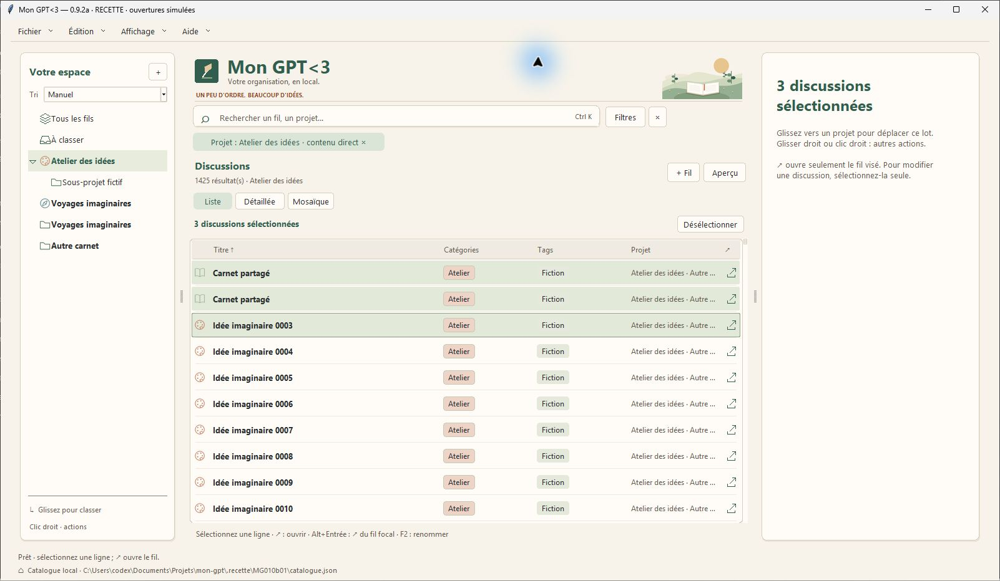
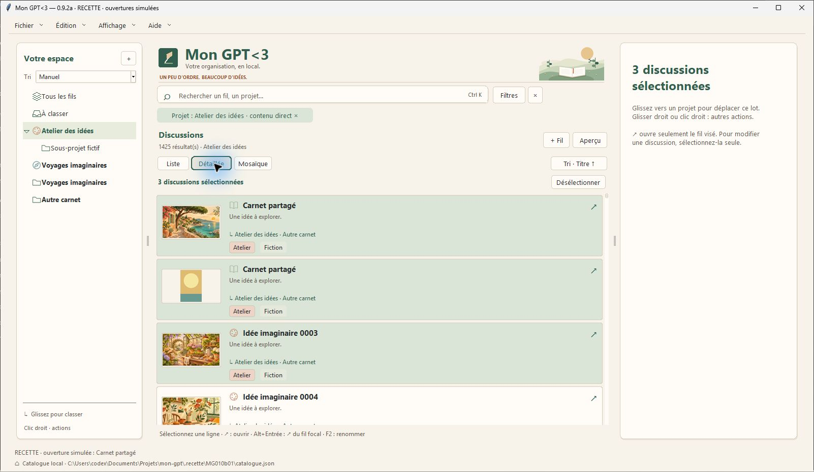
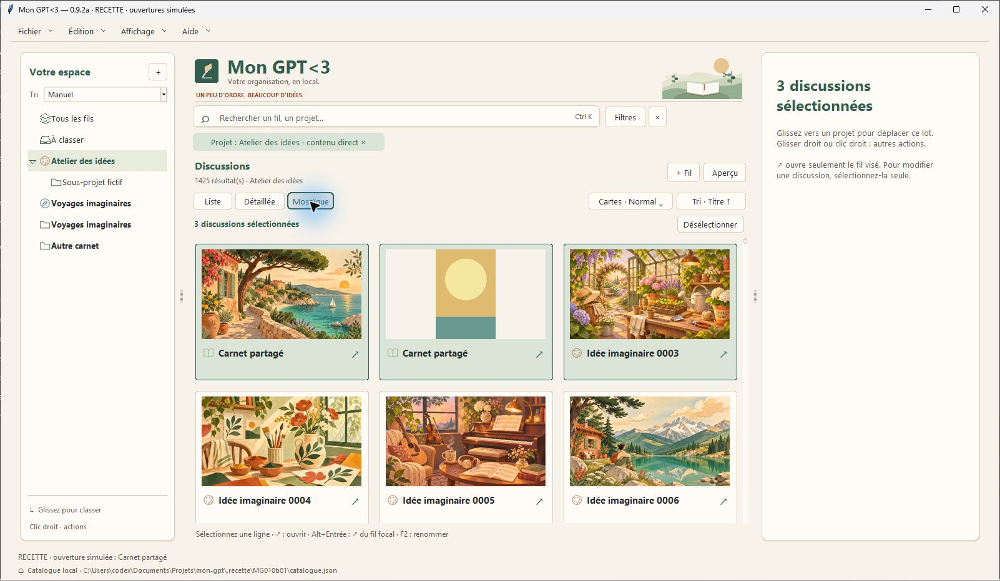
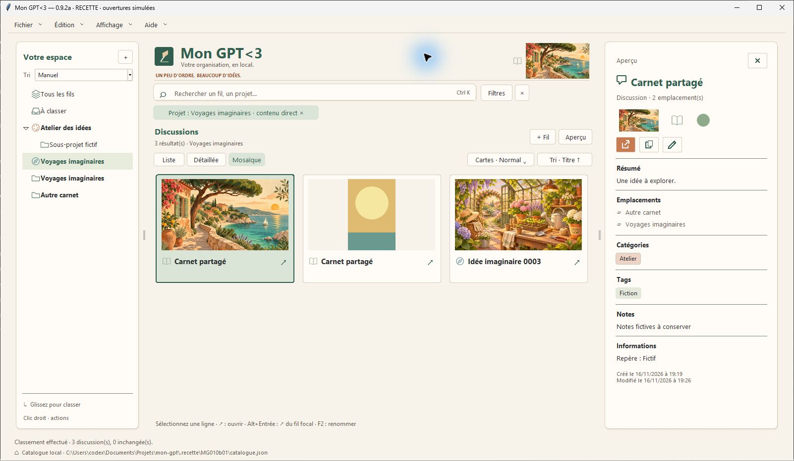
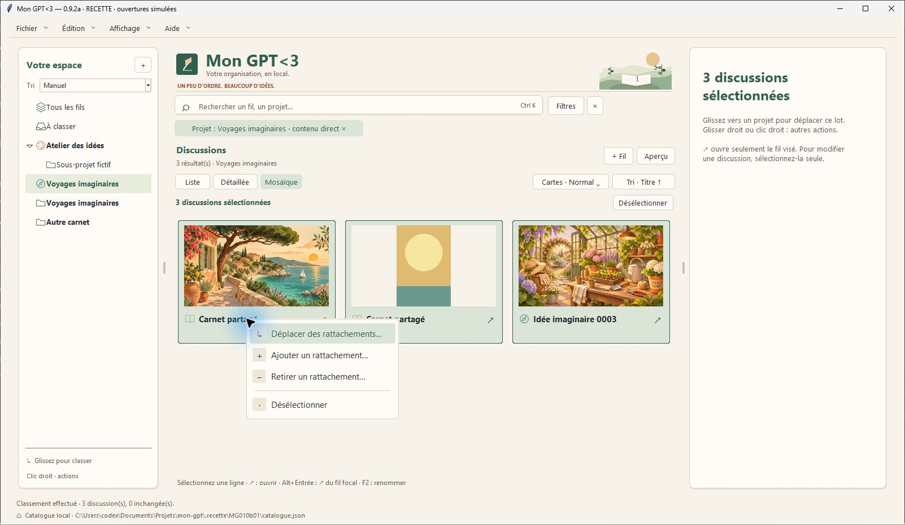
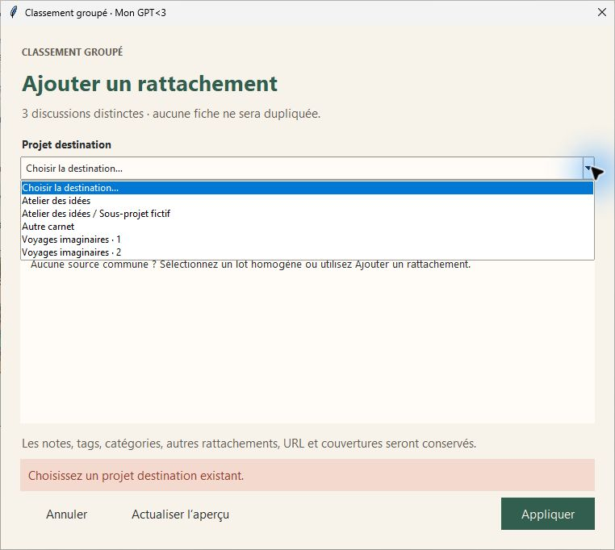

# MG-010b-01 — Gestes naturels et noms lisibles

Mon GPT<3 **0.9.2a** · 16 novembre 2026 · CODEX-VM / Windows / Python 3.13 / Tk.

## Résultat

Une discussion ou un lot utilise les mêmes gestes : **glisser gauche = déplacer**, **glisser droit = Déplacer ici / Ajouter un rattachement ici**. Le titre sélectionne ; **↗ ouvre uniquement le fil visé**, sans réduire un lot. Aucun dialogue ajouté au glisser connu, aucune sauvegarde préventive à chaque geste, aucune intervention dans ChatGPT.

Le bandeau conserve seulement le compteur et Désélectionner. Les actions groupées restent au clic droit et à la touche Menu. Les sélecteurs affichent les noms/chemins, avec un numéro local seulement pour les libellés réellement identiques. L’aide et le [guide des gestes](../../docs/MG-010b-selection.md) décrivent les nouveaux comportements.

## Diagnostic et réalisation

Trois mécanismes de 0.9.2 causaient les écarts : branche `batch` qui bloquait le glisser, hit-tests d’ouverture couvrant titre/icône, et UUID complets ajoutés systématiquement aux projets.

- `drag_press` photographie les identifiants sélectionnés si le départ appartient au lot ; un départ hors du lot sélectionne ce seul fil. La réduction différée au relâchement reste réservée au clic sans déplacement. Ctrl/Maj servent à sélectionner et ne lancent ni classement ni ouverture.
- `drag_motion` et `drop_target` sont communs : cible surlignée, curseur de dépose, nombre de fils dans le statut. Les projets gardent leur déplacement individuel dans l’arbre.
- `drop_items` résout la source depuis le contexte direct commun, sinon depuis l’unique source commune ; un lot À classer n’a pas de source à retirer. Plusieurs sources communes demandent **quel emplacement remplacer** dans un petit panneau intégré. Le bouton Déplacer applique directement ; sans source commune, aucune source arbitraire n’est choisie. Un changement de sélection pendant ce choix empêche d’agir sur l’ancien lot.
- `apply_classification` emploie **`build_batch` puis `Store.commit_batch` existants**, pour un fil comme pour plusieurs. Une seule écriture atomique, zéro écriture pour source = destination. Le glisser droit applique son choix sans seconde confirmation. Le sélecteur individuel utilise également ce moteur, y compris pour un no-op source = destination. L’aperçu est reconstruit depuis le catalogue actif après le commit, également pour un fil qui reste visible dans Tous les fils. Le dialogue du menu conserve son aperçu, puis Appliquer le ferme sans écran de succès supplémentaire.
- `project_choices.py` produit une table libellé → UUID. Chemins identiques numérotés dans l’ordre des UUID locaux, sans modifier les données ; noms réellement uniques sans suffixe. Les vrais noms contenant déjà « · 1 » ne sont pas écrasés. La fonction sert aussi aux sélecteurs individuels. Actualiser un dialogue conserve les choix par identité interne, pas par ancien libellé.
- Les trois hit-tests ne reconnaissent que la zone ↗ dessinée, indépendamment de la longueur du titre et du défilement. Le bouton ouvre un fil même hors du lot, sans le détruire. L’anti-rebond empêche la double ouverture. Titre, icône, couverture, double-clic et Entrée sur la ligne n’ouvrent aucune URL. **Alt+Entrée** active explicitement ↗ du fil focal ; Liste/Détaillée conservent droite pour focaliser l’action, puis Entrée pour l’activer. Une sélection normale revient au titre. Infobulle « Ouvrir dans ChatGPT » et curseur main uniquement sur ↗ ; séparateurs de colonnes préservés.

**Moteur `batch.py`, stockage, schéma 4, `core.py`, adaptateur ChatGPT, identité visuelle, sélection partagée, import MG-009 et Collector inchangés.** Pas de migration, de système de plugins, de nouveau projet logiciel ou de chantier du parking.

## Vérifications automatisées

**184 tests Python réussis** : [journal complet](tests-python.txt). **67 contrôles ciblés de l’interface repassés après les derniers ajustements de rafraîchissement et de sélecteur individuel** : [journal final](tests-interface-finale.txt). Les **173 contrôles existants** sont conservés, avec adaptation des attentes intentionnellement changées : titre/Entrée ne doivent plus ouvrir, drag valide désormais autorisé, et lecture du catalogue candidat actif après un commit atomique. Onze tests supplémentaires sur événements Tk couvrent les nouveaux gestes ; aucune suppression de test.

Les tests exercent les vrais `ButtonPress`, `B1/B3-Motion`, `ButtonRelease`, doubles clics horodatés et touches, pas uniquement les méthodes métier :

- ouverture ↗ unique, titres/icônes/couvertures inertes, Ctrl/Maj et conservation du lot, 1000×680 et 1600×900, trois vues ;
- glisser gauche d’un ou trois fils dans les trois vues, départ dans/hors du lot, source parent et sous-projet ;
- glisser droit d’un et trois fils, menu identique, déplacements et ajouts en une seule écriture, aucune fenêtre de confirmation supplémentaire ;
- source unique globale, plusieurs sources et choix intégré, À classer, source = destination, cible invalide, modificateurs ;
- autre rattachement conservé, zéro clone, panne d’écriture sans effet partiel, sélection remplacée pendant le choix de source ;
- noms simples, chemins distincts, homonymes déterministes et association finale au bon ID, collision avec un nom contenant déjà un numéro, bandeau sans trois boutons ;
- contrôles historiques maintenus : imports idempotents, sauvegarde/restauration, images personnelles, mappings, tri/filtres/reprise, colonnes et menus.

**43 tests JavaScript réussis**, Collector inchangé : [journal](tests-javascript.txt).

## Recette Windows réelle

Catalogue isolé **`.recette/MG010b01`** : **1 429 conversations fictives**, cinq projets avec parent/enfant et deux homonymes, quatre mappings fictifs, deux fils de même titre, multi-rattachements, six couvertures différentes et une image personnelle fictive. La bibliothèque habituelle n’a pas été ouverte.

```powershell
python -m mon_gpt --data-dir .recette/MG010b01 --simulate-open
```

Parcours observé dans l’application :

1. Double-clic réel sur un titre : sélection/aperçu, **zéro ouverture**. Maj+flèches construit un lot de trois fils ; Liste → Détaillée → Mosaïque garde les trois et l’inspecteur neutre.
2. Clic ↗ dans le lot : **une seule ouverture simulée**, sans réduction du lot. Glisser gauche réel depuis un titre sélectionné vers le projet dans l’arbre : **trois fils déplacés immédiatement**, source seule retirée, autre emplacement conservé, aucun dialogue.
3. Le projet destination affiche les trois fils ; inspection d’un fil : notes et deux emplacements attendus présents. Ctrl+A puis clic droit conservent le lot et ouvrent ses trois commandes. Le sélecteur montre des noms simples et les deux homonymes « · 1 / · 2 », sans GUID. Ajout de la source initiale en un clic Appliquer : fermeture immédiate, **trois liens ajoutés**, aucun clone.
4. Passage natif à **1000×680**, aperçu ouvert : compteur, Désélectionner, carte et ↗ accessibles. Clic ↗ : une ouverture simulée de ce seul fil, toujours trois sélectionnés. L’aide compacte reste lisible sur deux lignes.
5. Fermeture puis relance réelles : projet et Mosaïque retrouvés, **aucun lot caché, aucune ouverture au démarrage**. Journaux d’erreurs vides.

Comparaisons des instantanés avant/après glisser/après ajout : seuls les trois fils attendus changent de rattachements et date de modification. **Les 1 426 autres fils sont strictement identiques**. UUID, URL, titres, notes, tags, catégories, métadonnées, couvertures, dates de création et mappings préservés. ZIP exporté après la recette et restauré dans un autre répertoire isolé : état identique, image personnelle comprise. [Assertions statistiques uniquement](recette-statistiques.json).

### Captures natives, sans retouche













## Limites de recette et livraison

Le **glisser droit est fonctionnel et testé avec événements Tk complets dans des fenêtres Windows réelles**. L’outil de pilotage natif expose le drag gauche seulement : son geste physique droit reste à confirmer par David, comme lors des recettes précédentes. Le clic droit et les menus ont été pilotés nativement. Les autres facteurs DPI/zoom Windows et l’accessibilité par lecteur d’écran ne sont pas évalués dans cette correction.

Aucune donnée personnelle publiée. Six captures seulement, aucun catalogue de recette versionné. Pas de modification du parking ni de démarrage MG-010c. Arrêt après cette correction pour validation David/GPT.

Lancement habituel :

```powershell
& 'C:\Users\codex\Documents\Projets\mon-gpt\lancer.cmd'
```
