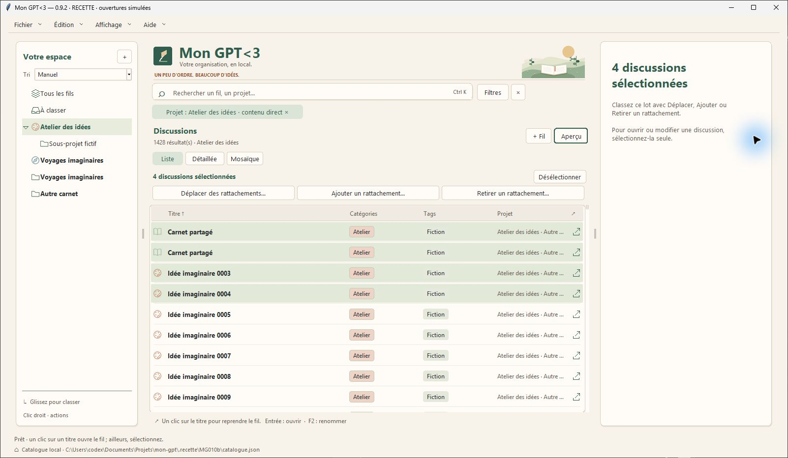
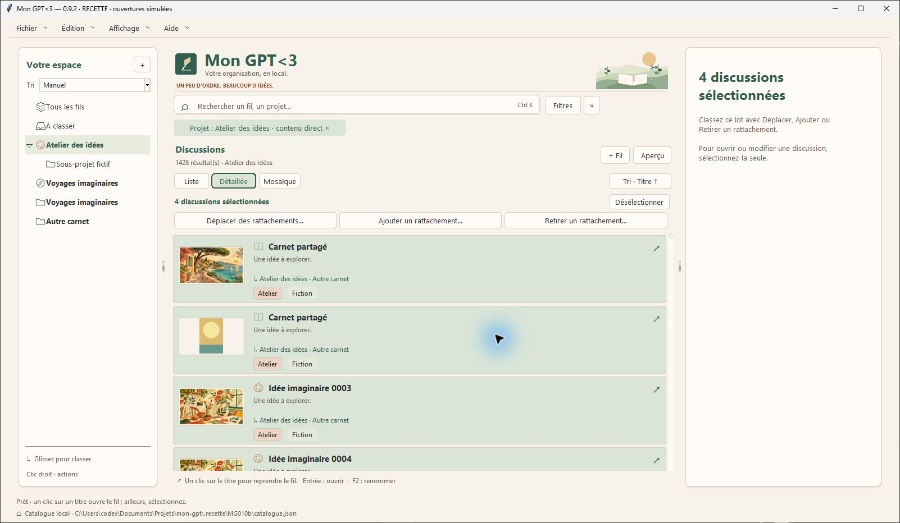
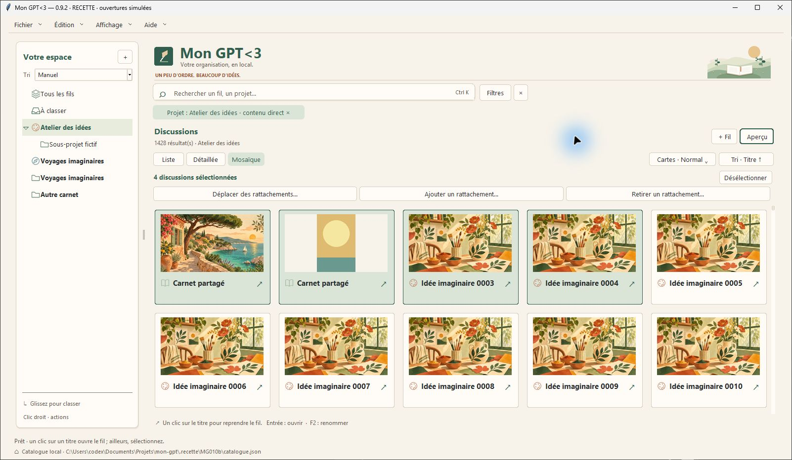
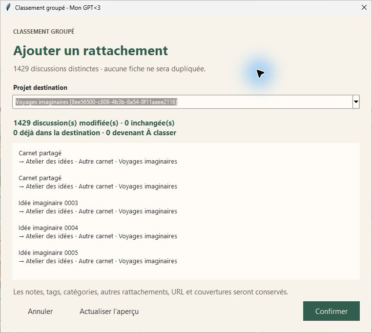
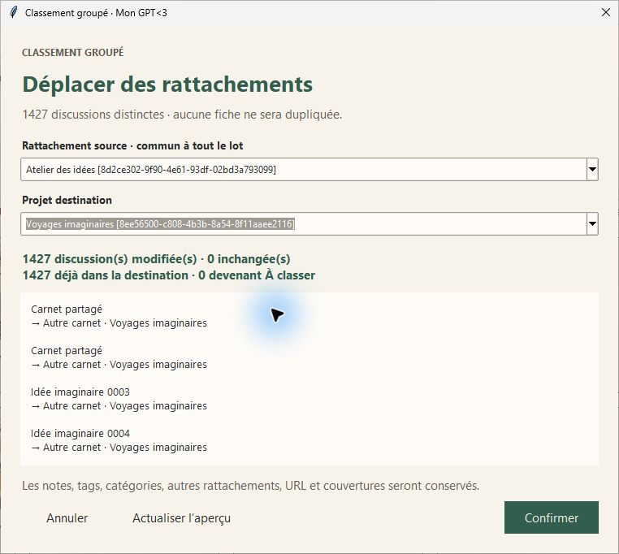
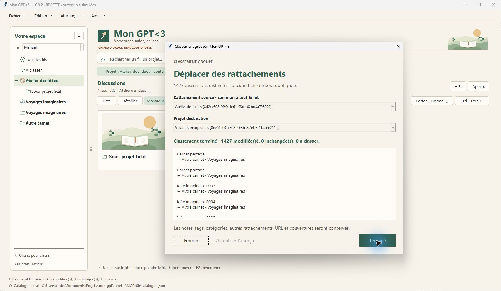

# MG-010b — Sélection multiple et classement groupé

Mon GPT<3 **0.9.2** · 16 novembre 2026 · CODEX-VM, Windows 11 / Python 3.13 / Tk 8.6.

Périmètre : sélection de **discussions** dans les trois vues, déplacement / ajout / retrait de rattachements, aperçu et confirmation atomique. Aucun projet sélectionné en lot, aucune suppression de masse, aucun éditeur par lot, configurateur de colonnes, dashboard ou installateur. Collector Chrome **0.8.2 inchangé** ; aucun accès à ChatGPT ni à la bibliothèque personnelle.

## Sélection et signaux

`selection.py` porte un modèle partagé, sans Tk : identifiants locaux ordonnés selon les résultats, ancre et focale. Liste, Détaillée et Mosaïque utilisent ce même état et dessinent toutes les fiches sélectionnées, avec une bordure de focale. Ctrl+clic ajoute/retire ; Maj+clic sélectionne la plage visible ; Ctrl+Maj fait l’union. Ctrl+A reste attaché au widget des résultats et exclut projets et fiches filtrées, même pour les lignes hors écran. Maj+flèches étend le lot ; Mosaïque tient compte de sa grille 2D.

Les vues conservent la sélection ; le tri et les filtres la limitent aux résultats encore visibles. Un changement de projet la vide. Les projets restent sélectionnables seuls. Échap réduit le lot après les traitements prioritaires existants, sans fermer l’aperçu. La reprise de session ne mémorise aucun lot caché.

À deux fiches, le bandeau compact propose les trois actions et Désélectionner. Il raccourcit les boutons en centre étroit, avec noms complets au survol/menu. L’inspecteur devient neutre et `current` ne désigne aucune fiche unique. Renommer, modifier et enregistrer sont désactivés dans le menu ; Entrée, F2, Ctrl+S et les autres commandes individuelles sont gardés par le contrôleur. Le clic simple revient à une sélection unique, dont le titre et ↗ gardent l’ouverture directe.

Le clic droit sur le lot le conserve ; sur une autre fiche il revient au menu individuel. Les modificateurs empêchent ouverture et drag. Le glisser d’un lot est **bloqué explicitement**, avec indication des commandes à employer. Les gestes de glisser d’une fiche et les poignées de colonnes MG-010a sont préservés. Aucun Ctrl+X / Ctrl+V ajouté.

## Plans et écriture

`batch.py` est indépendant de Tk, du stockage et de ChatGPT. Le plan pur photographie le catalogue, valide les fiches et projets, puis calcule uniquement les emplacements à changer et les compteurs. **Copier = ajouter un rattachement, jamais dupliquer la fiche.**

- Ajouter conserve tous les anciens liens, ignore les destinations déjà présentes.
- Déplacer retire **une seule source explicite**, commune à tout le lot, puis ajoute la destination sans doublon. Autres emplacements et leur ordre conservés. Depuis Tous les fils, aucune source choisie arbitrairement ; depuis un projet, préremplissage seulement si tous les fils lui sont directement liés. Source = destination : aucun changement. Un lot entièrement À classer peut recevoir son premier rattachement ; un lot hétérogène est bloqué.
- Retirer enlève cette seule source commune. Une fiche sans autre lien devient À classer ; aucune fiche supprimée.

`batch_ui.py` présente source/destination, nombre de fiches modifiées, déjà présentes, inchangées et devenant À classer, ainsi qu’un aperçu de six titres au maximum, **dans la fenêtre locale seulement**. Les homonymes sont désambiguïsés par chemin et UUID local intégral. Annuler / Échap ne mutent rien. Une fiche en cours d’édition passe d’abord par `can_leave()` ; annuler préserve le brouillon.

`Store.commit_batch()` revérifie le plan, la sélection visible côté interface, **tout l’état du catalogue et de l’adaptateur**, puis construit un candidat détaché. Validation stricte, limites et images sont contrôlées avant **un seul `Store.save()` atomique**. Les objets actifs sont remplacés après réussite seulement. Un no-op n’écrit rien ; une erreur ou un état périmé refuse tout le lot. Les dates de création et personnalisations restent inchangées ; la date de modification suit uniquement le reclassement effectif.

Le schéma 4, `chatgpt_projects`, UUID, URL, images, autres champs métier et sauvegardes restent inchangés. **`core.py`, `chatgpt.py`, `identity.py`, l’importeur v2 et `ui_state.py` ne sont pas modifiés.** L’arbre, les résultats, les comptes et l’inspecteur sont rafraîchis après commit ; les fiches sorties du périmètre quittent la sélection.

## Vérifications automatisées

- **173 tests Python réussis** : les 153 tests MG-010a et 20 nouveaux contrôles. [Journal](tests-python.txt).
- **43 tests JavaScript réussis**, Collector inchangé. [Journal](tests-javascript.txt).
- Événements Tk réels : Ctrl/Maj/Ctrl+Maj, plages, Ctrl+A filtré et texte inchangé, flèches 2D, Échap, menu, double-clic rapide avec Ctrl, en-têtes/redimensionnement et blocage du drag de lot. Les tests n’appellent pas seulement les fonctions de sélection.
- Même titre / deux UUID, projet enfant exclu du lot, maintien entre vues, tri, filtres et changement de périmètre ; inspecteur neutre ; commandes individuelles inactives ; brouillon et annulation préservés.
- Ajout de 20 fils : zéro clone, tous les champs conservés, une écriture. Répétition : zéro écriture. Déplacement de dix P+R vers Q : R conservé, P seul retiré. Retrait : autres emplacements préservés / À classer ; premier classement d’un lot vide.
- Source absente, lot mixte, destination/source supprimées, fiche supprimée, mappings/notes changés depuis l’aperçu, erreur à la cinquième mutation du candidat, panne de sauvegarde/remplacement et limite de taille : état initial des objets et du disque préservé.
- Image personnelle fictive et mappings dans un ZIP relu/restauré ; **réimport Collector v2 après classement sans doublon ni écrasement**. Fermeture/réouverture sans sélection multiple restaurée.
- Fixture de **1 429 fils** : lot de 100, Ctrl+A des 1 429 résultats, trois vues ; Canvas limité aux éléments dessinés visibles, sans création de widgets par fiche.

## Recette Windows native

Catalogue isolé **`.recette/MG010b`** : 1 429 discussions entièrement fictives, projets parent/enfant, deux dossiers homonymes, deux fils homonymes, liens multiples et un portrait personnel fictif. La bibliothèque habituelle n’a été ni ouverte ni modifiée.

```powershell
python -m mon_gpt --data-dir .recette/MG010b --simulate-open
```

Les captures suivantes sont des fenêtres réellement exécutées, sans retouche ni données personnelles. La sélection à la souris avec modificateurs est exercée par événements Tk dans les tests ; la recette physique utilise les clics simples, Maj+flèches, Ctrl+A, boutons et sélecteurs Windows.

Parcours natif exécuté : quatre discussions sélectionnées avec Maj+flèches, passage entre les trois vues, aperçu neutre affiché puis masqué. Ctrl+A a sélectionné les **1 429 fils hors écran compris**. Ajout confirmé vers un des deux dossiers homonymes, distingués par leurs UUID : **1 429 modifications, zéro clone**. Depuis le projet source, Ctrl+A a exclu son sous-projet et retenu **1 427 discussions** ; le déplacement confirmé a retiré cette seule source, conservé la destination déjà présente et le second emplacement de dix fils. Le projet source affiche ensuite son unique sous-projet, sans lot résiduel.

Enfin, retrait du rattachement commun depuis Tous les fils, avec choix explicite de source : **1 429 modifications, 1 419 fils devenus À classer, dix conservant leur autre emplacement**. Comparaison des trois états après écriture avec l’instantané initial : mêmes 1 429 UUID, mêmes URL et mappings, mêmes titres, descriptions, notes, tags, catégories, métadonnées, identités visuelles et dates de création. Seuls les rattachements et dates de modification attendus changent. La sauvegarde ZIP complète de ce catalogue a été restaurée dans un second répertoire isolé : contenu identique et image personnelle incluse. [Assertions statistiques](recette-statistiques.json).

Fermeture puis relance Windows : vue Mosaïque retrouvée, aucune sélection multiple et aucun bandeau de lot caché ; `selected: null` dans les préférences après fermeture du lot. **Zéro ouverture simulée pendant les trois opérations et au démarrage.** Un clic individuel volontaire sur le titre après relance a ensuite produit exactement une ouverture simulée, vérifiée dans le journal local non publié. Aucun navigateur lancé. Contrôle supplémentaire à **1000×680 avec aperçu ouvert** : compteur sur deux lignes, trois boutons courts lisibles et désélection accessibles, recherche et tri toujours visibles. Les journaux d’erreurs d’exécution sont vides.













## Utilisation et limites

[Guide court des gestes et des trois opérations](../../docs/MG-010b-selection.md). Le glisser de lot est volontairement désactivé ; aucune sélection multiple n’est restaurée au lancement. Les sources ambiguës doivent être résolues explicitement ; aucun choix individuel caché n’est effectué. Les limites du catalogue existant restent applicables.

Lancement habituel :

```powershell
& 'C:\Users\codex\Documents\Projets\mon-gpt\lancer.cmd'
```

Arrêt après MG-010b pour validation David/GPT. Parking inchangé ; MG-010c et les autres idées ne sont pas commencés.
