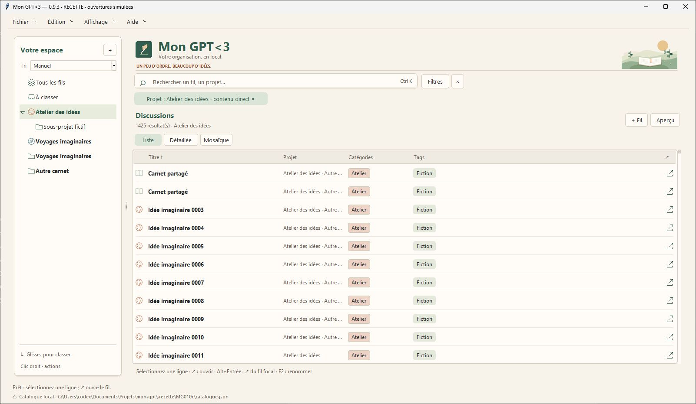
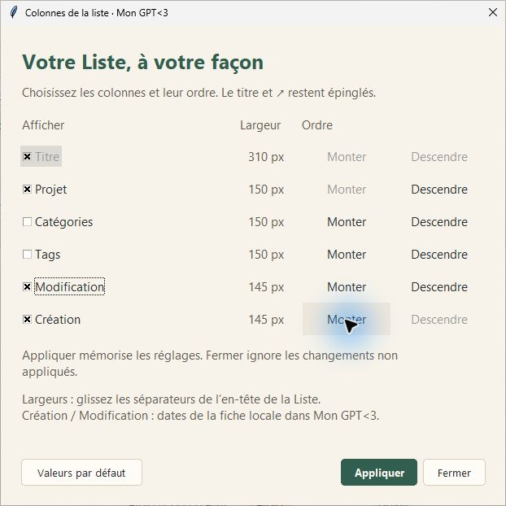
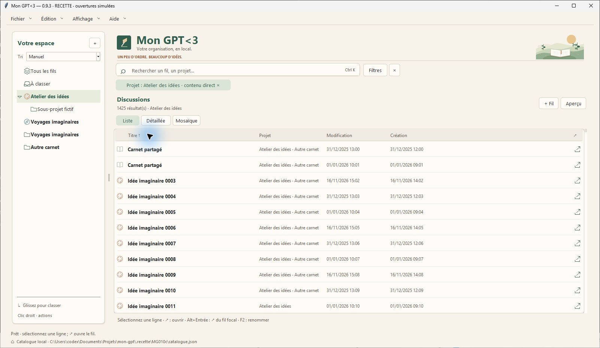
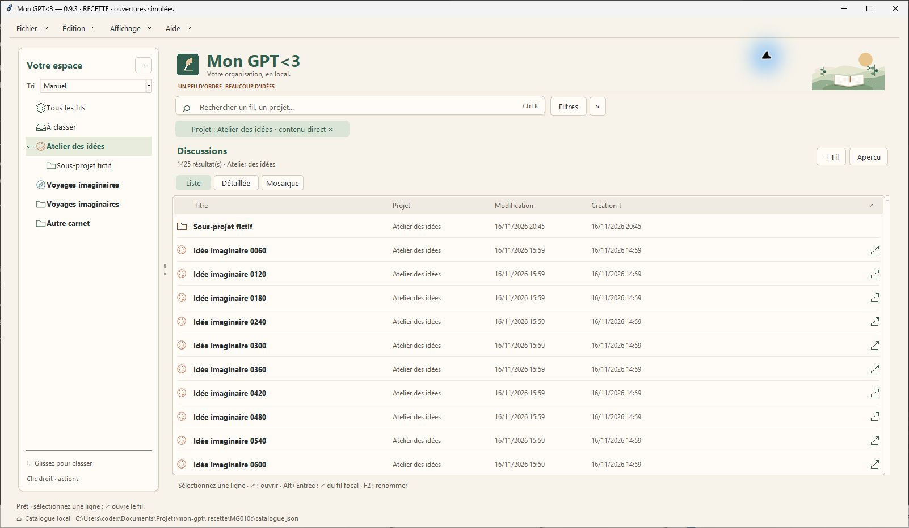
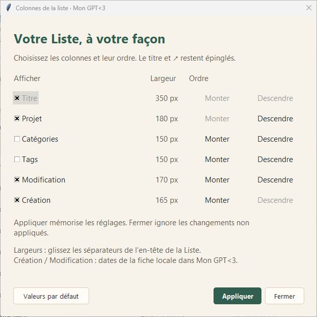
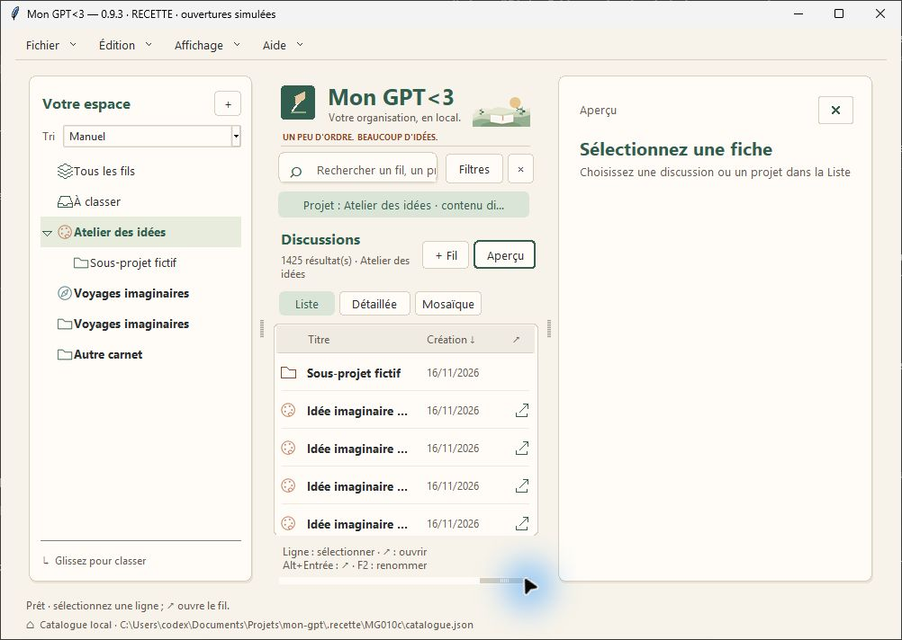

# MG-010c — Administration des colonnes de la Liste

Mon GPT<3 **0.9.3** · 16 novembre 2026 · CODEX-VM / Windows / Python 3.13 / Tk.

## Résultat livré

**Affichage → Colonnes de la liste…** propose les six colonnes avec cases de visibilité, Monter / Descendre, largeur en pixels, Valeurs par défaut, Appliquer et Fermer. Titre reste visible et premier ; icône et ↗ sont fixes. Les dates Création et Modification sont masquées initialement. Fermer ignore les changements non appliqués ; Appliquer les utilise et les mémorise, sans confirmation ni sauvegarde métier supplémentaire. Le panneau est accessible depuis les trois vues mais configure uniquement la Liste.

L’ordre choisi reste stable à toute largeur. Les colonnes secondaires défilent horizontalement, sans masquage automatique ni permutation. Le titre et ↗ restent accessibles. Les largeurs sont mémorisées au relâchement du séparateur, pas à chaque pixel. En espace contraint, la largeur effective du titre s’adapte ; sa largeur demandée reste conservée pour une fenêtre plus large.

[Guide d’utilisation](../../docs/MG-010c-colonnes.md).

## Diagnostic et architecture

Le tableau est un Canvas virtuel. L’ancien `layout()` permutait Projet/Catégories/Tags selon la largeur et repliait les colonnes sous un seuil. Les largeurs restaient dans le widget ; `interface.json` n’enregistrait pas leur configuration. Les valeurs de ligne étaient principalement un tuple positionnel et le tri utilisait du texte.

- **`list_columns.py`** centralise clé, libellé, largeur initiale, bornes, type de rendu et clé de tri des six colonnes. Le même registre sert à la validation, au panneau, aux en-têtes, aux cellules et au tri. Titre : 180–1200 px demandés ; Projet/Catégories/Tags : 65–1000 px ; dates : 90–1000 px.
- Les données de ligne de la Liste utilisent un dictionnaire **`cells` nommé**, indépendant de l’ordre affiché : titre, projet, catégories, tags et horodatages. Le tuple historique demeure seulement comme contrat de compatibilité des rendus Détaillée/Mosaïque existants ; leurs cartes et couvertures ne sont pas remaniées.
- **`columns_ui.py`** porte l’administration et la lecture/écriture des préférences complètes. Le panneau possède un brouillon : visibilité/ordre/defaults ne s’appliquent qu’avec Appliquer. Les séparateurs restent les commandes de largeur. Les actions au clavier et les boutons sont accessibles sans drag obligatoire. Le panneau est centré et les boutons restent visibles à sa taille minimale.
- **`atelier.py`** dessine les seules colonnes visibles dans l’ordre choisi, conserve le défilement et calcule les poignées sur les colonnes réellement présentes. Toutes les cellules restent dessinées dans le Canvas, uniquement pour les lignes visibles, sans widgets par conversation.
- **`ui_state.py`** étend le format **version 1** avec le champ optionnel `list_columns` : ordre complet, visibilité, largeurs et tri/direction. Un ancien fichier v1 est conservé tel quel à la lecture et reçoit les défauts côté interface. Si seul ce champ est invalide, les colonnes reviennent aux défauts avec un statut lisible ; recherche, filtres, périmètre, sélection, branches, aperçu et vue valides restent conservés. Les préférences générales invalides gardent le repli existant.
- La sauvegarde utilise **le même `interface.json`**, avec tous les champs existants. Elle intervient après Appliquer, après un tri, au relâchement d’une poignée ou à la fermeture. Une panne de préférences est signalée sans affecter le catalogue.

**Aucun changement à `core.py`, `chatgpt.py`, `identity.py`, au stockage métier, au schéma 4, au moteur groupé, à l’importeur v2 ou au Collector.** Aucun nouveau champ métier, migration de catalogue, système de plugins ou application séparée. Le parking demeure inchangé.

## Dates et tri

Les deux dates sont celles de la **fiche locale Mon GPT<3**, et non celles d’origine de la conversation ChatGPT. Les projets éventuellement affichés utilisent aussi leurs propres dates.

Les cellules montrent `JJ/MM/AAAA HH:MM` si la place le permet, sinon la date complète. Un fragment trop étroit affiche « … » ; l’année n’est jamais coupée. Le survol donne les deux valeurs complètes avec secondes et fuseau local. Le tri compare les **instants numériques des horodatages ISO**, y compris minutes et décalages de fuseau ; il n’utilise pas les chaînes françaises affichées.

Le tri commun propose les six clés. Masquer la colonne active avec Appliquer revient à Titre. En revenant d’une autre vue avec un tri masqué dans la Liste, le tri est ramené à Titre et le statut l’indique. Un changement de colonnes ou de tri n’écrit ni `created` ni `modified` dans le catalogue.

## Vérifications automatisées

- **192 tests Python réussis** : les **184 tests validés existants conservés sans modification**, et huit nouveaux tests de configuration/rendu/événements. [Journal complet](tests-python.txt).
- **Huit tests ciblés repassés après l’ajustement final du centrage et de la hauteur du panneau**, incluant ses boutons visibles. [Journal final](tests-colonnes-final.txt).
- **43 tests JavaScript réussis**, Collector 0.8.2 inchangé. [Journal](tests-javascript.txt).

Les contrôles supplémentaires couvrent :

1. Fichiers v1 historiques, restauration complète et configurations invalides : clés inconnues, ordre incomplet/doublonné, Titre masqué, largeur non numérique/booléenne/absurde, tri inconnu et mauvaise direction. Seules les colonnes invalides reviennent aux défauts ; catalogue et autres préférences intacts.
2. Cases au clavier, réordonnancement, Appliquer, Fermer, défauts préparés puis appliqués ; configuration depuis Détaillée sans changer son rendu. Zéro écriture de catalogue.
3. Quatre redimensionnements via **ButtonPress / B1-Motion / ButtonRelease** : exactement une écriture de préférences par relâchement, maintien du lot, passage entre vues puis restauration dans une nouvelle fenêtre.
4. Dates 31/12/2025, 01/01/2026 et 16/11/2026 à plusieurs minutes ; ordre ascendant/descendant de Création et Modification, cas où la chaîne ISO et le décalage horaire tromperaient un tri textuel. Dates affichées et infobulle complètes, dates des lignes projets, aucun timestamp métier modifié.
5. Colonnes cachées sans largeur ni poignée, défilement/pinning, 1000×680 et 1600×900 avec/sans aperçu ; titres inertes et ↗ ouvrant un seul fil. Retour clair au tri Titre lorsqu’il est masqué.
6. Après réordonnancement : lot de trois fils déplacé puis ajouté par glisser droit, une écriture métier par opération, autres liens conservés, menus et F2 fonctionnels.
7. **1 429 fils**, Ctrl+A hors écran, tri, défilement, filtre et Canvas borné aux éléments visibles ; panne d’écriture des préférences sans mutation du catalogue.
8. Les contrôles historiques de sélection, drag individuel/multiple gauche/droit, ouvertures, import idempotent, migrations, sauvegardes ZIP, images personnelles et mappings restent verts.

## Recette Windows native

Catalogue isolé **`.recette/MG010c`** : **1 429 discussions fictives**, cinq projets parent/enfant et homonymes, quatre mappings fictifs, multi-rattachements, couvertures variées et image personnelle fictive. Le fichier initial de préférences était un **v1 sans `list_columns`**. Aucune bibliothèque personnelle utilisée.

```powershell
python -m mon_gpt --data-dir .recette/MG010c --simulate-open
```

Parcours réellement exécuté :

- Démarrage : quatre colonnes Titre / Projet / Catégories / Tags. Ouverture du panneau depuis Affichage, masquage des deux colonnes à pastilles, activation des deux dates, déplacement de Modification avant Création, Appliquer.
- Redimensionnement natif de **Titre 350 px, Projet 180 px, Modification 170 px, Création 165 px**. Les valeurs ont été relues dans `interface.json` après les relâchements.
- Tri Création ascendant, puis décroissant : dates de décembre 2025, janvier 2026, novembre 2026 correctement groupées ; minutes cohérentes. **Comparaison octet pour octet : catalogue strictement identique après administration, redimensionnements et tris.**
- Fermeture puis réouverture réelles : mêmes colonnes, même ordre, quatre largeurs et **Création décroissante** retrouvés ; valeurs vérifiées dans le panneau rouvert. Aucun navigateur lancé au démarrage.
- Format **1000×680**, aperçu ouvert/fermé, déplacement de la barre horizontale jusqu’à Création : titre et ↗ restent fixes, dates lisibles en date seule. Un clic sur ↗ produit exactement une ouverture simulée ; un double-clic sur le titre n’en produit aucune.
- Trois fils sélectionnés avec Maj+flèches, passage Détaillée → Mosaïque → Liste : lot et configuration conservés. **Glisser gauche réel du lot vers un projet** : trois fils reclassés immédiatement, autres rattachements et dates de création conservés. Aucun appel d’ouverture lié au classement.

Le clic droit et les glissers droit/gauche après reconfiguration sont également vérifiés par événements Tk complets dans les tests Windows. L’outil de pilotage natif expose le drag gauche ; les gestionnaires de gestes validés MG-010b-01 sont inchangés.

Comparaisons finales : seuls les trois fils attendus changent de rattachement et date de modification pendant le classement volontaire. Les **1 426 autres fils** et les projets sont strictement identiques ; toutes les dates de création, UUID, URL, notes, tags, catégories, métadonnées, images et mappings restent conservés. Un ZIP métier a été exporté après recette puis restauré à l’identique, avec l’image personnelle : **aucun `interface.json` ou réglage de colonnes dans le ZIP**. Les trois journaux d’erreurs de la recette sont vides. [Assertions statistiques](recette-statistiques.json).

## Six captures réelles, sans retouche













## Limites et livraison

Les largeurs demandées sont mémorisées ; le titre se réduit si la place disponible l’exige. La position de défilement horizontal reste temporaire. Les autres facteurs DPI/zoom Windows et l’accessibilité par lecteur d’écran ne sont pas évalués dans cette mission. Détaillée/Mosaïque partagent les critères de tri mais ne reprennent ni l’ordre ni la visibilité des colonnes de la Liste.

Lancement habituel :

```powershell
& 'C:\Users\codex\Documents\Projets\mon-gpt\lancer.cmd'
```

Arrêt après MG-010c pour validation David/GPT. Aucun tableau de bord, statistiques produit, installateur ou autre idée du parking développé.
