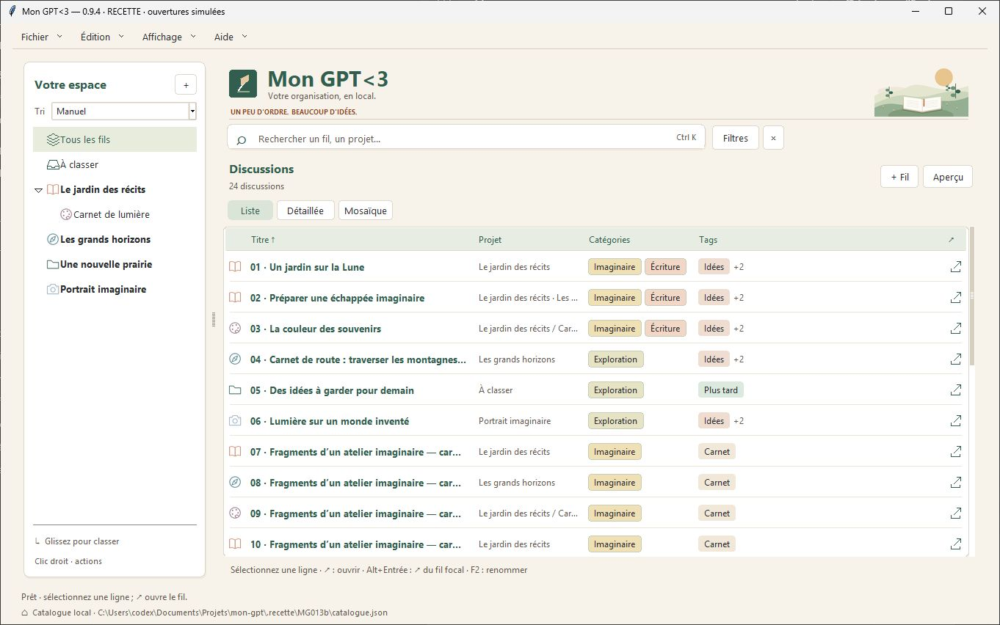
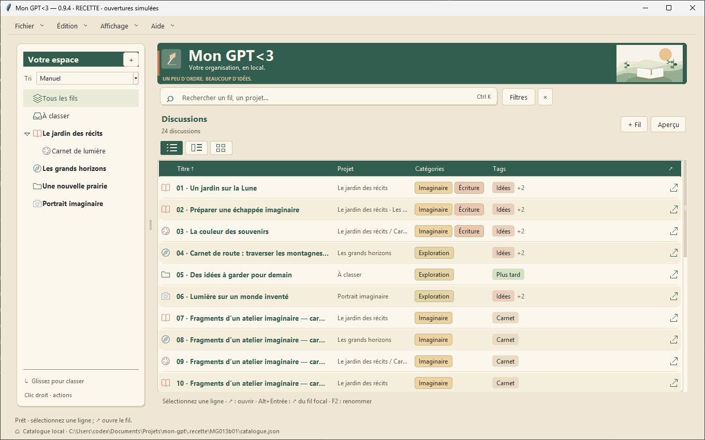
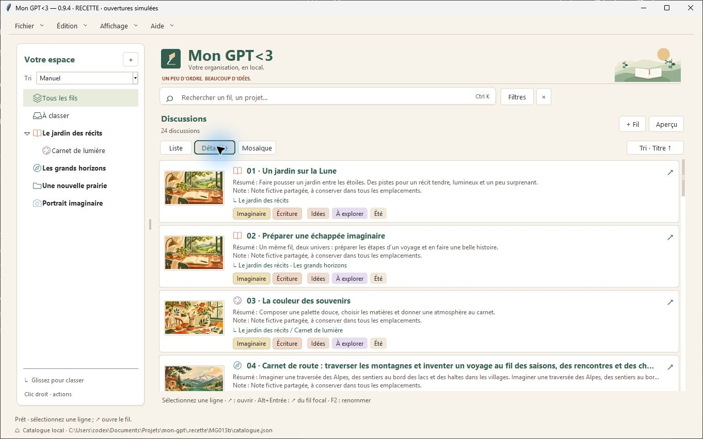
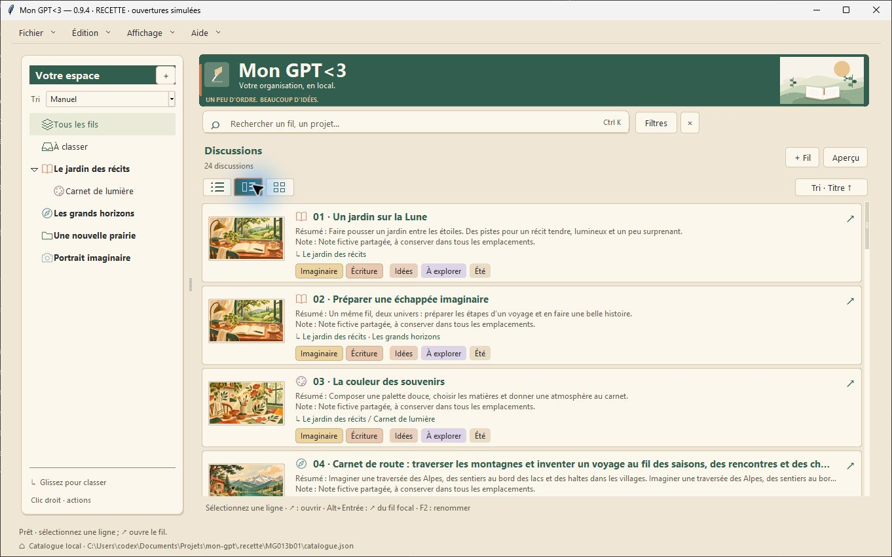
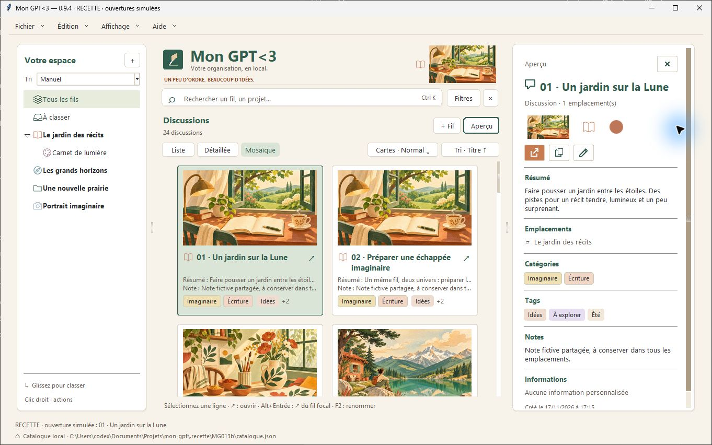
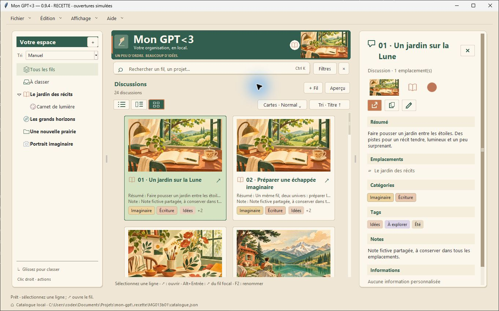
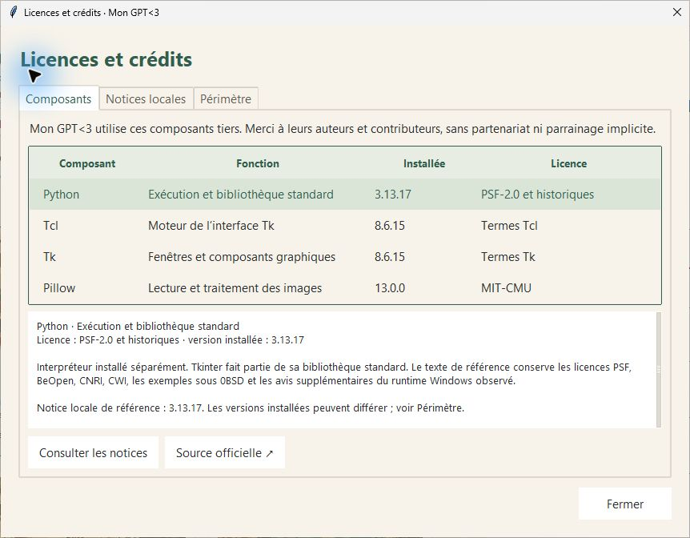
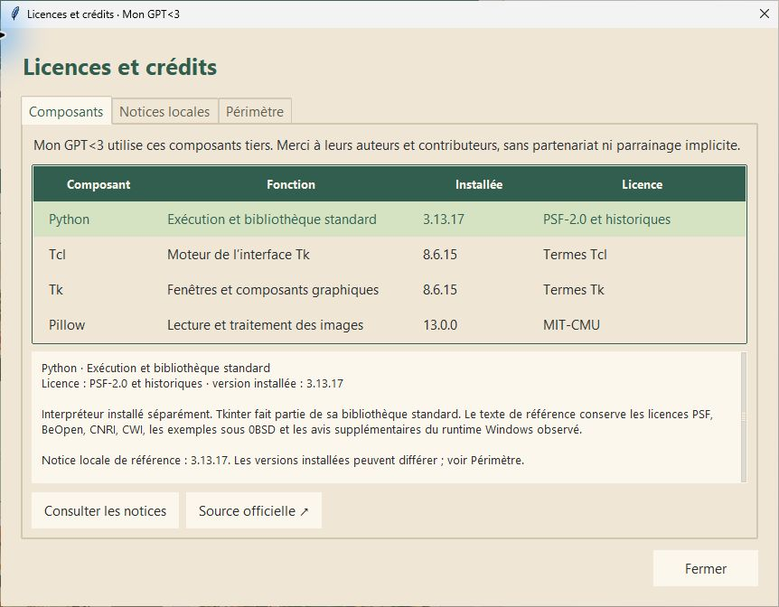

# MG-013b — Reprise graphique affirmée

**17 novembre 2026 · Mon GPT<3 0.9.4 · Windows / CODEX-VM. À valider visuellement par David.**

Cette reprise applique la nouvelle consigne du fil : transformation visuelle franche, fonctionnement gelé. Elle inclut désormais la présentation à icônes des vues et la simplification de l'en-tête droit, précédemment réservées aux lots suivants. Aucun lot fonctionnel ou chantier technique n'est ouvert.

## Avant / après réellement visibles

Même catalogue fictif de **24 discussions et 5 projets**, même périmètre Tous, tri Titre, fenêtre cliente 1360×820. Les images « avant » proviennent de MG-013b au commit `b3262ae` ; elles montrent notamment l'ancien blanc, désormais retiré. Cinq nouvelles captures Windows brutes, sans retouche. Seuls le chemin de recette et les retours d'activité peuvent différer dans les pieds de fenêtre.

| Avant MG-013b | Après cette reprise |
|---|---|
| **Liste** —  | **Liste** —  |
| **Détaillée** —  | **Détaillée** —  |
| **Mosaïque et inspecteur du même fil** —  | **Mosaïque et inspecteur** —  |
| **Crédits** —  | **Crédits** —  |

[Cinquième capture : sélection multiple et menu de classement existant](04-selection-menu.png). Elle illustre un état supplémentaire, sans prétendre à une paire identique avec un ancien jeu de recette différent.

## Changements de présentation

- **Contraste d'ensemble** : fond ivoire chaud `#EFE6D6`, panneaux crème `#FCF7EC`, bandeau et en-têtes sapin `#315E4F`, ponctuation terracotta. Aucun `#FFFFFF` ni couleur nommée `white` dans le code des styles Python ; les fonds Tk par défaut et listes déroulantes reçoivent aussi le papier crème. Illustrations et maquettes intactes.
- **Hiérarchie visible** : bandeau sapin dans son enveloppe actuelle, titre clair, illustration contextuelle conservée ; en-tête « Votre espace » contrasté ; en-tête de Liste sapin, lignes alternées crème/parchemin et repère latéral de sélection. Les métriques Segoe UI sont conservées ; la couleur et les aplats portent le changement plutôt qu'un agrandissement généralisé.
- **Trois commandes de vues à icônes** : lignes, vignette/texte, grille. Trois boutons compacts dans la même zone, mêmes callbacks `set_view`, noms français conservés dans leurs infobulles au survol/focus et dans le menu Affichage. Mode courant sapin, focus terracotta ; clavier et persistance existants conservés.
- **Panneau droit** : le vrai titre et la fermeture partagent l'en-tête ; le libellé statique « Aperçu » disparaît. Sans sélection, « Sélectionnez une fiche » et la fermeture restent disponibles, avec retour à la ligne adapté au volet. Les sections reçoivent des bandeaux parchemin à la place des filets gris. La sélection multiple conserve son résumé de lot existant.
- **Classement** : cible de dépôt vert doux plus affirmé, menu contextuel papier avec repères sable et sélection soulignée. Aucun fantôme mobile ou nouvelle surcouche ; le seuil de drag, les cibles, les choix et l'application du classement restent ceux du code validé.

Six modules de présentation touchés : `theme.py`, dessins et boutons dans `atelier.py`, styles d'arbre dans `navigation.py`, construction visuelle des commandes/en-tête gauche dans `ui.py`, dessin du bandeau dans `identity_ui.py`, en-tête/sections de `inspector.py`. La petite classe `ViewButton` réemploie intégralement l'activation et le focus de `PillButton` ; elle ne crée aucun modèle de vue.

## Gel fonctionnel vérifié

Les trois colonnes, la recherche, les actions et les sections restent dans leurs zones. Hauteurs de bandeau **80/112**, gabarits de résultats, tailles de cartes, grille, hit-tests, largeur des colonnes de Liste, seuils de repli et mécanisme des séparateurs sont conservés. Les changements de géométrie sont internes à l'habillage : boutons de vues plus compacts et en-tête droit regroupé.

Le bandeau reçoit toujours les informations du **projet courant** ; l'inspecteur reçoit toujours l'**élément sélectionné**. Une couverture peut suivre le fil selon l'héritage existant. Aucun changement de résolution d'identité, règles métier, stockage, schéma, données, import/export ou Collector. Aucune nouvelle dépendance. `AGENTS.md`, README et version restent intacts.

**205 tests Python réussis en 232,451 s** : [journal complet](tests-python.txt), commande `python -m unittest discover -s tests -v`. Coût de la vérification obligatoire finale : environ quatre minutes. Deux régressions ciblées ont été ajoutées : activation clavier et noms des commandes à icônes avec filtre/lot conservés et catalogue inchangé ; en-tête du panneau vide dans un volet réduit, fermeture, projet, fil et sélection multiple. Les tests historiques restent présents. Deux assertions de fond autour des portraits comparent désormais la couleur du thème plutôt que l’ancien ivoire figé ; les vérifications de scène entière, de bords et de gestes sont conservées.

**Pilotage Windows réel**, sur `.recette/MG013b01` avec `--simulate-open` : bascule des trois vues ; inspecteur sans sélection, puis fil ; constitution d'un lot de deux par Maj+flèche ; menu contextuel et annulation ; clic ↗ du premier fil, **une ouverture simulée exacte, lot conservé** ; ouverture des crédits depuis Aide et fermeture par Échap ; fermeture normale de l'application. Aucune ouverture sur les titres, aucune mutation du catalogue : SHA-256 inchangé `07eb22d99cf10ec2047ec26ed19abd7108ba276f1c68c90e120a3dc700609c0e`.

La suite complète Python et la recette Windows respectent la règle active d'`AGENTS.md`. Pas de tests Collector JS, campagne multi-DPI, nouveau protocole d'import ou audit transversal. Le geste physique de glisser droit n'est pas revendiqué comme rejoué ; ses règles sont couvertes par la suite historique Tk, sans modification du moteur. Aucune validation esthétique humaine n'est présumée.

Départ propre et distant vérifié à `b3262ae`. Contrôles de publication : liens/PNG, diff et espaces, seuls modules visuels, tests voisins et preuves fictives, SHA distant et dépôt propre. **Publication puis STOP pour validation visuelle de David.**
