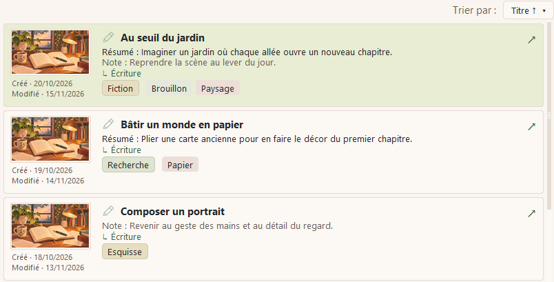

# MG-014f — Vue Détaillée

Les dates de création et de modification se lisent sous la couverture, en heure locale, au jour près. Le résumé et la note disposent de trois lignes à partager. Le contexte suit le texte présent et les catégories et tags se partagent la largeur disponible. Les cartes gardent leur hauteur de 126 pixels.

Le menu « Trier par » indique la colonne active et le sens du tri. Choisir à nouveau la même colonne inverse l’ordre.

### Comparaison visuelle sur CODEX_VM

Même projet fictif et même sélection dans les quatre captures. La première discussion montre son résumé, sa note, ses deux dates et ses deux tags. La Liste affiche un seul de ces tags et un compteur dans sa configuration de référence.

| Avant | Après |
| --- | --- |
|  |  |

[Détaillée en largeur contrainte](apres-compact.png) · [Liste témoin](liste-temoin.png)

### Vérifications L1

- Dix tests réussis. Les six tests de `test_detailed_view` couvrent notamment la sélection, le clavier, le défilement, le renommage et les bascules de vue. Quatre tests complémentaires couvrent le tri des dates, la colonne de tri masquée, les extraits facultatifs et les gestes d’ouverture.
- Recette Windows sur six discussions fictives, en fenêtres de 1440 × 884 et 1024 × 780 pixels. Vérification de l’ordre des résultats via le menu pour Titre, Catégories et Création, avec inversion. En largeur contrainte, vérification de la séparation entre dates et texte, de la sélection au clic et d’un seul appel à l’ouvreur simulé via ↗.
- Compilation des deux modules modifiés et contrôle du diff Git réussis. La suite complète et l’ouverture d’un navigateur externe ont été omises pour cette passe L1.
