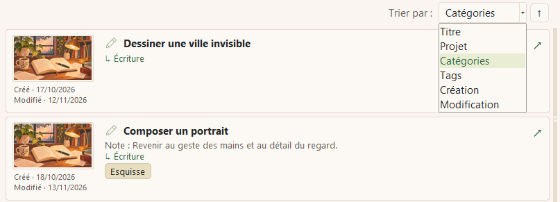
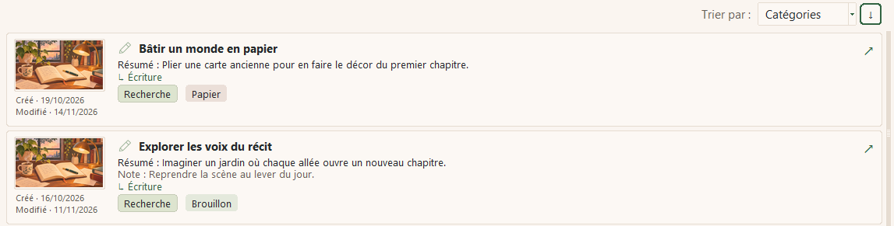

# MG-014g — Tri de la vue Détaillée

« Trier par » ouvre une liste de six colonnes sur fond papier, avec l’option active en sauge. La commande ↑/↓ inverse l’ordre de la colonne choisie. Son bord droit suit celui des cartes.

### Recette Windows sur CODEX_VM

Sur six discussions fictives, la recette a vérifié l’ordre des résultats pour Titre, Catégories et Création. Les flèches et Entrée permettent de choisir une colonne. Échap rend le focus au sélecteur. Tab atteint la commande de sens, activable par Espace ou Entrée. Les coordonnées à l’écran confirment l’alignement du tri avec le bord droit des cartes, inspecteur ouvert puis fermé.

Huit tests L1 réussis, dont les six tests de la vue Détaillée et deux tests sur le tri des dates et le passage entre vues avec une colonne de tri masquée. La syntaxe et le diff ont été vérifiés. La suite complète a été omise conformément au périmètre local de la mission.
